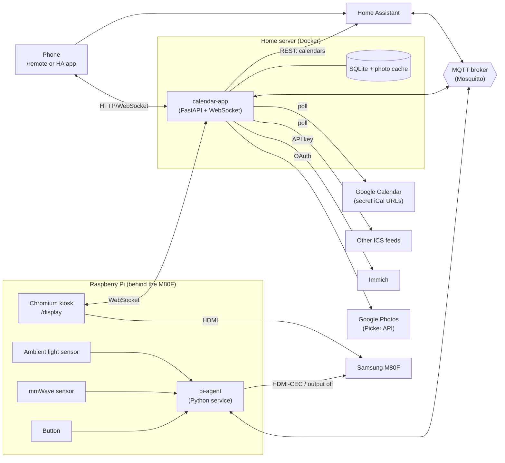

# Wall Calendar — Architecture

A self-hosted smart wall calendar. The UI runs on a Samsung Smart Monitor M8 (M80F), which is not a touchscreen. It is driven by a Raspberry Pi over HDMI. All logic lives in a web app on the home server. Control comes from Home Assistant, a phone, a physical button and on-device sensors.

---

## 1. Goals

- **Calendar first.** It should show month, week and today views of the family's calendars, with changes appearing within minutes.
- **No touch needed.** Control comes from Home Assistant, a phone remote page, a physical button and automations.
- **Thin display client.** The Pi only renders a web page and handles local hardware. It holds no configuration and no secrets, and you can reflash it in minutes.
- **First-class Home Assistant citizen.** The calendar auto-discovers into HA as entities, so it can be controlled, displayed and automated like any other device.
- **Photo wallpaper.** The background can rotate photos from Immich and/or Google Photos, or show a plain background.
- **Keeps working when HA is down.** The calendar still renders, and basic button and presence behaviour still works.

## 2. System overview



| Component | Runs on | Responsibility |
|---|---|---|
| `calendar-app` | Home server, Docker | Calendar aggregation, photo pipeline, the authoritative display state, web UI (`/display`, `/remote`, `/settings`), MQTT and HA discovery |
| MQTT broker | Home server or HA (Mosquitto add-on) | Message bus between app, Pi agent and HA |
| Chromium kiosk | Pi | Renders `/display` fullscreen. Stateless. |
| `pi-agent` | Pi, systemd service | Reads the button, presence and light sensors. Turns the screen on and off. Publishes to and subscribes from MQTT. |
| Home Assistant | Existing | Dashboards, phone control, automations, and HA-native calendars |

**Design rule:** the app on the server owns the state. The display, the phone, HA and the Pi agent send *commands* and receive *state*. None of them hold state of their own.

## 3. Calendar data

### 3.1 Sources

There are two source types. You configure each one per calendar.

| Source type | Use for | Mechanism |
|---|---|---|
| `ics` | Google calendars, and any calendar that publishes an iCal feed | Poll the URL directly. For Google, use *Settings → [calendar] → Integrate calendar → Secret address in iCal format*. |
| `homeassistant` | Calendars that only exist in HA, such as bin collection, school terms or holiday integrations | `GET /api/calendars/<entity_id>?start=…&end=…` with a long-lived access token |

Each calendar comes from **exactly one source**. This avoids duplicate events and the need to merge two copies of the same calendar. Google calendars go via ICS, which skips the lag you've seen in the HA Google integration. HA is used for things only HA knows about.

Possible later upgrade: use the Google Calendar API directly, with incremental `syncToken` polling. This needs OAuth, but it's cheap to poll every minute. It would only be worth it if ICS freshness isn't good enough.

### 3.2 Sync loop

- Each source has its own poll interval. Defaults: ICS every 2 minutes, HA every 5 minutes.
- ICS fetches use `ETag` / `If-Modified-Since` so most polls cost almost nothing.
- Recurring events are expanded server-side (`icalendar` + `recurring-ical-events`) over a rolling window, for example 2 weeks back and 8 weeks forward.
- Events are normalised to one model and stored in SQLite:

```text
Event { id, calendar_id, title, start, end, all_day, location, description, colour, source_updated_at }
```

- Times are stored in UTC and rendered in `Europe/London`. Changes into and out of daylight saving time are handled by the timezone library, not by hand.
- When anything changes, the app pushes `events.updated` over WebSocket and the display re-renders. Nothing reloads the page.
- A **manual refresh** (from a button in HA or on the remote) forces an immediate poll of every source.

### 3.3 Calendar config (example)

```yaml
calendars:
  - id: family
    name: Family
    colour: "#4F7DF3"
    source: { type: ics, url: !secret family_ics_url }
  - id: work
    name: Work
    colour: "#E0884A"
    source: { type: ics, url: !secret work_ics_url, poll_seconds: 300 }
  - id: bins
    name: Bins
    colour: "#3BA676"
    source: { type: homeassistant, entity_id: calendar.bin_collection }
```

Secrets (ICS URLs, the HA token, the Immich key, Google OAuth tokens) live in a mounted `secrets.yaml` or in environment variables. They never reach the browser.

## 4. Display

### 4.1 Views

| View | Contents |
|---|---|
| `month` | Month grid, the next few days' agenda in a side panel, clock, weather |
| `week` | 7-day columns with timed blocks |
| `agenda` | Today and tomorrow in large type. The default for mornings. |
| `photo` | Fullscreen photo with a small clock and the next event |
| `night` | Very dim clock only. Used when the room is dark but you want the screen on. |

Views are plain front-end routes inside one page (`/display`). The server tells the page which view to show. The page never decides for itself.

### 4.2 Rendering

- The layout is designed for a 16:9 screen at 2560×1440. On a 4K panel it renders at 1440p and is scaled up, which keeps Chromium responsive on the Pi. A Pi 5 can try native 4K.
- Large type, high contrast, nothing interactive. Any UI on the display should read clearly from 3 m away.
- With a photo background, calendar content sits on a blurred, darkened layer so the text stays readable over any photo.
- **Burn-in and wear:** clock and panel positions shift by a few pixels every few minutes.
- **Dimming:** the page can apply a dimming overlay (`brightness` 0–100). This lowers what you see but not the backlight. Changing the real backlight needs DDC/CI (see §7.3).
- **Resilience:** the page reconnects its WebSocket with backoff. If the server can't be reached, it shows the last-known data with a small "offline" badge rather than a browser error page.

## 5. Photo wallpaper

### 5.1 Pipeline

```text
Provider (Immich / Google Photos / local folder)
   → select assets (album, memories, random)
   → download + resize to display size (e.g. 2560×1440 WebP) into /data/photos
   → playlist (shuffled, no repeats until exhausted)
   → display requests /photos/next  → served from local cache
```

- The display only ever loads images from the calendar app. API keys stay on the server, and photos still show if a provider is briefly down.
- Portrait photos are shown centred over a blurred, enlarged copy of themselves. You can also filter to landscape only.
- Options: rotation interval, transition (crossfade), and "photo of the day from memories".
- The cache has a size cap with least-recently-used eviction.

### 5.2 Immich (recommended main source)

- Authenticate with an API key (Immich → Account Settings → API Keys), sent as the `x-api-key` header.
- Useful endpoints:
  - `GET /api/albums` and `GET /api/albums/{id}`: list albums and their assets
  - `POST /api/search/random`: random assets, with filters
  - `GET /api/memories`: "on this day"
  - `GET /api/assets/{id}/thumbnail?size=preview`: a display-sized image, so the server doesn't download originals
- Source modes: one or more albums, memories, or random from the whole library (optionally filtered by person or date).
- Immich is local, fast and fully under your control, so it's the best fit for a wallpaper that rotates all day.

### 5.3 Google Photos (with limits)

Since 31 March 2025, the Google Photos **Library API can only read media created by the app itself**. Third-party apps can no longer browse your library or albums. The supported route is the **Picker API**: the user picks photos in Google's own UI, and the app gets access to the selected items.

How that works here:

1. In `/settings` (or from the phone), start a picker session. This opens Google Photos and you pick photos.
2. The app polls the session. Once you've finished picking, it downloads the selected items into the local cache straight away, because the image URLs are short-lived.
3. The selection becomes a "Google Photos batch" playlist. To refresh it, you run another pick.

This is fine for a curated set. It **cannot** automatically follow a live album. If you want automatic syncing, a better route is to get photos into Immich, for example by having Immich ingest a Google Takeout export or by uploading from your phone to Immich, and then use the Immich provider.

### 5.4 Local folder (fallback)

A mounted directory of images, for testing or for anything else.

## 6. Control

### 6.1 State model

The app holds one state document per display (multiple displays are supported via `/display?id=hallway`):

```json
{
  "view": "agenda",
  "screen": "on",
  "background": "immich",
  "brightness": 80,
  "auto_presence": true,
  "auto_brightness": true,
  "overlay": null
}
```

Every input changes this state through the same command handler. Every change is broadcast to the display (WebSocket), to the remote page (WebSocket) and to HA (MQTT state topics). This keeps all inputs in sync.

### 6.2 Inputs

| Input | Path |
|---|---|
| Home Assistant (dashboard, automations, voice) | MQTT command topics, via the auto-discovered entities |
| Phone remote page `/remote` | HTTP POST / WebSocket to the app |
| HA companion app | The same HA entities. You can add the remote page as a Webpage card too. |
| Physical button | `pi-agent` → MQTT event → app button mapping (see §6.4) |
| mmWave presence | `pi-agent` → MQTT → app presence policy and/or HA automations |
| Ambient light | `pi-agent` → MQTT → app auto-brightness and/or HA automations |
| Built-in schedule | App-side rules, for example "agenda 06:30–09:00". Optional. HA can do this too. |

### 6.3 MQTT topics

The base is `wallcal/<display_id>/`.

| Topic | Direction | Payload |
|---|---|---|
| `…/view/set` | → app | `month` \| `week` \| `agenda` \| `photo` \| `night` \| `next` |
| `…/view/state` | app → | current view (retained) |
| `…/screen/set` | → app | `on` \| `off` |
| `…/screen/state` | app → | desired screen state (retained) |
| `…/background/set` / `state` | ↔ | `none` \| `immich` \| `google` \| `local` |
| `…/brightness/set` / `state` | ↔ | `0`–`100` |
| `…/auto_presence/set` / `state` | ↔ | `ON` \| `OFF` |
| `…/overlay/set` | → app | JSON `{ "text": "Bins out tonight", "icon": "trash", "ttl": 3600 }`, or empty to clear |
| `…/photo/next` | → app | (any) |
| `…/refresh` | → app | (any). Forces a calendar re-sync. |
| `…/pi/button` | pi → | `single` \| `double` \| `long` |
| `…/pi/presence` | pi → | `ON` \| `OFF` (retained) |
| `…/pi/illuminance` | pi → | lux (float) |
| `…/pi/screen/set` | app → pi | `on` \| `off`. The agent then turns the panel on or off. |
| `…/pi/screen/state` | pi → | the actual panel state, if it can be detected |
| `…/availability`, `…/pi/availability` | both | `online` / `offline` (MQTT last-will) |

### 6.4 Home Assistant integration

The app and the agent publish **MQTT discovery** configs, so HA creates two devices with no YAML:

**Device: Wall Calendar** (published by `calendar-app`)

| Entity | Type |
|---|---|
| View | `select` |
| Screen | `switch` |
| Background | `select` |
| Brightness | `number` (slider) |
| Auto presence | `switch` |
| Auto brightness | `switch` |
| Message | `text` (sets the overlay banner) |
| Next photo | `button` |
| Refresh calendars | `button` |
| Last sync | `sensor` (timestamp) |

**Device: Wall Calendar Pi** (published by `pi-agent`)

| Entity | Type |
|---|---|
| Button | `event` (single / double / long) |
| Presence | `binary_sensor` (occupancy) |
| Illuminance | `sensor` (lx) |
| Panel power | `binary_sensor` (actual state, if detectable) |
| CPU temperature, uptime | diagnostic sensors |

The app also reads HA's REST API, but only for `homeassistant` calendar sources. Optionally it can read a weather entity for the weather widget.

**Who handles the button?** This is set per gesture in the config:

```yaml
button:
  single: next_view      # handled by the app (works without HA)
  double: toggle_photo
  long: ha               # ignored by the app; HA automation decides
```

The HA `event` entity fires for every press either way, so HA can always react as well.

**Example automations**

```yaml
# Morning agenda
- alias: Wall calendar – morning agenda
  triggers: [{ trigger: time, at: "06:30:00" }]
  actions:
    - action: select.select_option
      target: { entity_id: select.wall_calendar_view }
      data: { option: agenda }

# Screen off when everyone leaves
- alias: Wall calendar – off when away
  triggers: [{ trigger: state, entity_id: zone.home, to: "0" }]
  actions:
    - action: switch.turn_off
      target: { entity_id: switch.wall_calendar_screen }

# Bin reminder banner
- alias: Wall calendar – bins reminder
  triggers: [{ trigger: calendar, event: start, entity_id: calendar.bin_collection, offset: "-6:00:00" }]
  actions:
    - action: text.set_value
      target: { entity_id: text.wall_calendar_message }
      data: { value: "Bins out tonight: {{ trigger.calendar_event.summary }}" }

# Long press = leaving the house
- alias: Wall calendar – long press
  # An event entity's state is the timestamp of the last press, so trigger on any
  # state change and check the event type (an attribute trigger would miss repeat long presses).
  triggers: [{ trigger: state, entity_id: event.wall_calendar_pi_button }]
  conditions:
    - condition: state
      entity_id: event.wall_calendar_pi_button
      attribute: event_type
      state: long
  actions:
    - action: scene.turn_on
      target: { entity_id: scene.leaving_home }
```

(Entity IDs are illustrative. HA generates them from the discovery names.)

### 6.5 Phone remote page

- `/remote` is a mobile-first page with large buttons for each view, a screen toggle, a background picker, a brightness slider, next photo and refresh. It works as an "Add to Home Screen" web app.
- It talks to the same command handler as MQTT, so it works even if HA is down.
- It's for the local network only. You can set an optional shared PIN or token in the config. Don't expose it to the internet. If you need remote access, use HA's existing remote access.

### 6.6 Built-in policies (work without HA)

These run in the app and each has an HA switch to turn it off:

- **Auto presence.** Presence ON turns the screen on. When presence has been OFF for N minutes (default 10), the screen turns off. This is suppressed during configured quiet hours.
- **Auto brightness.** Maps lux to the `brightness` overlay with a smoothing curve. Below a darkness threshold it can switch to the `night` view, or turn the screen off.

More complex logic, such as "only when someone is home", "not during a film" or tying in with lights, belongs in HA automations. Turn the built-in policy off when HA takes over.

## 7. Raspberry Pi

### 7.1 Software

- Raspberry Pi OS Lite (Bookworm or later) with a minimal Wayland compositor, auto-login, and Chromium in `--kiosk` mode pointed at `http://<server>:8080/display?id=hallway`.
- Turn off the screen blanker and screensaver. The panel power is controlled by the agent.
- `pi-agent` is a Python systemd service with `Restart=always`:
  - `gpiozero` for the button (debounce; single, double and long press detection)
  - UART reader for the mmWave sensor
  - I²C reader for the light sensor (publishes on change or every 30 s)
  - screen control (see §7.3)
  - MQTT with last-will availability, plus HA discovery for its own entities
- The agent's only config is the MQTT host and credentials, plus the display ID.

### 7.2 Hardware

| Part | Suggested | Interface | Notes |
|---|---|---|---|
| Button | Any momentary push button (a nice panel-mount or arcade-style one) | GPIO17 to GND, internal pull-up | Single, double and long press |
| mmWave presence | HLK-LD2410C (presence) or LD2450 (multi-target tracking) | UART (GPIO14/15), 5 V power, 3.3 V logic | Detects still people, unlike PIR. Tune range "gates" so it doesn't see through walls. Enable the UART and disable the serial console in `raspi-config`. Simplest option: wire the LD2410's OUT pin to a GPIO as a plain on/off signal. |
| Ambient light | VEML7700 (good low-light range) or BH1750 | I²C (GPIO2/3), 3.3 V | Mount it facing into the room, not at the screen, and away from the panel's own glow |

**Alternative:** put the sensors and button on an ESP32 running ESPHome instead of the Pi. This is native in HA and the Pi stays purely a kiosk. The app then gets them via HA or MQTT just the same. Choose this if the sensor placement doesn't suit where the Pi sits.

### 7.3 Screen power and brightness

These depend on what the M80F supports over HDMI. **Test early.**

1. **HDMI-CEC** (`cec-client` / libcec): standby and on. This is the best option if Samsung's Anynet+ works with the Pi.
2. **Output off**: turn the Pi's HDMI output off (`wlr-randr --output HDMI-A-1 --off` or `wlopm`). The monitor then goes to "no signal" standby. This works on almost any monitor, but wake-up can be slower.
3. **Black screen**: the display shows pure black. This always works, but the backlight stays on.

Real backlight control would need **DDC/CI** (`ddcutil`). Support on Samsung smart monitors is uncertain. If it works, `brightness` can drive the actual backlight. If not, it falls back to the CSS overlay.

## 8. Deployment

### 8.1 Containers (home server)

```yaml
services:
  calendar-app:
    image: wallcal/calendar-app:latest   # built locally
    restart: unless-stopped
    ports: ["8080:8080"]
    environment:
      TZ: Europe/London
    volumes:
      - ./config:/config          # config.yaml, secrets.yaml
      - ./data:/data              # SQLite, photo cache, Google OAuth tokens
  mosquitto:                      # skip if using the HA Mosquitto add-on
    image: eclipse-mosquitto:2
    restart: unless-stopped
    ports: ["1883:1883"]
    volumes: ["./mosquitto:/mosquitto"]
```

### 8.2 Tech stack

- **Backend:** Python 3.12, FastAPI (HTTP + WebSocket), `aiomqtt`, `httpx`, `icalendar` + `recurring-ical-events`, SQLite (via SQLModel or plain `sqlite3`), Pillow for resizing.
- **Frontend:** a small TypeScript app (Svelte or Preact) built into static files served by FastAPI. There are three entry points: `display`, `remote`, `settings`.
- **Pi agent:** Python 3, `gpiozero`, `pyserial`, an I²C sensor library, `paho-mqtt`.

### 8.3 Repo layout

```text
wallcal/
├── app/                 # FastAPI backend
│   ├── sources/         # ics.py, homeassistant.py
│   ├── photos/          # immich.py, google_picker.py, local.py, cache.py
│   ├── control/         # state.py, commands.py, policies.py
│   ├── mqtt/            # client.py, discovery.py
│   └── main.py
├── web/                 # display / remote / settings front-end
├── pi-agent/            # agent.py, sensors/, systemd unit, kiosk setup script
├── config.example.yaml
├── docker-compose.yml
└── docs/architecture.md
```

## 9. Failure modes

| Failure | Behaviour |
|---|---|
| HA down | The calendar still renders from ICS. Button, presence and the remote page still work via the app and MQTT, if the broker isn't the HA add-on. HA-source calendars show last-known data. |
| MQTT broker down | The display and remote page still work over WebSocket. Button, sensors and HA control pause. The agent reconnects with backoff. |
| Server down | The display shows last-known data with an "offline" badge. The agent can still turn the screen off with local presence rules after a timeout. |
| ICS feed fails | Keep the last good copy and expose "Last sync" in HA so an automation can alert. |
| Photo provider down | Rotate through the existing cache. |
| Pi reboots | Kiosk and agent auto-start. State comes back from retained MQTT messages and the server. |

Tip: run Mosquitto on the home server rather than as an HA add-on if you want button and presence to keep working when HA is down.

## 10. Build phases

1. **MVP.** ICS sources, `agenda` and `month` views, kiosk on the Pi, `/remote` page.
2. **HA integration.** MQTT, discovery entities, HA calendar source, overlay messages.
3. **Pi hardware.** Button, then mmWave, then light sensor. Screen power via CEC or output off.
4. **Photos.** Immich provider and cache, then the Google Photos Picker flow.
5. **Polish.** `week` and `night` views, weather, burn-in shifting, auto policies, multiple displays.

## 11. Open questions / test early

- Does the M80F respond to HDMI-CEC standby and wake from a Pi? Does it support DDC/CI brightness?
- Pi 4 or Pi 5: is 1440p smooth enough with photo crossfades, or is a Pi 5 needed?
- Where should the mmWave sensor go so it covers the area in front of the calendar but not the next room?
- Where does the MQTT broker live: server container or HA add-on? (See §9.)
- The home server runs Ubuntu 18.04, which is past standard support. Docker images will run, but plan an OS upgrade at some point.
