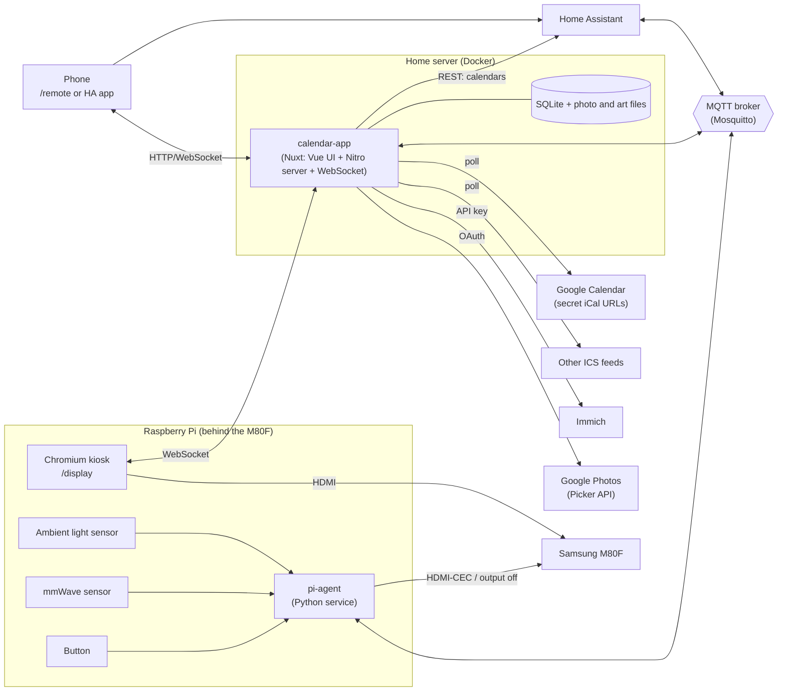

# Wall Calendar — Architecture

A self-hosted smart wall calendar. The UI runs on a Samsung Smart Monitor M8 (M80F), which is not a touchscreen. It is driven by a Raspberry Pi over HDMI. All logic lives in a web app on the home server. Control comes from Home Assistant, a phone, a physical button and on-device sensors.

---

## 1. Goals

- **Calendar first.** It should show month, week and today views of the family's calendars, with changes appearing within minutes. Each event belongs to a person (Mum, Dad, each child, Household), shown by a colour and an initial. People can each have their own calendar, or share one family calendar, with the person worked out from the event's description or title.
- **Look ahead and back.** From the phone you can move the month view up to 12 months either side of today. It goes back to the current month on its own.
- **Special days.** Birthdays, Halloween, Christmas and similar days can have their own art. Ahead of time the day's tile shows a small drawing. On the day itself the whole wall can switch to that day's palette, greeting and full-screen art. A look can be kept as a **scene** and used on many dates, such as every birthday in the family, with small changes for each one. Special days are set up in the browser, not in YAML.
- **No touch needed.** Control comes from Home Assistant, a phone remote page, a physical button and automations.
- **Thin display client.** The Pi only renders a web page and handles local hardware. It holds no configuration and no secrets, and you can reflash it in minutes.
- **First-class Home Assistant citizen.** The calendar auto-discovers into HA as entities, so it can be controlled, displayed and automated like any other device.
- **Photo frame mode.** A separate, fullscreen mode rotates photos from Immich, Google Photos or a local folder. The calendar views keep a plain, high-contrast background so they stay readable from across the room. (A photo background behind the calendar is a possible later option. See §4.5.)
- **Keeps working when HA is down.** The calendar still renders, and basic button and presence behaviour still works.

## 2. System overview



| Component | Runs on | Responsibility |
|---|---|---|
| `calendar-app` | Home server, Docker | A single Nuxt app (Node). Calendar aggregation, photo pipeline, special days and their art, the authoritative display state, web UI (`/display`, `/remote`, `/settings`), MQTT and HA discovery |
| MQTT broker | Home server or HA (Mosquitto add-on) | Message bus between app, Pi agent and HA |
| Chromium kiosk | Pi | Renders `/display` fullscreen. Stateless. |
| `pi-agent` | Pi, systemd service | Reads the button, presence and light sensors. Turns the screen on and off. Publishes to and subscribes from MQTT. |
| Home Assistant | Existing | Dashboards, phone control, automations, and HA-native calendars |

**Design rule:** the app on the server owns the state. The display, the phone, HA and the Pi agent send *commands* and receive *state*. None of them hold state of their own.

## 3. Calendar data

### 3.1 Sources

There are two source types. You configure each one per calendar.

| Source type | Use for | Mechanism |
|---|---|---|
| `ics` | Google calendars, and any calendar that publishes an iCal feed | Poll the URL directly. For Google, use *Settings → [calendar] → Integrate calendar → Secret address in iCal format*. |
| `homeassistant` | Calendars that only exist in HA, such as bin collection, school terms or holiday integrations | `GET /api/calendars/<entity_id>?start=…&end=…` with a long-lived access token |

Each calendar comes from **exactly one source**. This avoids duplicate events and the need to merge two copies of the same calendar. Google calendars go via ICS, which skips the lag you've seen in the HA Google integration. HA is used for things only HA knows about.

Possible later upgrade: use the Google Calendar API directly, with incremental `syncToken` polling. This needs OAuth, but it's cheap to poll every minute. It would only be worth it if ICS freshness isn't good enough.

### 3.2 Sync loop

- Each source has its own poll interval. Defaults: ICS every 2 minutes, HA every 5 minutes.
- ICS fetches use `ETag` / `If-Modified-Since` so most polls cost almost nothing.
  The validators are only sent while the stored events were expanded for the same window, time zone and default person. When the month rolls over, a window setting changes or the zone changes, the next fetch is unconditional, because a feed that hasn't changed still needs re-expanding.
- HA calendars have no validators, so every poll fetches the whole window, and the store writes only the rows that changed. HA has already expanded recurring events. An event with a `date` start is all-day, with an exclusive end date; one with a `dateTime` is timed. When an integration sends no `uid` (or no `recurrence_id` for a repeated one), the app makes a stable id from the event, so it keeps its row between polls.
- Recurring events are expanded server-side (`ical.js`, which handles `RRULE`, `EXDATE` and `RECURRENCE-ID` overrides) over a rolling window of whole months: from the start of the month 12 months ago to the end of the month 12 months ahead. The window is this wide because the remote's month picker can reach that far (see §7.5). It is configurable with `sync.months_back` and `sync.months_ahead` (0 to 60 months each, default 12). A family calendar over 25 months is a few thousand rows, so expanding and storing it is cheap. Each calendar's window is replaced inside one transaction, and only the rows that changed are written.
- Events are normalised to one model and stored in SQLite:

```text
Event { id, calendar_id, person_ids, title, display_title, start, end, all_day, location, description, source_updated_at }
```

- `person_ids` and `display_title` come from person detection (§3.3). `title` is kept as the source had it.
- Times are stored in UTC and rendered in `Europe/London`. Changes into and out of daylight saving time are handled by the timezone library (Luxon / `Intl`), not by hand. A recurring event keeps its wall-clock time across the change (09:00 stays 09:00). A wall time the spring change skips (01:30 in London on the last Sunday of March) moves forward by the gap, and one the autumn change repeats means the first of the two.
- When anything changes, the app pushes `events.updated` over WebSocket and the display re-renders. Nothing reloads the page.
- A **manual refresh** (from a button in HA or on the remote) forces an immediate poll of every source.

### 3.3 People

The display shows events by **person**, not by calendar. A person has a name, an initial and a colour. Each event belongs to one or more people.

- **Colour** marks the person's events everywhere: the dot or initial badge, and the tint of their all-day bars (the person's colour mixed into the page background, so bar text stays readable).
- **Initial** is shown in a small coloured circle on events in the Soft month style and the side panel (see §4.4). It defaults to the first letter of the name, and you can set it when two people share a letter.

**Which person an event belongs to** is decided at sync time. Who an event is for can be written in its **title** or in its **description**. The description is the better place for a shared calendar, because the same calendar also shows in Google Calendar, on phones and in other apps, and names added to every title would clutter all of them. The same rules apply to both.

- **Text that is checked.** The title, and each line of the description. Descriptions are turned into plain text first: Google often stores them as HTML, so tags are removed, `<br>` and `<p>` become line breaks, and entities are decoded. `detect_in` chooses which fields are checked (default `[title, description]`).
- **Name forms.** A person's name or one of their `aliases`, as a whole word, **at the start** of the title or of a description line: `Theo: Swimming`, `Theo - Swimming`, `[Theo] Swimming`, `Theo Swimming`, and lists such as `Isla & Theo: Dentist` or `Isla, Theo: Dentist`. In a description, a line that holds only names (`Theo`, `Isla & Theo`) works too. So does a line with a `Who:` or `For:` label in front (`Who: Theo, Isla`), which is the tidiest form for descriptions. Matching only at the start avoids false hits such as "Collect Mum's present". It can be widened to anywhere in the text with `detect_people: anywhere`.
- **The "for" form.** A name list can also end the phrase after the word `for`, wherever it comes in the text: `Haircut for Adam and Alex`, `Haircut for Adam, Alex & Theo`, `Party for the boys`. The list must run to the end of the text, or to punctuation (`. , ; : ! ? ) ] - – — |`), so `Haircut for Adam (Barbers)` and `Haircut for Adam - 3pm` match, but `Cake for Mum to collect` does not. An optional `the` may come before each name (it also works in the start-of-line forms: `The boys: football`). The text is checked in the title and in each description line, and every occurrence counts. Like the start-of-line forms, it is conservative, so a name inside a longer phrase (`Shopping for Mum's birthday`, `Present for Theodore`) is left alone.
- **Groups.** The top-level `groups` list gives a name to several people, for example `kids` for Isla, Theo and Poppy. A group's `name` and `aliases` are matched exactly where a person's would be (every form above, and `anywhere`), and expand to its members in the order the group lists them, so `Party for the kids` is for all three. A name or alias belongs to one person or one group, never both (unique ignoring case). A group id must differ from every person id, and its members must be people (no groups inside groups). Keyword rules may list group ids as well as person ids.
- **Keyword rules** on the calendar. Each rule is a case-insensitive regular expression mapped to one or more people, tested against the title and each description line. For example, `Ballet` maps to Isla and `5-a-side` maps to Dad. These are for regular activities that never mention a name.

They are applied in this order. The first step that finds anyone wins:

1. **Names**, if `detect_people` is on. People found in the title and the description are merged, title first, with no duplicates. Names come first because they are deliberate: a one-off "Isla" in a swimming event's description beats a "swimming → Theo" rule.
2. **Keyword rules**, against the title and then the description.
3. **The calendar's default person** (`person`), for example Household for the shared family calendar.

With `strip_names: true`, a matched name prefix is removed from the title shown on the wall, because the initial or colour already says who it is. So `Theo: Swimming` shows as "Swimming" with Theo's marker. A "for" clause that runs to the end of the title is removed too: `Haircut for Adam and Alex` shows as "Haircut", and `[Isla] Party for Theo` as "Party". A clause in the middle (`Haircut for Adam (Barbers)`) stays. If nothing would be left, the full title is kept. The full title is kept in the database. Descriptions aren't shown on the wall. If event details are added to the remote later, description lines that only name people are hidden there too.

If an event matches several people, it carries all of them in the order they were found. It takes the **first** person's colour for its bar fill, and shows **up to three** overlapping initials in its badge, or one dot per person in the Classic style.

This means a family can use a **single shared calendar** for everyone: one calendar with `detect_people` on, defaulting to Household, with `Who: Theo` in the description and titles left clean. Separate calendars per person still work too, and you can mix the two. The settings page's Calendars tab lists recent events that fell through to the default person, so you can spot events that need a name, a rule or an alias (§7.6).

Detection runs over every source, HA calendars included (their events have a `description` too). It is a pure function in `shared/`, so it can be tested on its own. When the people, groups or rules in config change, stored events are re-resolved at boot without a fresh fetch.

### 3.4 Calendar config (example)

```yaml
people:
  - { id: mum,  name: Mum,       colour: "#C67139", aliases: [Mummy, Sarah] }
  - { id: dad,  name: Dad,       colour: "#7A8A5E", aliases: [Daddy, Tom] }
  - { id: isla, name: Isla,      colour: "#D27FA0" }
  - { id: theo, name: Theo,      colour: "#5F94C4" }
  - { id: poppy, name: Poppy,    colour: "#9A7BC4", aliases: [Pops] }
  - { id: home, name: Household, colour: "#D9A93F", initial: H, aliases: [Family, All] }

# Optional. "Party for the kids" is for Isla, Theo and Poppy. Rules may list a group id too.
groups:
  - { id: kids, name: Kids, aliases: [Children], people: [isla, theo, poppy] }

calendars:
  # One shared calendar for the whole family: who an event is for comes from its
  # description ("Who: Theo") or title, so titles can stay clean in Google Calendar.
  - id: family
    person: home                 # default when nothing matches
    detect_people: true          # true (start of title / description lines) | anywhere | false
    detect_in: [title, description]
    strip_names: true
    rules:
      - { match: "ballet|brownies", people: [isla] }
      - { match: "swimming|football", people: [theo] }
      - { match: "rhyme time|playgroup|nursery", people: [poppy] }
    source: { type: ics, url: !secret family_ics_url }
  # A personal calendar: everything on it is Dad's.
  - id: dad-work
    person: dad
    source: { type: ics, url: !secret dad_work_ics_url, poll_seconds: 300 }
  - id: bins
    person: home
    source: { type: homeassistant, entity_id: calendar.bin_collection }
```

Secrets (ICS URLs, the HA token, the Immich key, Google OAuth tokens, the remote PIN) live in a `secrets.yaml` beside `config.yaml`, or in environment variables. A value in the config refers to one with the `!secret` tag, for example `url: !secret family_ics_url`. The environment variable `WALLCAL_SECRET_FAMILY_ICS_URL` (the name in capitals, with anything that isn't a letter or digit turned into `_`) overrides the same key in `secrets.yaml`. Secrets are plain text. They never reach the browser, and error messages name a secret without showing its value.

Config is checked when the app starts, and unknown keys are errors, so a typo stops the server with a message naming the field instead of being ignored. The other environment variables are `WALLCAL_CONFIG_FILE` (the config file), `WALLCAL_CONFIG_DIR` (the folder holding `config.yaml` and `secrets.yaml`, default `/config`), `WALLCAL_TIMEZONE` (overrides `timezone`) and `WALLCAL_DATA_DIR` (where the SQLite database and other app data live, default `/data`). `pnpm dev` uses `calendar-app/config.dev.yaml` when neither of the first two is set. An `ics` URL can also be a `file:` URL for local fixtures: `file:./family.ics` is relative to the config file's folder.

## 4. Display

### 4.1 Views

Views fall into two groups. The **calendar views** (`agenda`, `month`, `week`) and `night` use a plain themed background. **Photo frame** (`photo`) is its own mode and is the only place photos appear. The one exception is a special day's takeover art (see §6.3), which is illustration made for the palette, not a photo.

| View | Group | Contents |
|---|---|---|
| `month` | Calendar | Month grid, a side panel with today and the next three days (each with its weather), month title, special day art. See §4.4. |
| `week` | Calendar | 7-day columns with timed blocks on an hour scale, an all-day strip, and a "now" line. See §4.5. |
| `agenda` | Calendar | Today and tomorrow in large type. The default for mornings. |
| `photo` | Photo frame | Fullscreen rotating photos with a small clock and a "next event" chip. No calendar grid. |
| `night` | Ambient | A very dim clock on pure black, whatever the theme. Used when the room is dark but you want the screen on. A line under the clock is set per display with `night_text`: nothing (`none`, the default), the first timed event in the next 24 hours (`first_event`), or the next alarm (`next_alarm`, read from Home Assistant, see §7.4). |

Views are plain front-end routes inside one page (`/display`). The server tells the page which view to show, and which month the month view shows. The page never decides for itself.

### 4.2 Rendering

- The layout is designed for a 16:9 screen at 2560×1440, or 1440×2560 on a portrait display (§4.6). On a 4K panel it renders at 1440p and is scaled up, which keeps Chromium responsive on the Pi. A Pi 5 can try native 4K.
- **Two stages.** The page lays a view out on a fixed stage and scales it to fit the window, with black bars on the spare side. The stage is 1440×2560 when the display is portrait and the view being shown has a portrait layout, and 2560×1440 otherwise, so a view without a portrait layout yet is drawn as in landscape and letterboxed in a portrait window. A display is portrait when its `orientation` preference says so, or, with `auto` (the default), when the window is taller than it is wide; `?orientation=auto|landscape|portrait` on `/display` overrides the preference for that one device, so a demo phone can be turned without changing the wall. The views are given the stage's size and orientation (`stage` in `ViewProps`). The overlay banner, the badges, the dimmer and the burn-in shift sit on whichever stage is in use.
- Large type, high contrast, nothing interactive. Any UI on the display should read clearly from 3 m away.
- Calendar views use a solid, themed background and never a photo. This keeps text contrast predictable. On a special day with a takeover the palette changes, but tiles and panels stay solid (see §6.3).
- In photo frame mode, the clock, the current weather and the next-event chip sit on a small translucent, blurred pill in a corner, the top left unless burn-in shifting moves it (the overlay banner is at the bottom centre, and the pill keeps to a top corner while one shows, so they never meet), so they stay readable over any photo without covering it. The pill is dark glass with white text whatever the theme or special day palette. The chip shows the first timed event that is on now or starts today or tomorrow; all-day events are left out because they would sit there all day and hide the appointment that matters.
- **Burn-in and wear:** unless the display sets `burn_in: false`, everything on the stage except the dimming overlay (the view, any takeover art, the preview and offline badges and the overlay banner) moves together in a slow orbit: a circle of radius 8 px in 8 whole-pixel steps, one step every 3 minutes (24 minutes a lap), eased over a few seconds so the step is not seen. The photo frame's pill walks clockwise round the four corners, 15 minutes in each; while an overlay banner is showing, a bottom corner becomes the top corner on the same side so the pill never meets the banner, and the offline badge moves to the top left when the pill has the top right. The night view, the worst case (static glyphs on black), drifts much further: its clock block moves every 5 minutes through a fixed sequence of twelve spots within about ±240 px across and ±160 px up and down of the centre (on the portrait stage, the same spots turned round: ±160 px across and ±240 px up and down). All of it is worked out from the clock alone (`app/utils/burnIn.ts`, `app/utils/night.ts`), so it is the same after a reload. With `burn_in: false` nothing moves, the pill stays top left and the night clock is centred.
- **Dimming:** the page can apply a dimming overlay (`brightness` 0–100). This lowers what you see but not the backlight. Changing the real backlight needs DDC/CI (see §8.3).
- **Resilience:** the page reconnects its WebSocket with backoff. If the server can't be reached, it shows the last-known data with a small "offline" badge rather than a browser error page.
- **Installable on any device.** `/display?id=<id>` works as an app on a phone, tablet or second screen as well as in the kiosk. It links a per-display manifest, `/display.webmanifest?id=<id>` (named "<display> wall", scoped to `/display`, `display: fullscreen` with `standalone` as the fallback, and the theme's background as its colours), and the iOS metas (`apple-mobile-web-app-capable`, a `black-translucent` status bar, the display's name and a touch icon), so it opens without browser chrome once added to the home screen. The server draws its icons (`public/icons/display-*.png`, a darker palette than the remote's, so the two apps tell apart on a home screen) and the app-wide favicon (`public/favicon.svg`, `.ico` and a 32 px PNG) with `node scripts/render-icons.mjs`. A browser only offers Install in a secure context, so this needs HTTPS (the local HTTPS hostname) or `localhost`; over plain HTTP to another host the page still works in a tab, and the Displays tab says so (§7.6).
- **Offline.** A service worker, `/display-sw.js`, registered with scope `/display` (never in dev, and only where the browser has service workers), keeps the app shell so an installed display opens with no network and shows the state it last had (the page keeps its last state and events in `localStorage`). The page itself is fetched network first with a short timeout and falls back to the cached copy; the hashed files under `/_nuxt/` are cache first, since a new build gets new names; the manifest and icons are network first. It never touches `/api` or `/_ws`, so live data is never served stale. Each release uses a new cache name and removes the old ones.
- **Staying awake and fullscreen.** The page asks for a Screen Wake Lock so a tablet doesn't dim or lock, and takes it again whenever the page becomes visible, since the browser drops it when the page is hidden. In an ordinary browser tab that can go fullscreen, a small "Tap for fullscreen" pill appears at the bottom; a tap enters fullscreen and the pill goes. It never shows in the kiosk or in an installed app, which are already fullscreen.
- **A second device mirrors the display.** A device that opens `/display?id=hallway` is another page on that display's room: it shows the same view and dimming and goes black with the screen, and counts under that display's Wall page connections. For a demo that shouldn't follow the wall, add a display for it under `displays:` in the config.

### 4.3 Visual design

The look comes from the **Organic** design system in the Claude Design project for this repo: warm, rounded and a little playful.

- **Tokens.** Colours, fonts, radii and shadows come from the design system's `styles.css` variables: a cream ground (`--color-bg`), a terracotta accent (`--color-accent`), a sage second accent (`--color-accent-2`), and a 100–900 ramp for each role, generated in OKLCH. The app copies these tokens once into its own stylesheet and builds every theme from them. Nothing hard-codes a colour the tokens already have.
- **Type.** Caprasimo for headings, month titles and big numbers, and Figtree for everything else. Both fonts are **bundled with the app** (self-hosted woff2), not loaded from Google Fonts, so the display looks right when the server has no internet.
- **Icons.** Lucide, at stroke width 2.75. Weather uses the Lucide cloud-rain, sun, cloud-sun and moon icons.
- **Shapes.** Over-rounded: 24–64 px radii on tiles and panels, and pill-shaped bars, buttons and toggles.
- **Themes.** Two base themes, `light` (cream, the default) and `dark` (warm charcoal), set per display in config. Each theme is a set of named tokens (`bg`, `surface`, `text`, `muted`, `line`, `accent`, `todayCell`, `panel`, `tile`, `veil`, …). A special day's palette (§6.4) is another set with the same names, so swapping it in needs no layout changes.
- **People.** Every event is marked with its person's colour (§3.3). All-day bars are filled with that colour mixed into the page background (about 36% on light, 52% on dark), so bar text keeps its contrast.
- **Locale.** British English, 24-hour times, weeks start on Monday (configurable).

Design reference: the mocks are in the Claude Design project "Wall Display", and a copy is in [`docs/design/`](design/README.md). It has a picture of each mock (linked below) and the exported source, with exact sizes and colours.

| Mock | Shows |
|---|---|
| [1a](design/mocks/1a.png), [1b](design/mocks/1b.png) | Month, Classic style, light and dark |
| [1c](design/mocks/1c.png), [1d](design/mocks/1d.png) | Month, Soft style, light and dark (the default style) |
| [1e](design/mocks/1e.png), [1f](design/mocks/1f.png) | Remote, light and dark |
| [2a](design/mocks/2a.png) | Halloween takeover on the day |
| [2b](design/mocks/2b.png) | Special day art on tiles before the day |
| [3a](design/mocks/3a.png) | Admin: special days |
| [3b](design/mocks/3b.png) | Remote with the month picker |
| [4a](design/mocks/4a.png), [4b](design/mocks/4b.png) | Portrait month (Soft), light and dark |
| [4c](design/mocks/4c.png), [4d](design/mocks/4d.png) | Portrait week, light and dark |
| [4e](design/mocks/4e.png), [4f](design/mocks/4f.png) | Portrait agenda, light and dark |
| [4g](design/mocks/4g.jpg), [4h](design/mocks/4h.jpg) | Portrait photo frame: a portrait photo, and a landscape photo over its blurred copy |
| [4i](design/mocks/4i.png) | Portrait night |
| [4j](design/mocks/4j.png) | Portrait Halloween takeover |
| [4k](design/mocks/4k.jpg), [4l](design/mocks/4l.jpg) | `week_photo` in portrait, light and dark |
| [4m](design/mocks/4m.png), [4n](design/mocks/4n.png) | `month_week` in portrait, light and dark |
| [4o](design/mocks/4o.jpg), [4p](design/mocks/4p.png) | `week_photo` and `month_week` in landscape |
| [4q](design/mocks/4q.png), [4r](design/mocks/4r.png) | Explored, not adopted: the week as a list, and today by person |

### 4.4 Month view

The month view has two styles, set per display as `month_style`. Both use the same layout engine and differ only in how they draw it.

| Style | Grid | Side panel |
|---|---|---|
| `soft` (default) | Rounded day tiles with a gap between them. Events carry a small circle with the person's initial, or up to three overlapping initials for a shared event. | On the **left**. The month title sits above a sage panel holding today's date in large type, the weekday and current weather. Below that are the next four days (Today, Tomorrow, then weekday names), each with a weather icon, high/low and its events. |
| `classic` | Ruled week rows with no tiles. Events carry a coloured dot. | On the **right**. The month title sits above a weather card (current conditions and a three-day forecast), followed by the next four days' events. |

Grid rules (both styles):

- **Always five week rows.** In a month that needs a sixth row (a 31-day month starting on a Saturday or Sunday, or a 30-day month starting on a Sunday, with Monday-first weeks), the last one or two days wrap into the empty leading cells of the top row. This keeps every row tall enough to read.
- **Four lanes per day.** Each day has a date row and four event lanes. All-day and multi-day events are placed first, ordered by start and then by length, longest first. Timed events then fill the free lanes in time order. When a day has more than four items, its fourth lane shows "+N more" instead. The number of lanes is an option of the layout engine: the portrait month's taller cells have six (§4.6).
- **Multi-day bars** run unbroken across the days they cover in a week row. Where a bar starts or ends it has a rounded end. Where it carries on into the next or previous week it has a square end. If a "+N more" hides part of a bar, the bar is split around it.
- **Timed events** show the person marker, the start time and the title, cut off with an ellipsis.
- **Today** gets a tinted cell and its date in a filled accent circle.
- **Past days** are dimmed with a translucent veil. Each run of consecutive past days in a row gets one veil, so a bar crossing them dims evenly.
- Days from the next or previous month have a faint date (and in `soft`, a plain tile).
- Special days add a tint and a small drawing to their tile (§6.2).

**Browsing months.** The state's `month` field (§7.1) chooses the month shown. The title, grid and special day art follow it. The side panel always shows today and the next three days, whichever month the grid shows. Today's highlight and the past-day veil are always relative to the real today.

The layout engine is a pure function in `shared/`: given a month, today, the display's time zone and week start, and events (each already carrying its people), it returns the weekday header, five rows of cells with their bars, timed rows, "+N more" labels and veils, and the side panel's four days. Special days are added to its input with the special days PRs. Both styles render its output, and it is unit-tested apart from the UI.

### 4.5 Week view

The week view shows seven day columns, from the display's `week_start`, for the week containing today (or the previewed date while a special day preview runs). It is drawn in the soft style of the month view: one rounded tile per day, the same person markers and colours, and the same tints and takeover.

- **All-day strip.** All-day and multi-day events, and timed events that run past midnight, are bars across the top of the columns, packed into three lanes by the same rules as the month view's bars: by start and then longest first, round ends where the event starts or ends, square ends where it carries in from another week or is split around a "+N more". A day with more than three of them gives its last lane to "+N more". The strip is only as tall as the lanes in use, so it takes no room in a week without such events.
- **Timed blocks.** Every other event is a block on a shared hour scale, placed by its start and end on the wall clock in the display's time zone (not by the length between two instants), so a day with a clock change still lines up with its hour labels. An event shorter than 30 minutes is drawn 30 minutes long. Events that overlap in time sit **side by side** in the same column: within a group of overlapping events each takes the lowest free track and the group's tracks share the column's width equally. Events that merely touch (one ends as the next starts) do not overlap. Past events are dimmed.
- **Collapsed hours.** The hours drawn in full are the display's `week_hours` (`from` to `to`, whole hours, default 7 to 21; `to` may be 24), set in config like the other per-display settings. The hours before `from` and from `to` on are folded into a thin band at the top and bottom of the columns, which shows the events that fall wholly inside it (their time and title) instead of leaving them out. An event that crosses the edge of the range is a block cut off at the edge, with a square end there. With `from: 0` or `to: 24` that band does not exist.
- **Now line.** A line across today's column at the current time, with its time in the hour gutter. Before `from` or from `to` on, it sits on the edge of the matching band. It appears only when today is in the week shown.
- **Special days and weather.** Past days are veiled, a decorated date has its tinted tile and small drawing, and a takeover shows its greeting, as in the month view (§6). Each day's head shows that day's forecast when there is a weather snapshot with one for it.

The layout is a pure function in `shared/week-layout.ts`: given the week, now, the time zone, the week start, `week_hours` and the events (each already carrying its people), it returns the title, the seven days, the strip's bars and "+N more" labels, the blocks with their tracks, the two bands and the now line. The view draws it and adds nothing. The events come from the same fetch as the month view, whose grid always covers the week.

### 4.6 Portrait

A display can be portrait (1440×2560) as well as landscape (2560×1440). The `orientation` preference (`auto`, `landscape`, `portrait`) chooses the stage (PR 5.10, §4.2). Type sizes, radii and badge sizes are the same px as landscape, because a rotated panel is viewed from the same distance; only the layout changes. A view without a portrait layout is drawn on the landscape stage and letterboxed. The night view has had its portrait layout since PR 5.10, the agenda and the photo frame since PR 5.11, and the month since PR 5.12; the week follows in PR 5.13. A Pi kiosk on a portrait-mounted panel turns its output with `setup.sh --rotate` (`kiosk/README.md`), and the page's `auto` then sees a portrait window. The mocks are 4a to 4r (§4.3), with pictures in [`docs/design/mocks/`](design/mocks/).

| View | Portrait layout | Mock |
|---|---|---|
| `month` (Soft) | Month title, then a sage **today band** across the top: the date in large type, the weekday, current weather and high/low on the left, today's events on the right (seven rows, the last of them "+N more" when there are more). Five week rows below get taller cells with **six lanes** a day. Timed rows in the grid show the badge and title only, because the time doesn't fit a ~180 px cell; times appear in the band and the strip. A **strip of three cards** at the bottom holds the next three days, each with weather and up to four events. | [4a](design/mocks/4a.png), [4b](design/mocks/4b.png) |
| `week` | Seven columns of about 170 px on the `week_hours` scale (08:00–21:00 in the mock), with a 64 px hour gutter. The heading stacks date, weekday and weather. The all-day strip keeps three lanes. `maxTracks` is 2: an event past the second track becomes a "+N" chip at its start time, on the column's right edge. Two-line blocks wrap the title (up to three lines); blocks under 50 minutes are one line with badge and title. | [4c](design/mocks/4c.png), [4d](design/mocks/4d.png) |
| `agenda` | Today's sage card (about 60% of the height, with the clock in its header) is stacked above tomorrow's tile. Rows, badges and the now marker are unchanged from landscape. | [4e](design/mocks/4e.png), [4f](design/mocks/4f.png) |
| `photo` | Photos are rendered at 1440×2560. A portrait photo fills the screen; a landscape one is fitted over its blurred copy. The pill is unchanged and still walks the four corners. | [4g](design/mocks/4g.jpg), [4h](design/mocks/4h.jpg) |
| `night` | The same block on the portrait stage (PR 5.10). It drifts across a taller area. | [4i](design/mocks/4i.png) |
| Special days | A takeover changes the palette and shows the greeting at the top of the today band. The 2560×1440 full-screen art is not shown in portrait; the day's or scene's 1440×2560 portrait art is (PR 5.11a), and a day with none shows the palette, greeting and tile art only. Tile tints and tile art are as in landscape; in the week view the tint is lighter (16%) because the tiles are full height. | [4j](design/mocks/4j.png) |

**Hybrid views.** Views become panes that draw into the box they are given (PR 5.14). Both hybrids ship in landscape as well as portrait.

- **`week_photo`** (PR 5.14): the photo frame across the top 1000 px with rounded lower corners and a compact pill (96 px clock), and the week below with a short title ("26 Oct – 1 Nov"). In landscape: the photo on the left (1100 px), the week on the right. The landscape photo pane is about 3:4, so it uses the portrait rendition. ([4k](design/mocks/4k.jpg), [4l](design/mocks/4l.jpg), [4o](design/mocks/4o.jpg))
- **`month_week`** (PR 5.15): a compact month across the top 1000 px (title, weekday header, five rows of tiles with the date, today highlight, special day tint and art, and one 16 px dot per person, in calendar order), and the week below. In landscape: the compact month on the left (980 px) in place of the side panel. ([4m](design/mocks/4m.png), [4n](design/mocks/4n.png), [4p](design/mocks/4p.png))

**Not adopted (explored).** Both are candidates for later views, not part of PRs 5.10 to 5.15.

- The week as a list, one rounded row per day with events in two columns and past days folded ([4q](design/mocks/4q.png)).
- Today by person, one column per person on an hour scale ([4r](design/mocks/4r.png)).

### 4.7 Later option: photo behind the calendar

Not planned for the first release. If it's added, it should be opt-in per view and keep readability first: calendar panels sit on a heavily blurred, darkened layer, with an automatic contrast check that falls back to the plain background if a photo is too bright or busy. Photo frame mode stays the main way to show photos.

## 5. Photo frame mode

### 5.1 Pipeline

```text
Provider (Immich / Google Photos / local folder)
   → select assets (album, memories, random)
   → download + render to the stage's shape (2560×1440, or 1440×2560 on a portrait display, as WebP) into /data/photos
   → playlist (shuffled per display, no repeats until exhausted, kept in SQLite)
   → display requests GET /api/photos/next?display=<id>&orientation=landscape|portrait
   → the image is loaded from /photos/<sha256>.webp  → served from the local cache
```

- Photos are only shown in the `photo` view (see §4.1). The display only ever loads images from the calendar app. API keys stay on the server, and photos still show if a provider is briefly down.
- A photo that is not the shape of the stage (a portrait photo on a landscape display, a landscape one on a portrait display) is shown whole, centred over a blurred, enlarged copy of itself. The server pre-renders this composite with `sharp`, so the Pi only draws one image. A photo within 10% of the stage's shape is cropped to fill it instead. `photos.match_orientation` shows each display only photos of its own shape; `landscape_only` is the older name for it.
- Options: rotation interval, transition (crossfade), and "photo of the day from memories".
- **Rotation:** the server owns the clock. While a display's view is `photo`, a per-display timer emits `photo.next` every `photos.interval_seconds`; a `photo_next` command emits at once and restarts that display's timer; leaving the view stops it. The display, on `photo.next` (and when it enters the view), fetches `GET /api/photos/next`, preloads and `decode()`s the image off screen, then crossfades (about 1.5 s) between two layered ``s. An answer that is `null`, fails, or is older than a newer request leaves the current photo alone.
- The cache has a size cap (`photos.cache_max_mb`) with least-recently-used eviction. Files are named after a hash of what was rendered, so identical renders are stored once. A photo is rendered for the shape of the display that asks, so the cache is keyed by photo and shape (the `photo_renditions` table: a landscape and a portrait file at most), and each is evicted on its own. The file a display is showing, or the one prepared to follow it, is never evicted.
- Each provider's pool is listed at start-up and every 10 minutes, and kept in the `photo_assets` table. A photo is fetched and rendered when it is first due, and the one after it in the playlist is prepared in the background, both for the shape of the display that asked. Photos that are no longer listed are dropped from the pool and the cache. If a provider can't be listed, the last pool is kept. If a photo can't be fetched, the next one already in the cache is shown instead, and with nothing cached there is no photo (`{ "photo": null }`) until the provider is back.
- The playlist is per display and per provider (`photo_playlists`): a shuffled order of the pool and how far through it the display is. When the pool changes, photos that have gone are dropped and new ones are slotted in at random among those not yet shown. A new round never starts with the photo just shown. One playlist serves both shapes of a display; with `match_orientation`, photos of the other shape are passed over rather than taken out of it, so they keep their place for a device of that shape.
- A display uses the provider in its `photo_source` if that one is set up in the config, otherwise the first that is, in the order Immich, Google Photos, local folder.

### 5.2 Immich (recommended main source)

- Authenticate with an API key (Immich → Account Settings → API Keys), sent as the `x-api-key` header.
- Useful endpoints:
  - `GET /api/albums` and `GET /api/albums/{id}`: list albums and their assets
  - `POST /api/search/random`: random assets, with filters
  - `GET /api/memories`: "on this day"
  - `GET /api/assets/{id}/thumbnail?size=preview`: a display-sized image, so the server doesn't download originals
- Source modes (`photos.immich.mode`): `albums` (every image in `album_ids`, read with `POST /api/search/metadata` a page of 1000 at a time, following `nextPage`; the default when there are album ids), `random` (`POST /api/search/random`, `random.count` images, optionally narrowed by `person_ids` and `taken_after` / `taken_before`; the default when there are none) and `memories` (`GET /api/memories?for=<now>`, flattened). With no memories today, `memories` uses the `random` pick, so the frame is never empty.
- Only images are used. Videos, photos in the bin and archived photos are left out, and so is any asset whose id is not a UUID. The size comes from the EXIF (swapped for orientations 5 to 8, since the preview is upright) and the date from `dateTimeOriginal`, then `localDateTime`, then `fileCreatedAt`.
- A random pick is a new batch at every listing, so the pool changes under the playlist. The service copes: a listing that drops a photo doesn't touch the file a display is showing, and a photo that leaves the pool while it is being downloaded is not stored. The provider also keeps the last 100 photos it has downloaded in the pool, so they stay in the cache and give the frame something to rotate if Immich goes down.
- Requests have a 30 second timeout, redirects are not followed (the key would go with them), and a 401 or 403 is reported as "Immich refused the API key". No message holds the address, a query or the key.
- Immich is local, fast and fully under your control, so it's the best fit for a wallpaper that rotates all day.

### 5.3 Google Photos (with limits)

Since 31 March 2025, the Google Photos **Library API can only read media created by the app itself**. Third-party apps can no longer browse your library or albums. The supported route is the **Picker API**: the user picks photos in Google's own UI, and the app gets access to the selected items.

How that works here:

1. In `/settings` (or from the phone), start a picker session. This opens Google Photos and you pick photos.
2. The app polls the session. Once you've finished picking, it downloads the selected items into the local cache straight away, because the image URLs are short-lived.
3. The selection becomes a "Google Photos batch" playlist. To refresh it, you run another pick.

This is fine for a curated set. It **cannot** automatically follow a live album. If you want automatic syncing, a better route is to get photos into Immich, for example by having Immich ingest a Google Takeout export or by uploading from your phone to Immich, and then use the Immich provider.

### 5.4 Local folder (fallback)

A mounted directory of images, for testing or for anything else (`photos.local.path`). It is read recursively for JPEG, PNG, WebP, AVIF, GIF and TIFF files (HEIC only if the `sharp` build can read it, which the prebuilt one can't); hidden files and folders are left out. A photo's id is its path inside the folder, and the date it was taken is read from its EXIF when it has one. A folder that is missing is a warning in the log and an empty pool, and is read again at the next listing.

## 6. Special days

A special day is a date with its own art: a birthday, Halloween, Christmas, moving day. Ahead of time it decorates its tile on the calendar. On the day itself it can take over the whole wall.

### 6.1 Model

Special days are edited in the browser (§7.6) and stored in SQLite, not in `config.yaml`. Their art lives in `/data/special-days/`.

A special day has two parts, so one look can be used on many dates:

- A **scene** is a look with no date: tile art, full-screen art, palette, greeting, lead window, and whether it takes over. "Birthday", "Halloween" and "Christmas" are scenes.
- A **special day** is one date on the calendar, such as "Isla's birthday" on 14 March. It can use a scene and change any part of that look for itself. Whatever it doesn't change comes from the scene, so editing the Birthday scene updates every birthday at once, apart from the parts a birthday has its own version of.

```text
Scene {
  id, name,                // e.g. "Birthday"
  lead: day | week | month | days,
  lead_days,               // 1–365, set only when lead = days
  tile_art,                // file name, or null
  takeover: bool,
  full_art,                // file name, or null
  full_art_portrait,       // the same picture cropped to 1440×2560 for a portrait wall, or null
  greeting,                // e.g. "Happy {nth} birthday, {who}!"
  palette: warm | night | frost | sage,
  updated_at
}

SpecialDay {
  id, name,                // e.g. "Isla's birthday"
  month, day, year,        // year is set only when repeat = once
  repeat: yearly | once,
  scene_id,                // the scene it uses, or null
  who,                     // e.g. "Isla", or null; fills {who}
  since_year,              // e.g. 2019, or null; fills {years} and {nth}. Yearly days only
  // Its own version of the scene's look. Each is null to use the scene's.
  lead, lead_days, tile_art, takeover, full_art, greeting, palette,
  extra_art,               // a layer drawn over the full art, or null
  extra_art_portrait,      // the same layer cropped to 1440×2560, or null
  updated_at
}
```

| Field | Meaning |
|---|---|
| `repeat` | `yearly` repeats on the same date every year. `once` is a single date, such as moving day. |
| `lead` | When the tile art starts to show on the calendar: `day` (only on the day), `week` (from 7 days before), `month` (all of the day's month) or `days` (from `lead_days` days before, a custom number from 1 to 365). |
| `tile_art` | A square drawing, transparent PNG or SVG, for the day's tile. |
| `takeover` | Whether the day takes over the whole wall when it arrives. |
| `full_art`, `greeting`, `palette` | Used by the takeover only. |
| `full_art_portrait` | The full-screen art for a portrait wall, cropped to 1440×2560 (see §4.6). It is not a field of its own: it goes with `full_art`, as `lead_days` goes with `lead`. A day that has either of the two uses its own pair and nothing of its scene's, so a day with a picture of its own never shows its scene's portrait picture beside it (nor loses its own portrait picture to the scene's landscape one). Setting only one leaves the other blank for that day. A wall in the other orientation shows no full-screen art when its half of the pair is null. Saving a day as a scene, and deleting a scene with its days detached, move the pair together. |
| `extra_art` | A transparent layer drawn on top of the full art, for the one thing that differs on this day: a "7" balloon, a name banner. The scene's picture is shared and only the extra is drawn per day. Takeover only. |
| `extra_art_portrait` | The day's own layer for a portrait wall, cropped to 1440×2560 so it lines up with `full_art_portrait`. Takeover only; scenes have none. |
| `who`, `since_year` | Fill the greeting's placeholders (below). |

**The look a day uses** is worked out one field at a time: the day's own value if it has one, otherwise its scene's, otherwise a default (no art, no greeting, `warm`, lead `day`, no takeover). `lead` and `lead_days` count as one field. A day with no scene simply has all of its own values. This is how S.1 stored every day, so those days carry on unchanged. A scene can't be based on another scene: one level (day over scene) covers "nearly the same, with an extra thing", and a chain would make it hard to see where a value comes from. Copying (below) covers a scene that is mostly like another.

**Greeting placeholders.** A greeting, on a scene or a day, can use:

| Placeholder | Becomes | Example |
|---|---|---|
| `{who}` | the day's `who` | Isla |
| `{years}` | the year of this occurrence minus `since_year` | 7 |
| `{nth}` | the same, as an ordinal | 7th |

They are filled in for each occurrence, so the same birthday says "7th" this year and "8th" next year. Any other `{…}` is rejected. A save is refused if it would leave some day with a greeting it can't fill, for example a scene greeting that uses `{nth}` while one of its days has no `since_year`, and the error names those days. A day with a `since_year` doesn't show in that year or before it.

**Copying.** Three actions make something new from something that exists. All of them copy rather than link:

- **Duplicate a day.** The copy keeps the scene, `who`, `since_year` and its own values, and is named "Copy of …" for you to change along with the date. Theo's birthday starts as a copy of Isla's.
- **Duplicate a scene.** An independent copy, for a look that is mostly like another: "Birthday" becomes "Birthday (garden party)", and you change what differs.
- **Save as scene.** Makes a new scene from a day's look and moves the day onto it, clearing its own values. For when the first birthday was set up by hand and now a second is coming.

Art files are named by a hash of their content, so a copy shares the files rather than storing them twice. A file is deleted once no scene or day refers to it.

A scene in use can't be deleted on its own. The editor offers **Copy into days and delete**, which first gives each of its days the scene's values as their own, so nothing changes on the wall. Save as scene and this delete both leave the days' `updated_at` as it was: the wall looks the same afterwards, so which day wins a shared date (§6.3) mustn't move. Only an edit made to a day itself changes it.

One day with several dates was considered instead of scenes. Each birthday needs its own name, greeting and age anyway, so that would need a set of changes per date, which is what a day on a scene already is.

### 6.2 Before the day: tile art

Here and in §6.3, a day's lead, art, palette and greeting are the ones it uses after its scene is applied (§6.1). While the lead period is running, the day's tile in the month view (both styles) gets:

- a **tint** taken from the special day's palette accent, mixed into the tile at about 26%
- the **tile art**, drawn about 60 px tall in the tile's top-right corner, beside the date number and clear of the event lanes

Events on that day draw as normal. If a special day has no tile art, only the tint shows. Tile art also stays on the day itself and is dimmed with the other past days afterwards.

### 6.3 On the day: takeover

From midnight to midnight (`Europe/London`) on a special day with `takeover` on, every calendar view changes:

- **Palette.** The display swaps its theme tokens for the special day's palette (§6.4). This covers the page background, tiles, panel, text and accents.
- **Greeting.** The greeting, with its placeholders filled in (§6.1), appears in large heading type at the top of the today panel (Soft month), above the weather card (Classic month), and above today's list in the agenda view.
- **Art.** The full-screen art (2560×1440) is a layer behind the view, with the day's extra art, if it has any, drawn on top of it. A portrait wall draws the portrait pair (1440×2560) in the same way and never the landscape one, because a 16:9 picture does not crop well to 9:16; with no portrait art it shows the takeover's palette, greeting and tile art only, and the admin page marks the days that have none. Tiles and panels stay solid, so text contrast doesn't depend on the art. The art shows in the margins, the gaps between tiles and the empty lower part of the side panel, where the mock puts its scene. Artists should keep the busy parts of the picture out from behind text.

The photo frame and night views don't change. Overlay banners (§7.1) still show on top. If two special days fall on the same date, a `once` day wins over a `yearly` one, and then the most recently edited day wins. Editing a scene doesn't count as editing its days. Only one takes over. Every matching day's tile art is drawn side by side.

### 6.4 Palettes

A palette is a complete set of theme tokens with the same names as the base themes (§4.3), so the views need no changes to use one.

| Palette | Look |
|---|---|
| `warm` | The display's normal theme. A greeting and art with no colour change. |
| `night` | Deep plum ground, terracotta accents, light text. Halloween and Bonfire Night. |
| `frost` | Dark blue ground with icy highlights. Christmas and winter. |
| `sage` | Light sage ground with deep green accents. Gentle days such as moving day. |

More palettes can be added in code. They aren't user-editable, so every palette can be checked for contrast once.

### 6.5 Timing, preview and art

- **Resolution on the server.** The server works out the special days for any date range (each day's look from its scene, yearly dates, one-off dates, lead windows, greeting placeholders, the precedence rule above). A 29 February special day shows on 28 February in non-leap years. The display gets the tile decorations for the month it shows, plus today's takeover if there is one. It never works out dates itself.
- **Midnight.** A timer in the app fires at local midnight, and on DST change days too. It re-resolves and broadcasts, so a takeover starts and ends at midnight without a page reload. The display preloads (`img.decode()`) the next day's art in the evening, so the switch is instant. The resolution lists it as `tomorrow_art`: tomorrow's takeover art and the tile art of every tile decorated tomorrow.
- **Preview on wall.** The admin page's "Preview on wall" button sends a `preview_special_day` command. The display shows that day's takeover and tile art for 60 seconds (`seconds`, from 5 to 600), as if today were that day, with a small "Preview" badge. The server sets `preview` in the state, and clears it when the time is up, so the display goes back on its own. The display gets the answer from `GET /api/special-days/preview?special_day=<id>` (or `?scene=<id>`), which resolves the day for the date it next falls on, so a day months away still shows, and with its own takeover even if another day shares the date. A scene can be previewed too (`preview_special_day { scene }`): it is shown through the first day that uses it, so the placeholders are filled in, or with them as typed if no day uses it yet.
- **Uploads.** Tile art is PNG, WebP or SVG, up to 2 MB. Raster images are resized to fit 512×512. SVGs are sanitised on upload (no scripts, event handlers or external references) and served with a locked-down `Content-Security-Policy` and `X-Content-Type-Options: nosniff`. Full-screen art can be any image `sharp` reads, up to 20 MB. It is cropped to fill 2560×1440 and saved as WebP. Extra art is the same, but must have transparency (PNG, WebP or SVG), keeps it, and is cropped the same way so it lines up with the full art. The portrait slots (`full-portrait` for days and scenes, `extra-portrait` for days) follow the same rules and limits but are cropped to fill 1440×2560. Scenes and days both take uploads. Files are named by a hash of their content, so they can be cached for good: they are served at `/special-days/<hash>.<webp|svg>` with `Cache-Control: public, max-age=31536000, immutable` and `X-Content-Type-Options: nosniff` (SVGs also with the `Content-Security-Policy` above), outside `/api` so the displays need no PIN to load them. A file is deleted only once no day or scene refers to it in any of its art columns (tile, full, portrait full, extra, portrait extra), because copies share files. Duplicating a day or scene copies the portrait art along with the rest.
- **Home Assistant.** The app publishes today's special day name (or empty) as a sensor, so automations can react to it, for example with themed lights.

## 7. Control

### 7.1 State model

The app holds one state document per display (multiple displays are supported via `/display?id=hallway`):

```json
{
  "view": "month",
  "month": null,
  "month_set_at": null,
  "screen": "on",
  "photo_source": "immich",
  "last_calendar_view": "month",
  "brightness": 80,
  "auto_presence": true,
  "auto_brightness": true,
  "schedules_off": [],
  "schedule": null,
  "overlay": null,
  "preview": null
}
```

- `month` is `null` when the month view follows the current month, which is the normal case. Otherwise it is a pinned month such as `"2026-12"`, limited to 12 months either side of today. A pinned month goes back to `null` when the view changes away from `month`, when someone picks the current month, and after `month_return_minutes` with no month change (default 15, set per display). So the wall never stays stuck on another month.
- `month_set_at` is the time (an ISO 8601 instant) the pinned month was last set. `month_return_minutes` counts from it, and it is `null` whenever `month` is. Every `set_month` that pins a month restarts the count, even for the month already shown. `set_month` also switches the view to `month`, since a month only means something there.
- `last_calendar_view` is the last view that wasn't `photo` (`month` until there is one). The command handler keeps it, whichever input changed the view, and `toggle_photo` uses it: from any other view it goes to `photo`, and from `photo` it goes back to `last_calendar_view`. `toggle_photo` is the button's double press (`button.double`, §7.4), so it has no MQTT topic. A state stored before the field existed gets `month`.
- `schedules_off` lists the ids of the display's schedules that are turned off (§7.8), sorted. It is empty when every schedule is on. A state stored before the field existed gets `[]`.
- `schedule` is `null` unless a schedule window is in charge of the view. Then it is `{ "schedule": "mornings", "rule": 0, "view": "agenda", "return_view": "month" }`: the schedule's id, the index of its rule, the view the window put on the wall and the view to go back to at its end. The command handler drops it as soon as the view is anything but `view`, or the schedule is turned off (§7.8). A state stored before the field existed gets `null`.
- `overlay` is `null` when no message is shown. Otherwise it is `{ "text", "icon", "until" }`, where `until` (an ISO 8601 instant, or `null` to stay until cleared) is worked out from the command's `ttl`. The server clears the overlay when `until` passes, like any other change, so the display, the remote page and HA all see it go. HA gets the text on `overlay/state`, and an empty payload once it has gone.
- `preview` is set while a special day preview runs (`{ "special_day": "christmas", "until": "…" }`, or `{ "scene": "birthday", "until": "…" }` for a scene) and clears itself when it ends (§6.5).
- Per-display settings that rarely change, such as `theme` (`light` | `dark`), `month_style` (`soft` | `classic`), `month_return_minutes`, `week_hours`, `burn_in` (on by default) and `night_text` (`none` | `first_event` | `next_alarm`), are not in this state. They come from config, and the settings page's Displays tab can change them while the app runs, as preferences stored on top of the config (§7.6).

Every input changes this state through the same command handler. Every change is broadcast to the display (WebSocket), to the remote page (WebSocket) and to HA (MQTT state topics). This keeps all inputs in sync.

### 7.2 Inputs

| Input | Path |
|---|---|
| Home Assistant (dashboard, automations, voice) | MQTT command topics, via the auto-discovered entities |
| Phone remote page `/remote` | HTTP POST / WebSocket to the app |
| HA companion app | The same HA entities. You can add the remote page as a Webpage card too. |
| Physical button | `pi-agent` → MQTT event → app button mapping (see §7.4) |
| mmWave presence | `pi-agent` → MQTT (`pi/presence`) → app presence policy (§7.7) and/or HA automations |
| Ambient light | `pi-agent` → MQTT (`pi/illuminance`) → app auto-brightness policy (§7.7) and/or HA automations |
| Built-in schedule | App-side rules, for example "agenda 06:30–09:00" (§7.8). Optional. HA can do this too. |

### 7.3 MQTT topics

The base is `wallcal/<display_id>/`.

| Topic | Direction | Payload |
|---|---|---|
| `…/view/set` | → app | `month` \| `week` \| `agenda` \| `photo` \| `night` \| `next` |
| `…/view/state` | app → | current view (retained) |
| `…/month/set` | → app | `YYYY-MM` \| `current` \| `prev` \| `next` |
| `…/month/state` | app → | the month the month view shows, as `YYYY-MM` (retained) |
| `…/screen/set` | → app | `on` \| `off` |
| `…/screen/state` | app → | desired screen state (retained) |
| `…/photo_source/set` / `state` | ↔ | `immich` \| `google` \| `local` (which provider photo frame mode uses) |
| `…/brightness/set` / `state` | ↔ | `0`–`100` |
| `…/auto_presence/set` / `state` | ↔ | `ON` \| `OFF` |
| `…/auto_brightness/set` / `state` | ↔ | `ON` \| `OFF` |
| `…/schedule/<schedule_id>/set` / `state` | ↔ | `ON` \| `OFF`: whether the schedule is on. There is one pair for each schedule in the display's config (§7.8). |
| `…/overlay/set` | → app | JSON `{ "text": "Bins out tonight", "icon": "trash", "ttl": 3600 }`, or empty to clear |
| `…/overlay/state` | app → | the overlay's text, or empty when there is none, because it expired or was cleared (retained). The icon and the time left are not published. |
| `…/photo/next` | → app | (any) |
| `…/refresh` | → app | (any). Forces a calendar re-sync. |
| `…/last_sync/state` | app → | ISO 8601 instant (UTC) of the last successful calendar sync, such as `2026-10-28T12:00:00.000Z` (retained). Not published until a calendar has synced. |
| `…/special_day/state` | app → | today's special day name, or empty (retained) |
| `…/pi/button` | pi → | `single` \| `double` \| `long` |
| `…/pi/presence` | pi → | `ON` \| `OFF` (retained): whether someone is there. Published on every change the agent confirms and again on every connect, so the app learns the current state at once. |
| `…/pi/illuminance` | pi → | lux, as a number with at most two decimal places, such as `12.5`. Published when the reading changes meaningfully, and otherwise at least every `report_seconds` (30 by default), so a subscriber is never more than that out of date. Not retained, because a stale reading is worse than none. |
| `…/pi/cpu_temperature` | pi → | the Pi's CPU temperature in °C, to one decimal place, such as `48.3`. Published every minute (diagnostics interval); not published where it can't be read. |
| `…/pi/uptime` | pi → | seconds since the Pi booted, a whole number. Published every diagnostics interval. |
| `…/pi/screen/set` | app → pi | `on` \| `off` (retained): the display's `screen` state, published on every change and every connect. The agent then turns the panel on or off. |
| `…/pi/screen/state` | pi → | `on` \| `off` (retained): the actual panel state as far as the back end can tell (see §8.3) |
| `…/availability`, `…/pi/availability` | both | `online` / `offline` (MQTT last-will). The app's is also read by the agent, for the offline fallback (§10). |

[`contracts/mqtt.json`](../contracts/mqtt.json) is the authoritative definition of the topics and payloads, and tests hold the app's code to it. A `…/set` message that arrives with the retain flag set is ignored, so a stale one on the broker isn't replayed at every reconnect. A connection has one last will, so the app opens one connection per display and each has its own `…/availability`.

### 7.4 Home Assistant integration

The app and the agent publish **MQTT discovery** configs, so HA creates two devices with no YAML. The app publishes its configs retained, and again whenever HA sends `online` on its birth topic (`homeassistant/status`):

**Device: Wall Calendar** (published by `calendar-app`)

| Entity | Type |
|---|---|
| View | `select` |
| Month shown | `sensor` (`YYYY-MM`) |
| Previous month, Next month, This month | `button`s |
| Screen | `switch` |
| Photo source | `select` |
| Brightness | `number` (slider) |
| Auto presence | `switch` |
| Auto brightness | `switch` |
| Schedule <name> | `switch`, one for each schedule in the display's config (§7.8). Turns the schedule on or off. Config category. |
| Message | `text` (sets the overlay banner, and empties when the banner expires or is cleared) |
| Next photo | `button` |
| Refresh calendars | `button` |
| Last sync | `sensor` (timestamp) |
| Special day | `sensor` (today's special day name, or empty) |

**Device: Wall Calendar Pi** (published by `pi-agent`)

| Entity | Type |
|---|---|
| Button | `event` (single / double / long) |
| Presence | `binary_sensor` (occupancy) |
| Illuminance | `sensor` (lx) |
| Panel power | `binary_sensor` (actual state, if detectable) |
| CPU temperature, uptime | diagnostic sensors |

Removing a schedule from the config leaves its switch in HA until you delete it there.

The app also reads HA's REST API, but only for `homeassistant` calendar sources. It also reads a `weather` entity for the weather shown in the month view's side panel, the agenda and the photo frame pill. The server polls it, keeps the last good snapshot and sends changes as `weather.updated`. Without one, those views leave the weather out.

An `alarm` block names one more HA entity, for a display whose night view has `night_text: next_alarm`: a timestamp sensor such as the companion app's `sensor.<phone>_next_alarm`, or an `input_datetime` that has a date. The server polls it (every `poll_seconds`, 300 by default), keeps the last good answer and sends changes as `alarm.updated`, an ISO 8601 instant or `null` for none. The page ignores an alarm that has passed or is more than a day away. Like `weather`, it needs the `homeassistant` block, and the config is refused if a display asks for `next_alarm` with no `alarm` block.

**Who handles the button?** This is set per gesture in the config:

```yaml
button:
  single: next_view      # handled by the app (works without HA)
  double: toggle_photo
  long: ha               # ignored by the app; HA automation decides
```

A gesture is one of `next_view`, `toggle_photo`, `next_photo`, `toggle_screen`, `next_month`, `prev_month`, `this_month`, `refresh`, `ha` and `none`. `buttonCommand(action, state)` in `server/control/button.ts` turns each into the command the control service applies (`next_photo` is `photo_next`, `toggle_screen` is `set_screen` to the opposite of the screen now, `ha` and `none` are no command at all), so the button handling only has to look the gesture up and apply what comes back.

The app subscribes to `…/pi/button`, looks the gesture up in `button:` and applies what `buttonCommand(...)` returns through `applyCommand()`, so it works with HA down as long as the broker is up. A retained press is ignored, so one is never replayed on a reconnect.

The HA `event` entity fires for every press either way, so HA can always react as well.

**Example automations**

```yaml
# Morning agenda
- alias: Wall calendar – morning agenda
  triggers: [{ trigger: time, at: "06:30:00" }]
  actions:
    - action: select.select_option
      target: { entity_id: select.wall_calendar_view }
      data: { option: agenda }

# Screen off when everyone leaves
- alias: Wall calendar – off when away
  triggers: [{ trigger: state, entity_id: zone.home, to: "0" }]
  actions:
    - action: switch.turn_off
      target: { entity_id: switch.wall_calendar_screen }

# Bin reminder banner
- alias: Wall calendar – bins reminder
  triggers: [{ trigger: calendar, event: start, entity_id: calendar.bin_collection, offset: "-6:00:00" }]
  actions:
    - action: text.set_value
      target: { entity_id: text.wall_calendar_message }
      data: { value: "Bins out tonight: {{ trigger.calendar_event.summary }}" }

# Long press = leaving the house
- alias: Wall calendar – long press
  # An event entity's state is the timestamp of the last press, so trigger on any
  # state change and check the event type (an attribute trigger would miss repeat long presses).
  triggers: [{ trigger: state, entity_id: event.wall_calendar_pi_button }]
  conditions:
    - condition: state
      entity_id: event.wall_calendar_pi_button
      attribute: event_type
      state: long
  actions:
    - action: scene.turn_on
      target: { entity_id: scene.leaving_home }
```

(Entity IDs are illustrative. HA generates them from the discovery names.)

Working versions with the generated entity IDs, broker setup and a dashboard are in [home-assistant.md](home-assistant.md).

### 7.5 Phone remote page

`/remote` is a mobile-first page that works as an "Add to Home Screen" web app. It follows the phone's light or dark setting. From top to bottom (mocks 1e, 1f and 3b):

- **Header.** The display's name (for example "Hallway") and a connection pill: *Connected*, *Reconnecting* or *Offline*, from the WebSocket.
- **Screen.** A card with a power icon, the state ("On" or "Off, panel in standby") and a toggle. While the screen is off, the controls below fade to half opacity but still work.
- **On the wall.** Large tiles for Agenda, Month, Week and Night in a 2×2 grid, plus a full-width Photo frame tile. The active view is filled with the accent colour.
- **Month shown.** Only while Month is the active view. It has back and forward arrows and a dropdown of months, covering 12 months either side of the current one. A "Back to this month" link appears when another month is shown. These send `set_month` (§7.1).
- **Photos from.** A segmented control (Immich, Google, Folder) for `photo_source`, and a "Next photo" button that briefly reads "Skipped" (two seconds) to confirm. The server says which sources are set up (`photo_sources` in `GET /api/displays`, names only): the others are disabled and marked "Not set up", and the control shows the source the wall really uses, which is the first one that is set up when the display's own choice isn't. "Next photo" is off while the wall isn't on the photo frame, with a line saying so. With no source set up (no `photos` block) the Photo frame tile and this section are left out, because the wall would have nothing to show; the tile stays, lit, if the wall is on the photo view anyway.
- **More.** Brightness, Refresh calendars and a link to the settings pages (§7.6). These aren't in the mocks yet, so they sit in a plain section at the bottom until they are designed.

It talks to the same command handler as MQTT, so it works even if HA is down. It's for the local network only. You can set an optional shared PIN (`remote.pin`, 4 to 12 digits, usually via `!secret`) in the config. The page learns from `GET /api/remote` whether one is needed, asks for it once and sends it as an `X-Wallcal-Pin` header on every write. The server checks it in one middleware (`server/middleware/pin.ts`) that covers every request under `/api/` except GET, HEAD and OPTIONS, so no write route can forget to, and it runs before the route, so an unauthenticated caller can't learn which displays exist. It answers 401 for a missing or wrong PIN, compares it in constant time, and answers 429 to an address that sends 10 wrong ones in 5 minutes (counted from the socket's address, not `X-Forwarded-For`, and reset by the right PIN or when the window ends). Reading state and the WebSocket (`/_ws`) stay open. Don't expose it to the internet. If you need remote access, use HA's existing remote access.

### 7.6 Settings pages

`/settings` is the admin area, for use from a laptop or tablet. It has tabs along the top (mock 3a), and a Remote link beside the connection chips in the header goes back to `/remote`:

| Tab | Contents |
|---|---|
| Calendars | Each calendar with its default person, whether name detection is on, source type, last sync and last error. "Refresh now". A list of recent events that fell back to the default person, with their titles, so you can add a rule or an alias. |
| Photos | Read-only: each photo source with its mode or folder, photo and cached counts, last listing and last error; the cache size against `cache_max_mb`; the interval and whether photos of the other shape are left out (`match_orientation`). "Refresh now" lists the sources again. The Google Photos picker flow (§5.3) is not built yet. |
| Special days | The special days editor (below). |
| Displays | Each display's live state and connection, an "Open on another device" panel (the link to the display on the address the page was opened on, and a QR code of it, dark on white in both themes), its preferences (editable), and the preferences every display shares (editable). "Republish discovery". Over plain HTTP to a host other than `localhost` the panel notes that installing needs HTTPS. |

**Special days editor.** The left column has a **Days** / **Scenes** switch above its list.

- **Days** lists the special days, each with a date chip (day and month), its name and a summary such as "Birthday scene · 2 changes" or "Every year · tile art · full screen", plus an **Add** button.
- **Scenes** lists the scenes, each with its tile art, its name and how many days use it ("Used by 4 days"), plus an **Add** button.

On the right, a selected day has:

- name, date, and **Repeats** (Every year or Once)
- **Scene**: a picker (or None), with **Who** and **Since** (a year) next to it for the greeting's placeholders
- **Day tile art**: a square drop zone for the drawing, and **Show on the calendar from** (On the day, A week before, All month, or a number of days before)
- **Full-screen takeover**: an on/off toggle. When it's on, there's a 16:9 drop zone for the 2560×1440 art, a second one for the **Extra layer**, a **Greeting** field and **Palette** swatches (Warm, Night, Frost, Sage). When it's off, these fade out.
- **Delete**, **Duplicate**, **Save as scene**, **Preview on wall** and **Save**

A new day or scene has no id to attach art to, so its drop zones wait until it has been saved once. **Duplicate**, **Save as scene** and **Preview on wall** act on what is saved, so they ask you to save first while there are unsaved changes. **Preview on wall** is sent to every display, not just one.

On a day with a scene, each field shows the scene's value, marked "From Birthday". Changing it makes it the day's own, marked "Changed" with a **Reset** link that goes back to the scene's. The greeting field shows the filled-in text for the next occurrence beneath it ("Happy 7th birthday, Isla!").

A selected scene has the same art, lead, takeover, greeting and palette fields, without a date, plus the list of days that use it, each a link to that day. It has **Delete** (or **Copy into days and delete** when it is in use), **Duplicate**, **Preview on wall** and **Save**. Saving a scene says how many days it changes.

**Preferences.** The Displays tab edits the settings that are worth changing while the app runs, without touching `config.yaml`:

- for each display: `theme`, `month_style`, `week_start`, `month_return_minutes`, `week_hours`, `burn_in`, `night_text` and `orientation` (§4.2);
- for every display: the photo frame's `photos.interval_seconds`, and the policies' thresholds (§7.7): auto presence's `off_after_minutes` and `quiet_hours`, and auto brightness's `night_action`, `night_below_lux`, `night_above_lux`, `min_step` and `smoothing_seconds`. The brightness `curve` stays in YAML.

A saved change is stored in SQLite (`preference_overrides`, one row per display and one shared row, holding only the changed keys) and is laid over the config: it wins over the YAML until it is reset, and the YAML file is never written. Each field shows whether it has a change, with **Reset** to go back to the config's value. The same rules as the config apply, including the ones that look across fields: a night action other than `none` needs `night_below_lux`, `night_above_lux` must be above it, quiet hours' times must differ, `night_text: next_alarm` needs the `alarm` block, and the photo interval needs the `photos` block. A stored change that no longer fits the config (say the `alarm` block has gone) is ignored with a warning in the log, never a failed start.

Every preference takes effect at once, with no restart. The display's page gets its new settings over the socket (`settings.updated`) and redraws, so the theme, week start, week hours, burn-in shifting, night text and orientation change on the wall straight away. A new `month_return_minutes` counts from when the month was pinned, so a month pinned longer ago than the new limit goes back at once. A new photo interval restarts the wait on a display that is showing photos. A new `off_after_minutes` applies to a wait already running, counted from when the room went empty. The brightness settings apply from the next reading, and the policy keeps what it remembered, so a wall it put on the night view still comes back when the room is light. The default view is not a preference: the state is stored, so a display only starts from a default once, the first time.

Sources and secrets stay in YAML, as do ids, people, calendars, schedules, the button and MQTT. Special days and scenes, and the preferences, are stored in SQLite and edited here. The PIN that protects the remote also protects every write route under `/api` used by the settings pages, uploads included (§7.5: one middleware guards every non-GET request there).

**Settings API.** The pages read five open routes, none of which carries a secret (no feed URL, Home Assistant URL or token, MQTT username or password, Immich API key or PIN), and use four writes. Their shapes are in `shared/settings.ts`:

- `GET /api/settings/calendars` has each calendar's default person, detection setting, source type, last attempt, last success, last error and event count, from the config and `sync_status`. A calendar that hasn't been tried yet shows nulls. `fallbacks` lists the events that fell back to the default person. `matchedBy` (§3.3) isn't stored, so it is worked out on read: the server takes the calendar's events from 30 days back to 30 days ahead whose stored people are exactly the default person, runs detection on their title and description again, and keeps those that no name or rule matched. A recurring event's instances are grouped by `uid` into one entry with a count, and the 20 nearest to now are returned. It is empty when `detect_people` is `false`.
- `GET /api/settings/displays` has each display's state, its open sockets by role (`display`, `remote`) and its MQTT link (`off` when there is no `mqtt` block).
- `GET /api/settings/connections` has the broker as scheme, host and port, and how many displays are connected to it, and the result of asking Home Assistant `GET /api/` with the token. That answer is kept for a minute, failures too, so a page polling every few seconds doesn't call Home Assistant each time.
- `GET /api/settings/photos` has `{ configured: false }` with no `photos` block, otherwise each running photo source (Immich's mode and host only, or the local folder's path, with its pool and cached counts, last successful listing and last error, from `PhotoService.status()`), the cache's bytes against its cap, `interval_seconds`, `match_orientation` (true if either it or the older `landscape_only` is on) and whether a `google` block is being ignored.
- `POST /api/settings/photos/refresh` ("Refresh now" on the Photos tab) lists every source again, waits, and answers with the same shape. It answers 409 if there is no `photos` block.
- `POST /api/settings/discovery` ("Republish discovery") publishes the discovery configs again on every connection that is up. It answers 409 if MQTT isn't set up or discovery is off.
- `GET /api/settings/preferences` has each display's preferences and the shared ones, each as `values` (in force), `config` (what the YAML says) and `changed` (the keys with a saved change), and whether the config has the `photos`, `alarm` and `mqtt` blocks the choices depend on.
- `PUT /api/settings/preferences/displays/:id` and `PUT /api/settings/preferences/shared` take `{ "set": { … }, "reset": [ … ] }`: values to save, and keys to go back to the config's. They answer with the same shape as the GET. A refused value is a 400 whose `data.fields` has a message per key, and nothing is saved; an unknown display is a 404.

### 7.7 Built-in policies (work without HA)

These run in the app and each has an HA switch to turn it off. Schedules (§7.8) work the same way, and have their own section:

- **Auto presence.** The app reads `…/pi/presence` and keeps, for each display, whether someone is there (`ON`), nobody is (`OFF`) or it doesn't know (nothing yet, or an empty retained message). The Pi publishes it retained, and the app accepts the retained value, which is how it learns the current state when it connects. The rules, which apply only while `auto_presence` is on:
  - **Presence goes ON.** The wait for the screen to go off is cancelled. If the screen is `off` and it isn't quiet hours, the screen is turned on. A repeated `ON` does nothing.
  - **Presence goes OFF.** The wait starts: after `off_after_minutes` (default 10) of `OFF`, the screen is turned off. If that time comes in quiet hours, the app checks again every minute, so the screen goes off once the quiet window ends if there is still nobody there.
  - **Unknown.** The app forgets the presence and cancels the wait. Nothing changes the screen.
  - **Switched on with nobody there.** While presence is `OFF`, turning `auto_presence` on, or turning the screen on (from the remote, HA or the button), starts the wait from that moment, so a screen that someone switches on with nobody in view still goes off after `off_after_minutes`. Turning `auto_presence` or the screen off cancels the wait.
  - **Quiet hours** (`policies.auto_presence.quiet_hours`, `from` and `to` in the config's `timezone`, which must differ and may wrap midnight, such as 22:30 to 06:30) leave the screen alone in both directions: presence doesn't turn it on, and the wait doesn't turn it off.

  The policy applies `set_screen` through the same command handler as every other input, so the change reaches the display, the remote, HA and the agent like any other. It is in `server/control/presence.ts`, and every switch it makes is logged. The HA "Auto presence" switch turns it off.
- **Auto brightness.** The app reads `…/pi/illuminance` and sets `brightness` from it. A reading is a measurement, so a retained message there is ignored, like the button's. The rules, with every setting under `policies.auto_brightness`:
  - **Every reading** updates the smoothed lux and whether the room is dark, whether or not `auto_brightness` is on. With it off, nothing else happens. The rest of the rules apply only while it is on.
  - **The curve** (`curve`, default 0 lx → 30, 20 lx → 60, 200 lx → 100) maps lux to brightness. Between two points it is read on a log scale (a straight line in the logarithm of 1 plus the lux), so each doubling of the light counts the same, which is how the eye sees it. Beyond the first and last points it stays flat. The lux in the points must go up, and each brightness is a whole number from 0 to 100.
  - **Smoothing** (`smoothing_seconds`, default 30, 0 to follow each reading at once) is exponential, also on the log scale, with that time constant. Readings that come close together barely move it, so a passing shadow or a flash is mostly ignored, while a reading after a long gap is followed almost entirely. A restart starts from the first reading.
  - **Hysteresis** (`min_step`, default 5) stops the brightness from creeping. It only moves once the curve's brightness is at least `min_step` away from the current one. The lowest and highest brightness the curve can give are the exception: they are always reached, so a dark room gets exactly its lowest value, not one step short of it.
  - **Darkness** needs a night action as well (`night_action`: `none`, the default, `night_view` or `screen_off`) and `night_below_lux`, which the config needs for any action other than `none`. The room is dark once the smoothed lux is below `night_below_lux`, and light again only once it is at or above `night_above_lux` (default twice `night_below_lux`, and it must be above it). The gap between the two stops the wall from flipping at dusk. The first reading decides on `night_below_lux` alone.
  - **Getting dark.** With `night_view`, a wall that is not already on the `night` view goes to it, and the policy remembers the view it left. A wall that is already on `night` is left alone and nothing is remembered, because someone chose that. With `screen_off`, a screen that is `on` is turned off, and the policy remembers that it did it.
  - **Getting light.** With `night_view`, the wall goes back to the remembered view, but only if it is still on `night`. With `screen_off`, the screen is turned on again, but only if it is still off. If someone has changed it in the meantime, the policy leaves it.
  - **Someone else changes things.** Leaving the `night` view, or turning the screen on, makes the policy forget what it remembered, so it never undoes a change that someone made by hand. It acts when the room *becomes* dark, not while it stays dark, so a screen that someone (or auto presence) turns on in a dark room stays on until the room has been light and then dark again. Turning `auto_brightness` off also makes it forget, and leaves the wall as it is.
  - **Switched on.** When `auto_brightness` is turned on with a reading already known, the brightness goes to the curve's value at once, whatever the step, and if the room is dark the night action applies as above. Until the first reading after a start, nothing changes.
  - **While it is on, it owns the brightness.** A brightness set by hand is put back at the next reading, unless it is within `min_step` of the curve. With no readings (the agent is offline, or `sensors.light` is off) nothing changes: the policy has no timers and holds the wall as it was.

  The policy applies `set_brightness`, `set_view` and `set_screen` through the same command handler as every other input. It is in `server/control/brightness.ts`. Every view or screen change it makes is logged with the lux that caused it; brightness changes are not, because there would be one every few minutes at dusk. It needs the Pi agent with the light sensor on (`sensors.light`). The HA "Auto brightness" switch turns it off.

The thresholds above (`off_after_minutes`, `quiet_hours`, and every auto brightness setting but the `curve`) can also be changed on the settings page's Displays tab while the app runs (§7.6).

More complex logic, such as "only when someone is home", "not during a film" or tying in with lights, belongs in HA automations. Turn the built-in policy off when HA takes over.

### 7.8 Built-in schedules

A display can have schedules: rules that put a view on the wall for part of the day, such as the agenda from 06:30 to 09:00, or the photo frame from 10:00 to 16:00 on weekdays. They run in the app, so they work without MQTT and without HA. Each schedule has an HA switch to turn it off (§7.4).

```yaml
displays:
  - id: hallway
    schedules:
      - id: mornings
        name: Morning agenda
        rules:
          - { view: agenda, from: "06:30", to: "09:00" }
      - id: daytime-photos
        name: Daytime photos
        rules:
          - { view: photo, from: "10:00", to: "16:00", days: weekdays }
```

- **Config.** A schedule has an `id` (a slug, unique within the display), an optional `name` (the id if left out, and the name HA shows) and a list of `rules`. A rule has a `view` (`month`, `week`, `agenda`, `photo` or `night`), `from` and `to` as `"HH:MM"`, and `days`. A `photo` rule needs the `photos` block, as everywhere else.
- **Days.** `days` is `every_day` (the default), `weekdays`, `weekends`, or a list of `mon` to `sun`. It is stored as a list in week order.
- **Past midnight.** `from` and `to` must differ. If `from` is later than `to`, the window runs past midnight, such as 22:00 to 06:00, and `days` names the day it starts. So `days: [fri]` with 22:00 to 06:00 runs from Friday 22:00 to Saturday 06:00.
- **Time zone.** Times are wall-clock times in the config's `timezone` (Europe/London by default), the same as the quiet hours in §7.7. A time the clocks skip on a DST change day moves forward by the gap, and a time that is shown twice is the first one. An occurrence whose end is then not after its start is skipped.
- **Edge-triggered.** The policy acts only at a window's start and end. Between them it never touches the wall, so a view chosen by hand, from the remote, HA or the button, lasts until the next boundary.
- **Start.** The wall goes to the rule's `view`, and the state keeps the view it left as `return_view`. If the wall is already on that view, nothing changes and nothing is remembered, because someone chose it.
- **End.** The wall goes back to `return_view`, but only if the window still holds it, which means nobody has changed the view since it started. If someone has, the wall is left as it is.
- **Same instant.** Starts are applied before ends, then in config order (the schedules in order, and each one's rules in order). So agenda from 06:30 to 09:00 followed by photos from 09:00 to 16:00 goes from the agenda straight to the photo frame, and the end at 16:00 returns to the view from before 06:30. Overlapping windows chain the same way: a window that starts while another holds the wall takes over its `return_view`, and the first window's end then does nothing, because it no longer holds the wall.
- **Turned off.** A schedule that is off has its boundaries skipped, and turning it off leaves the wall as it is: a window that is showing stays on its view until someone changes it, and it won't go back. Turning it on again does nothing until its next start. A schedule is turned off with its HA switch, or with `{ "type": "set_schedule", "schedule": "mornings", "on": false }` on the HTTP API. An id the display doesn't have is a 404. The start and end the policy applies are internal: neither the API nor MQTT can send them.
- **Restart.** A start that came while the app was down is not caught up, so a view someone chose before the restart isn't undone. A window that was showing when the app stopped is looked at again at start. If its rule has gone from the config (the schedule or the rule is missing, or the rule's view differs), or its window is no longer in progress, it is ended at once, so the wall never stays on a scheduled view because the app was down at the end.
- **Auto brightness.** The night view of `auto_brightness` (§7.7) and a schedule both change the view. Whichever changes it later wins, and each treats the other's change as a change by someone else: a schedule's start while it is dark replaces the night view, and the policy forgets the view it remembered. The end of a window that the night view replaced does nothing.
- **Logging.** Every switch the policy makes is logged at info, such as `[schedule] hallway: Morning agenda (06:30–09:00) starts, so the wall shows agenda` and `[schedule] hallway: Morning agenda (06:30–09:00) ends, so the wall goes back to month`. A boundary that doesn't change the view isn't logged.

The policy is in `server/control/schedule.ts` and applies its changes through the same command handler as every other input. Anything the rules can't say belongs in HA automations (see the Home Assistant guide). Turn the schedule off when HA takes over.

## 8. Raspberry Pi

### 8.1 Software

- Raspberry Pi OS Lite (Bookworm or later) with a minimal Wayland compositor, auto-login, and Chromium in `--kiosk` mode pointed at `http://<server>:8080/display?id=hallway`. Setup and reflashing are in [`kiosk/README.md`](../kiosk/README.md).
- Turn off the screen blanker and screensaver. The panel power is controlled by the agent.
- `pi-agent` is a Python systemd service with `Restart=always`:
  - `gpiozero` for the button (debounce; single, double and long press detection)
  - the mmWave sensor: the LD2410's OUT pin read as a plain GPIO input by default (debounced, so a change counts once it has held for `presence.hold_ms`), or its UART frames as an option (`presence.source: uart`)
  - I²C reader for the light sensor: a VEML7700 (which switches between two sensitivities by itself, so one reading works from a dark room to daylight) or a BH1750, read every `light.sample_ms` (1 s). It publishes when the reading changes meaningfully (by `light.change_percent`, 10 %, and by at least `light.change_lux`, 0.5 lx, so noise in the dark doesn't count) and at least every `light.report_seconds` (30 s)
  - screen control (see §8.3)
  - offline fallback: reads the app's `…/availability`, and while the app has been away for `fallback.timeout_minutes` it turns the screen off when nobody is there and on when someone comes (§10)
  - MQTT with last-will availability, plus HA discovery for its own entities
- The agent's only config is the MQTT host and credentials, plus the display ID.

### 8.2 Hardware

| Part | Suggested | Interface | Notes |
|---|---|---|---|
| Button | Any momentary push button (a nice panel-mount or arcade-style one) | GPIO17 to GND, internal pull-up | Single, double and long press |
| mmWave presence | HLK-LD2410C (presence) | OUT pin to GPIO27 (the default), 5 V power, 3.3 V logic. Optionally UART (GPIO14/15) | Detects still people, unlike PIR. Tune range "gates" so it doesn't see through walls. The OUT pin is a plain on/off signal and is the default, because it needs no setup on the Pi. With `presence.source: uart` the agent reads the LD2410's own frames instead; enable the serial port and disable the serial console in `raspi-config` for that. The LD2450 (multi-target tracking) isn't supported. |
| Ambient light | VEML7700 (good low-light range) or BH1750 (`light.chip`) | I²C: VIN to 3.3 V, GND, SDA to GPIO2 (pin 3), SCL to GPIO3 (pin 5). Address 0x10 for the VEML7700, 0x23 for the BH1750 (0x5C with its ADDR pin high) | Mount it facing into the room, not at the screen, and away from the panel's own glow. Switch I²C on in `raspi-config` (Interface Options, I2C). `i2cdetect -y 1` should show 10 or 23 (5c). |

**Alternative:** put the sensors and button on an ESP32 running ESPHome instead of the Pi. This is native in HA and the Pi stays purely a kiosk. The app then gets them via HA or MQTT just the same. Choose this if the sensor placement doesn't suit where the Pi sits.

### 8.3 Screen power and brightness

These depend on what the M80F supports over HDMI. **Test early.**

1. **HDMI-CEC** (`cec-client` / libcec): standby and on. This is the best option if Samsung's Anynet+ works with the Pi.
2. **Output off**: turn the Pi's HDMI output off (`wlr-randr --output HDMI-A-1 --off` or `wlopm`). The monitor then goes to "no signal" standby. This works on almost any monitor, but wake-up can be slower.
3. **Black screen**: the display shows pure black. This always works, but the backlight stays on.

The pi agent has all three as back ends, chosen with `screen.backend` in its config (`cec`, `output` or `black`). It subscribes to `…/pi/screen/set`, which the app publishes retained whenever the display's `screen` state changes, so an agent that starts later still gets the last request. Commands run off the MQTT thread, and a burst of requests is applied once, as the latest. After each change, and every `screen.poll_seconds`, the agent reads the panel back and publishes `…/pi/screen/state` (retained): with `cec` the monitor's own power status (`pow`), with `output` whether the output is on, and with `black` simply the last request. The agent never turns the panel on or off by itself, except for the offline fallback (§10), and a clean stop leaves it as it is.

The display page goes black whenever `screen` is `off`, whatever the back end. That *is* the `black` back end, and with `cec` or `output` it covers a monitor that ignores the request or a Pi whose agent is down. `black` is the default until the hardware findings (H.1) show which of the other two the M80F supports.

- **`cec`** runs `cec-client -s -d 1` with `on 0` or `standby 0` (logical address 0, the display, by default). It needs `cec-utils`, the agent user in the `video` group for `/dev/cec*`, and Anynet+ (HDMI-CEC) turned on in the monitor's settings.
- **`output`** runs `wlopm --on|--off HDMI-A-1` (the default, which keeps the output's mode, so Chromium isn't resized) or `wlr-randr --output HDMI-A-1 --on|--off` against the kiosk's compositor. The agent runs as its own user, so the kiosk launcher grants that user access to the Wayland socket with an ACL.

Real backlight control would need **DDC/CI** (`ddcutil`). Support on Samsung smart monitors is uncertain. If it works, `brightness` can drive the actual backlight. If not, it falls back to the CSS overlay.

## 9. Deployment

### 9.1 Containers (home server)

```yaml
services:
  calendar-app:
    image: ghcr.io/kallb123/wall-display/calendar-app:latest   # published by CI
    restart: unless-stopped
    ports: ["8080:8080"]
    environment:
      TZ: Europe/London
    volumes:
      - ./config:/config:ro       # config.yaml, secrets.yaml
      - ./data:/data              # SQLite, photo cache, special day art, Google OAuth tokens
  mosquitto:                      # skip if using the HA Mosquitto add-on
    image: eclipse-mosquitto:2
    profiles: [mqtt]              # docker compose --profile mqtt up
    restart: unless-stopped
    ports: ["1883:1883"]
    volumes:
      - ./mosquitto/config:/mosquitto/config:ro
      - ./mosquitto/data:/mosquitto/data
```

The `Publish images` workflow builds the image for amd64 and arm64 and pushes it to GHCR on every push to `main` (`:latest`, `:sha-<short sha>`) and on `v*` tags (`:1.2.3`, `:1.2`). `docker-compose.build.yml` builds it from the checkout instead. The image is a multi-stage build on `node:24-bookworm-slim` (glibc, for `better-sqlite3` and `sharp`). It holds only the Nitro `.output/`, runs as the `node` user (uid 1000), so `./data` must be writable by uid 1000, and has a `HEALTHCHECK` on `/api/health`. Nitro closes cleanly on SIGTERM, so `docker stop` returns at once and no init process is needed. Mosquitto allows anonymous connections by default, which suits a home LAN; `mosquitto/config/mosquitto.conf` explains how to add a password file.

Back up `./data` as well as `./config`. Special days and their art are only stored there, so they can't be rebuilt from YAML or from a provider.

### 9.2 Tech stack

- **App:** one Nuxt 4 project in TypeScript on Node 24 LTS, built with the Nitro `node-server` preset and run as a single process.
  - **Server (Nitro):** API routes in `server/api`, a WebSocket handler (Nitro's built-in `crossws` support), and long-running services (sync scheduler, MQTT client, photo cache) started from Nitro plugins and stopped on the `close` hook. Libraries: `mqtt` (MQTT.js), `ical.js`, Luxon, `zod` for config and command validation, `yaml` for config, `better-sqlite3` + Drizzle ORM for SQLite, `sharp` for resizing photos and special day art, and DOMPurify (with `jsdom`) for sanitising uploaded SVGs.
  - **Frontend (Vue 3):** client-rendered pages (`ssr: false`) for `/display`, `/remote` and `/settings`. Types for state, commands and events live in Nuxt's `shared/` directory and are used by both client and server, along with pure logic both sides need (the month layout engine, special day date rules). Design tokens from the Organic design system go in one CSS file. Caprasimo and Figtree are bundled with `@fontsource` packages, and icons come from `lucide-vue-next`. Theme colours use OKLCH and `color-mix()`, which need Chromium 111 or later. Bookworm's Chromium is newer than that.
  - **Tests:** Vitest for unit and server tests, Playwright for visual checks of the display at 2560×1440.
- **Pi agent:** Python 3.11 (the Bookworm system version), `gpiozero`, `pyserial`, `smbus2` or an Adafruit sensor library, `paho-mqtt` 2.x. Linted with Ruff, tested with pytest against a fake hardware layer.
- **MQTT contract:** topic names and payloads are defined once in `contracts/mqtt.json`. The app (Vitest) and the agent (pytest) are both tested against it, which keeps the two languages in step.

### 9.3 Repo layout

```text
wall-display/
├── calendar-app/                # Nuxt 4 app (Vue UI + Nitro server)
│   ├── app/                     # Vue side
│   │   ├── pages/               # display.vue, remote.vue, settings/ (calendars, photos, special-days, displays)
│   │   ├── components/          # views/ (agenda, month-soft, month-classic, week, photo, night), widgets/
│   │   ├── assets/              # tokens.css (Organic), themes and palettes
│   │   └── composables/         # useDisplaySocket, useClock, …
│   ├── server/                  # Nitro side
│   │   ├── api/                 # REST routes
│   │   ├── routes/_ws.ts        # WebSocket handler
│   │   ├── config/              # config schema (zod) and loader
│   │   ├── plugins/             # boot order: config → db → state → scheduler → mqtt
│   │   ├── sources/             # ics.ts, homeassistant.ts
│   │   ├── photos/              # immich.ts, google-picker.ts, local.ts, cache.ts
│   │   ├── special-days/        # resolve.ts, art.ts (uploads, sanitising), midnight.ts
│   │   ├── weather/             # HA weather entity + forecast cache
│   │   ├── alarm/               # HA next-alarm entity, polled
│   │   ├── control/             # state.ts, commands.ts, policies.ts, schedule.ts
│   │   ├── mqtt/                # client.ts, discovery.ts
│   │   └── db/                  # Drizzle schema + migrations
│   ├── shared/                  # types and pure logic used by client and server (month-layout.ts, special-days.ts)
│   ├── public/                  # icons/ (remote and display app icons), favicon, display-sw.js (service worker)
│   ├── config.dev.yaml          # config for pnpm dev (fixture calendars, no secrets)
│   ├── nuxt.config.ts
│   └── Dockerfile
├── pi-agent/                    # Python: agent, sensors/, screen/, systemd unit
├── kiosk/                       # Pi OS kiosk setup script and Chromium flags
├── tools/hw-probe/              # standalone hardware test kit for the Pi + M80F (no app dependency)
├── contracts/mqtt.json          # MQTT topics + payload schemas (shared by app and agent tests)
├── config.example.yaml
├── secrets.example.yaml
├── docker-compose.yml           # pulls the image from GHCR
├── docker-compose.build.yml     # override that builds it from the checkout instead
└── docs/
    ├── architecture.md
    ├── home-assistant.md
    └── implementation-plan.md
```

## 10. Failure modes

| Failure | Behaviour |
|---|---|
| HA down | The calendar still renders from ICS. Button, presence and the remote page still work via the app and MQTT, if the broker isn't the HA add-on. HA-source calendars show last-known data. |
| MQTT broker down | The display and remote page still work over WebSocket. Button, sensors and HA control pause. The agent reconnects with backoff. |
| Server down | The display shows last-known data with an "offline" badge. The agent notices through the app's `…/availability` (or a broker it can't reach). After `fallback.timeout_minutes` (5 by default) it takes over: with nobody there for `fallback.off_after_minutes` (10) it turns the screen off, and it turns it on again when someone comes. It ignores the app's retained `…/pi/screen/set` meanwhile, and hands back as soon as the app is up again, applying the newest screen request it has heard. Needs the presence sensor. |
| ICS feed fails | Keep the last good copy and expose "Last sync" in HA so an automation can alert. |
| Photo provider down | Rotate through the existing cache. |
| Special day art missing or fails to load | The tile tint, palette and greeting still show. Only the picture is left out. |
| No internet on the server | Fonts and icons are bundled, so the display looks the same. Only Google-hosted calendars and photos stop updating. |
| Pi reboots | Kiosk and agent auto-start. State comes back from retained MQTT messages and the server. |

Tip: run Mosquitto on the home server rather than as an HA add-on if you want button and presence to keep working when HA is down.

## 11. Build phases

The milestones and PRs are in [implementation-plan.md](implementation-plan.md). In outline:

0. **Foundations.** Nuxt scaffold, config, SQLite, Docker, and early hardware tests on the M80F.
1. **MVP.** ICS sources, design tokens and themes, `agenda` view, the month layout engine and the Soft `month` view, kiosk on the Pi, `/remote` page with the month picker.
2. **HA integration.** MQTT, discovery entities, HA calendar source, overlay messages, the settings shell, weather.
3. **Pi hardware.** Screen power via CEC or output off, then the button, mmWave and light sensor.
4. **Photo frame.** Photo cache and the `photo` view, then Immich, then the Google Photos Picker flow.
5. **Polish.** `week` and `night` views, burn-in shifting, schedules, multiple displays, editable display settings, the Classic month style.

A **special days** track (model, art uploads, display takeover, admin page) can start once the month view and the settings shell are in, and runs alongside Milestones 3 and 4.

## 12. Open questions / test early

- Does the M80F respond to HDMI-CEC standby and wake from a Pi? Does it support DDC/CI brightness?
- Pi 4 or Pi 5: is 1440p smooth enough with photo crossfades, or is a Pi 5 needed?
- Where should the mmWave sensor go so it covers the area in front of the calendar but not the next room?
- Where does the MQTT broker live: server container or HA add-on? (See §10.)
- The home server runs Ubuntu 18.04, which is past standard support. This doesn't block anything, because containers bring their own userland. Plan an OS upgrade at some point anyway.
- Month style: Soft is the default here because the special days work was designed on it. Do we still want Classic as an option, or can it be dropped?
- Takeover art: is a full-wall layer behind solid tiles (§6.3) right, or should the art only fill the side panel's lower area, as in the mock?
- Tile tint: the mock tints a birthday with the child's colour, but the admin page has no colour picker. This doc takes the tint from the palette. Should a special day be linkable to a person instead? A day's `who` (§6.1) is free text for now, but matching it to a configured person's name or alias would be a natural way to do it.
- Month picker: is 15 minutes the right time before the wall goes back to the current month?
- Designs still to do: agenda, week, night and photo frame views, the scenes half of the special days editor (mock 3a only has days), the brightness and refresh controls on the remote, and the other settings tabs.
- Google OAuth redirects to the app's existing local HTTPS hostname. This works as long as that hostname is under a public domain; Google rejects `.local`, `.lan` and bare IPs. Google never needs to reach the server, because the redirect happens in the browser.
