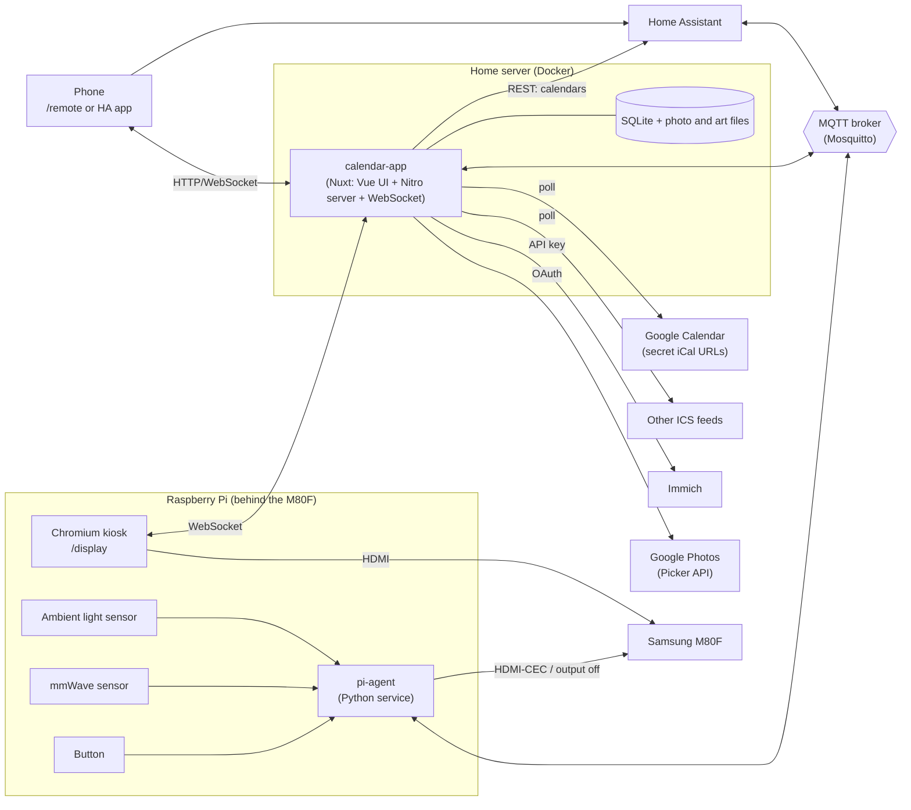

# Wall Calendar — Architecture

A self-hosted smart wall calendar. The UI runs on a Samsung Smart Monitor M8 (M80F), which is not a touchscreen. It is driven by a Raspberry Pi over HDMI. All logic lives in a web app on the home server. Control comes from Home Assistant, a phone, a physical button and on-device sensors.

---

## 1. Goals

- **Calendar first.** It should show month, week and today views of the family's calendars, with changes appearing within minutes. Each event belongs to a person (Mum, Dad, each child, Household), shown by a colour and an initial. People can each have their own calendar, or share one family calendar, with the person worked out from the event's description or title.
- **Look ahead and back.** From the phone you can move the month view up to 12 months either side of today. It goes back to the current month on its own.
- **Special days.** Birthdays, Halloween, Christmas and similar days can have their own art. Ahead of time the day's tile shows a small drawing. On the day itself the whole wall can switch to that day's palette, greeting and full-screen art. Special days are set up in the browser, not in YAML.
- **No touch needed.** Control comes from Home Assistant, a phone remote page, a physical button and automations.
- **Thin display client.** The Pi only renders a web page and handles local hardware. It holds no configuration and no secrets, and you can reflash it in minutes.
- **First-class Home Assistant citizen.** The calendar auto-discovers into HA as entities, so it can be controlled, displayed and automated like any other device.
- **Photo frame mode.** A separate, fullscreen mode rotates photos from Immich, Google Photos or a local folder. The calendar views keep a plain, high-contrast background so they stay readable from across the room. (A photo background behind the calendar is a possible later option. See §4.5.)
- **Keeps working when HA is down.** The calendar still renders, and basic button and presence behaviour still works.

## 2. System overview



| Component | Runs on | Responsibility |
|---|---|---|
| `calendar-app` | Home server, Docker | A single Nuxt app (Node). Calendar aggregation, photo pipeline, special days and their art, the authoritative display state, web UI (`/display`, `/remote`, `/settings`), MQTT and HA discovery |
| MQTT broker | Home server or HA (Mosquitto add-on) | Message bus between app, Pi agent and HA |
| Chromium kiosk | Pi | Renders `/display` fullscreen. Stateless. |
| `pi-agent` | Pi, systemd service | Reads the button, presence and light sensors. Turns the screen on and off. Publishes to and subscribes from MQTT. |
| Home Assistant | Existing | Dashboards, phone control, automations, and HA-native calendars |

**Design rule:** the app on the server owns the state. The display, the phone, HA and the Pi agent send *commands* and receive *state*. None of them hold state of their own.

## 3. Calendar data

### 3.1 Sources

There are two source types. You configure each one per calendar.

| Source type | Use for | Mechanism |
|---|---|---|
| `ics` | Google calendars, and any calendar that publishes an iCal feed | Poll the URL directly. For Google, use *Settings → [calendar] → Integrate calendar → Secret address in iCal format*. |
| `homeassistant` | Calendars that only exist in HA, such as bin collection, school terms or holiday integrations | `GET /api/calendars/<entity_id>?start=…&end=…` with a long-lived access token |

Each calendar comes from **exactly one source**. This avoids duplicate events and the need to merge two copies of the same calendar. Google calendars go via ICS, which skips the lag you've seen in the HA Google integration. HA is used for things only HA knows about.

Possible later upgrade: use the Google Calendar API directly, with incremental `syncToken` polling. This needs OAuth, but it's cheap to poll every minute. It would only be worth it if ICS freshness isn't good enough.

### 3.2 Sync loop

- Each source has its own poll interval. Defaults: ICS every 2 minutes, HA every 5 minutes.
- ICS fetches use `ETag` / `If-Modified-Since` so most polls cost almost nothing.
  The validators are only sent while the stored events were expanded for the same window, time zone and default person. When the month rolls over, a window setting changes or the zone changes, the next fetch is unconditional, because a feed that hasn't changed still needs re-expanding.
- HA calendars have no validators, so every poll fetches the whole window, and the store writes only the rows that changed. HA has already expanded recurring events. An event with a `date` start is all-day, with an exclusive end date; one with a `dateTime` is timed. When an integration sends no `uid` (or no `recurrence_id` for a repeated one), the app makes a stable id from the event, so it keeps its row between polls.
- Recurring events are expanded server-side (`ical.js`, which handles `RRULE`, `EXDATE` and `RECURRENCE-ID` overrides) over a rolling window of whole months: from the start of the month 12 months ago to the end of the month 12 months ahead. The window is this wide because the remote's month picker can reach that far (see §7.5). It is configurable with `sync.months_back` and `sync.months_ahead` (0 to 60 months each, default 12). A family calendar over 25 months is a few thousand rows, so expanding and storing it is cheap. Each calendar's window is replaced inside one transaction, and only the rows that changed are written.
- Events are normalised to one model and stored in SQLite:

```text
Event { id, calendar_id, person_ids, title, display_title, start, end, all_day, location, description, source_updated_at }
```

- `person_ids` and `display_title` come from person detection (§3.3). `title` is kept as the source had it.
- Times are stored in UTC and rendered in `Europe/London`. Changes into and out of daylight saving time are handled by the timezone library (Luxon / `Intl`), not by hand. A recurring event keeps its wall-clock time across the change (09:00 stays 09:00). A wall time the spring change skips (01:30 in London on the last Sunday of March) moves forward by the gap, and one the autumn change repeats means the first of the two.
- When anything changes, the app pushes `events.updated` over WebSocket and the display re-renders. Nothing reloads the page.
- A **manual refresh** (from a button in HA or on the remote) forces an immediate poll of every source.

### 3.3 People

The display shows events by **person**, not by calendar. A person has a name, an initial and a colour. Each event belongs to one or more people.

- **Colour** marks the person's events everywhere: the dot or initial badge, and the tint of their all-day bars (the person's colour mixed into the page background, so bar text stays readable).
- **Initial** is shown in a small coloured circle on events in the Soft month style and the side panel (see §4.4). It defaults to the first letter of the name, and you can set it when two people share a letter.

**Which person an event belongs to** is decided at sync time. Who an event is for can be written in its **title** or in its **description**. The description is the better place for a shared calendar, because the same calendar also shows in Google Calendar, on phones and in other apps, and names added to every title would clutter all of them. The same rules apply to both.

- **Text that is checked.** The title, and each line of the description. Descriptions are turned into plain text first: Google often stores them as HTML, so tags are removed, `<br>` and `<p>` become line breaks, and entities are decoded. `detect_in` chooses which fields are checked (default `[title, description]`).
- **Name forms.** A person's name or one of their `aliases`, as a whole word, **at the start** of the title or of a description line: `Theo: Swimming`, `Theo - Swimming`, `[Theo] Swimming`, `Theo Swimming`, and lists such as `Isla & Theo: Dentist` or `Isla, Theo: Dentist`. In a description, a line that holds only names (`Theo`, `Isla & Theo`) works too. So does a line with a `Who:` or `For:` label in front (`Who: Theo, Isla`), which is the tidiest form for descriptions. Matching only at the start avoids false hits such as "Collect Mum's present". It can be widened to anywhere in the text with `detect_people: anywhere`.
- **Keyword rules** on the calendar. Each rule is a case-insensitive regular expression mapped to one or more people, tested against the title and each description line. For example, `Ballet` maps to Isla and `5-a-side` maps to Dad. These are for regular activities that never mention a name.

They are applied in this order. The first step that finds anyone wins:

1. **Names**, if `detect_people` is on. People found in the title and the description are merged, title first, with no duplicates. Names come first because they are deliberate: a one-off "Isla" in a swimming event's description beats a "swimming → Theo" rule.
2. **Keyword rules**, against the title and then the description.
3. **The calendar's default person** (`person`), for example Household for the shared family calendar.

With `strip_names: true`, a matched name prefix is removed from the title shown on the wall, because the initial or colour already says who it is. So `Theo: Swimming` shows as "Swimming" with Theo's marker. The full title is kept in the database. Descriptions aren't shown on the wall. If event details are added to the remote later, description lines that only name people are hidden there too.

If an event matches several people, it carries all of them in the order they were found. It takes the **first** person's colour for its bar fill, and shows **up to three** overlapping initials in its badge, or one dot per person in the Classic style.

This means a family can use a **single shared calendar** for everyone: one calendar with `detect_people` on, defaulting to Household, with `Who: Theo` in the description and titles left clean. Separate calendars per person still work too, and you can mix the two. The settings page's Calendars tab lists recent events that fell through to the default person, so you can spot events that need a name, a rule or an alias (§7.6).

Detection runs over every source, HA calendars included (their events have a `description` too). It is a pure function in `shared/`, so it can be tested on its own. When the people or rules in config change, stored events are re-resolved at boot without a fresh fetch.

### 3.4 Calendar config (example)

```yaml
people:
  - { id: mum,  name: Mum,       colour: "#C67139", aliases: [Mummy, Sarah] }
  - { id: dad,  name: Dad,       colour: "#7A8A5E", aliases: [Daddy, Tom] }
  - { id: isla, name: Isla,      colour: "#D27FA0" }
  - { id: theo, name: Theo,      colour: "#5F94C4" }
  - { id: poppy, name: Poppy,    colour: "#9A7BC4", aliases: [Pops] }
  - { id: home, name: Household, colour: "#D9A93F", initial: H, aliases: [Family, All] }

calendars:
  # One shared calendar for the whole family: who an event is for comes from its
  # description ("Who: Theo") or title, so titles can stay clean in Google Calendar.
  - id: family
    person: home                 # default when nothing matches
    detect_people: true          # true (start of title / description lines) | anywhere | false
    detect_in: [title, description]
    strip_names: true
    rules:
      - { match: "ballet|brownies", people: [isla] }
      - { match: "swimming|football", people: [theo] }
      - { match: "rhyme time|playgroup|nursery", people: [poppy] }
    source: { type: ics, url: !secret family_ics_url }
  # A personal calendar: everything on it is Dad's.
  - id: dad-work
    person: dad
    source: { type: ics, url: !secret dad_work_ics_url, poll_seconds: 300 }
  - id: bins
    person: home
    source: { type: homeassistant, entity_id: calendar.bin_collection }
```

Secrets (ICS URLs, the HA token, the Immich key, Google OAuth tokens, the remote PIN) live in a `secrets.yaml` beside `config.yaml`, or in environment variables. A value in the config refers to one with the `!secret` tag, for example `url: !secret family_ics_url`. The environment variable `WALLCAL_SECRET_FAMILY_ICS_URL` (the name in capitals, with anything that isn't a letter or digit turned into `_`) overrides the same key in `secrets.yaml`. Secrets are plain text. They never reach the browser, and error messages name a secret without showing its value.

Config is checked when the app starts, and unknown keys are errors, so a typo stops the server with a message naming the field instead of being ignored. The other environment variables are `WALLCAL_CONFIG_FILE` (the config file), `WALLCAL_CONFIG_DIR` (the folder holding `config.yaml` and `secrets.yaml`, default `/config`), `WALLCAL_TIMEZONE` (overrides `timezone`) and `WALLCAL_DATA_DIR` (where the SQLite database and other app data live, default `/data`). `pnpm dev` uses `calendar-app/config.dev.yaml` when neither of the first two is set. An `ics` URL can also be a `file:` URL for local fixtures: `file:./family.ics` is relative to the config file's folder.

## 4. Display

### 4.1 Views

Views fall into two groups. The **calendar views** (`agenda`, `month`, `week`) and `night` use a plain themed background. **Photo frame** (`photo`) is its own mode and is the only place photos appear. The one exception is a special day's takeover art (see §6.3), which is illustration made for the palette, not a photo.

| View | Group | Contents |
|---|---|---|
| `month` | Calendar | Month grid, a side panel with today and the next three days (each with its weather), month title, special day art. See §4.4. |
| `week` | Calendar | 7-day columns with timed blocks |
| `agenda` | Calendar | Today and tomorrow in large type. The default for mornings. |
| `photo` | Photo frame | Fullscreen rotating photos with a small clock and a "next event" chip. No calendar grid. |
| `night` | Ambient | Very dim clock only. Used when the room is dark but you want the screen on. |

Views are plain front-end routes inside one page (`/display`). The server tells the page which view to show, and which month the month view shows. The page never decides for itself.

### 4.2 Rendering

- The layout is designed for a 16:9 screen at 2560×1440. On a 4K panel it renders at 1440p and is scaled up, which keeps Chromium responsive on the Pi. A Pi 5 can try native 4K.
- Large type, high contrast, nothing interactive. Any UI on the display should read clearly from 3 m away.
- Calendar views use a solid, themed background and never a photo. This keeps text contrast predictable. On a special day with a takeover the palette changes, but tiles and panels stay solid (see §6.3).
- In photo frame mode, the clock and next-event chip sit on a small translucent, blurred pill in a corner, so they stay readable over any photo without covering it.
- **Burn-in and wear:** clock and panel positions shift by a few pixels every few minutes.
- **Dimming:** the page can apply a dimming overlay (`brightness` 0–100). This lowers what you see but not the backlight. Changing the real backlight needs DDC/CI (see §8.3).
- **Resilience:** the page reconnects its WebSocket with backoff. If the server can't be reached, it shows the last-known data with a small "offline" badge rather than a browser error page.

### 4.3 Visual design

The look comes from the **Organic** design system in the Claude Design project for this repo: warm, rounded and a little playful.

- **Tokens.** Colours, fonts, radii and shadows come from the design system's `styles.css` variables: a cream ground (`--color-bg`), a terracotta accent (`--color-accent`), a sage second accent (`--color-accent-2`), and a 100–900 ramp for each role, generated in OKLCH. The app copies these tokens once into its own stylesheet and builds every theme from them. Nothing hard-codes a colour the tokens already have.
- **Type.** Caprasimo for headings, month titles and big numbers, and Figtree for everything else. Both fonts are **bundled with the app** (self-hosted woff2), not loaded from Google Fonts, so the display looks right when the server has no internet.
- **Icons.** Lucide, at stroke width 2.75. Weather uses the Lucide cloud-rain, sun, cloud-sun and moon icons.
- **Shapes.** Over-rounded: 24–64 px radii on tiles and panels, and pill-shaped bars, buttons and toggles.
- **Themes.** Two base themes, `light` (cream, the default) and `dark` (warm charcoal), set per display in config. Each theme is a set of named tokens (`bg`, `surface`, `text`, `muted`, `line`, `accent`, `todayCell`, `panel`, `tile`, `veil`, …). A special day's palette (§6.4) is another set with the same names, so swapping it in needs no layout changes.
- **People.** Every event is marked with its person's colour (§3.3). All-day bars are filled with that colour mixed into the page background (about 36% on light, 52% on dark), so bar text keeps its contrast.
- **Locale.** British English, 24-hour times, weeks start on Monday (configurable).

Design reference (Claude Design project "Wall Display"):

| Mock | Shows |
|---|---|
| 1a, 1b | Month, Classic style, light and dark |
| 1c, 1d | Month, Soft style, light and dark (the default style) |
| 1e, 1f | Remote, light and dark |
| 2a | Halloween takeover on the day |
| 2b | Special day art on tiles before the day |
| 3a | Admin: special days |
| 3b | Remote with the month picker |

### 4.4 Month view

The month view has two styles, set per display as `month_style`. Both use the same layout engine and differ only in how they draw it.

| Style | Grid | Side panel |
|---|---|---|
| `soft` (default) | Rounded day tiles with a gap between them. Events carry a small circle with the person's initial, or up to three overlapping initials for a shared event. | On the **left**. The month title sits above a sage panel holding today's date in large type, the weekday and current weather. Below that are the next four days (Today, Tomorrow, then weekday names), each with a weather icon, high/low and its events. |
| `classic` | Ruled week rows with no tiles. Events carry a coloured dot. | On the **right**. The month title sits above a weather card (current conditions and a three-day forecast), followed by the next four days' events. |

Grid rules (both styles):

- **Always five week rows.** In a month that needs a sixth row (a 31-day month starting on a Saturday or Sunday, or a 30-day month starting on a Sunday, with Monday-first weeks), the last one or two days wrap into the empty leading cells of the top row. This keeps every row tall enough to read.
- **Four lanes per day.** Each day has a date row and four event lanes. All-day and multi-day events are placed first, ordered by start and then by length, longest first. Timed events then fill the free lanes in time order. When a day has more than four items, its fourth lane shows "+N more" instead.
- **Multi-day bars** run unbroken across the days they cover in a week row. Where a bar starts or ends it has a rounded end. Where it carries on into the next or previous week it has a square end. If a "+N more" hides part of a bar, the bar is split around it.
- **Timed events** show the person marker, the start time and the title, cut off with an ellipsis.
- **Today** gets a tinted cell and its date in a filled accent circle.
- **Past days** are dimmed with a translucent veil. Each run of consecutive past days in a row gets one veil, so a bar crossing them dims evenly.
- Days from the next or previous month have a faint date (and in `soft`, a plain tile).
- Special days add a tint and a small drawing to their tile (§6.2).

**Browsing months.** The state's `month` field (§7.1) chooses the month shown. The title, grid and special day art follow it. The side panel always shows today and the next three days, whichever month the grid shows. Today's highlight and the past-day veil are always relative to the real today.

The layout engine is a pure function in `shared/`: given a month, today, the display's time zone and week start, and events (each already carrying its people), it returns the weekday header, five rows of cells with their bars, timed rows, "+N more" labels and veils, and the side panel's four days. Special days are added to its input with the special days PRs. Both styles render its output, and it is unit-tested apart from the UI.

### 4.5 Later option: photo behind the calendar

Not planned for the first release. If it's added, it should be opt-in per view and keep readability first: calendar panels sit on a heavily blurred, darkened layer, with an automatic contrast check that falls back to the plain background if a photo is too bright or busy. Photo frame mode stays the main way to show photos.

## 5. Photo frame mode

### 5.1 Pipeline

```text
Provider (Immich / Google Photos / local folder)
   → select assets (album, memories, random)
   → download + resize to display size (e.g. 2560×1440 WebP) into /data/photos
   → playlist (shuffled, no repeats until exhausted)
   → display requests /photos/next  → served from local cache
```

- Photos are only shown in the `photo` view (see §4.1). The display only ever loads images from the calendar app. API keys stay on the server, and photos still show if a provider is briefly down.
- Portrait photos are shown centred over a blurred, enlarged copy of themselves. The server pre-renders this composite with `sharp`, so the Pi only draws one image. You can also filter to landscape only.
- Options: rotation interval, transition (crossfade), and "photo of the day from memories".
- The cache has a size cap with least-recently-used eviction.

### 5.2 Immich (recommended main source)

- Authenticate with an API key (Immich → Account Settings → API Keys), sent as the `x-api-key` header.
- Useful endpoints:
  - `GET /api/albums` and `GET /api/albums/{id}`: list albums and their assets
  - `POST /api/search/random`: random assets, with filters
  - `GET /api/memories`: "on this day"
  - `GET /api/assets/{id}/thumbnail?size=preview`: a display-sized image, so the server doesn't download originals
- Source modes: one or more albums, memories, or random from the whole library (optionally filtered by person or date).
- Immich is local, fast and fully under your control, so it's the best fit for a wallpaper that rotates all day.

### 5.3 Google Photos (with limits)

Since 31 March 2025, the Google Photos **Library API can only read media created by the app itself**. Third-party apps can no longer browse your library or albums. The supported route is the **Picker API**: the user picks photos in Google's own UI, and the app gets access to the selected items.

How that works here:

1. In `/settings` (or from the phone), start a picker session. This opens Google Photos and you pick photos.
2. The app polls the session. Once you've finished picking, it downloads the selected items into the local cache straight away, because the image URLs are short-lived.
3. The selection becomes a "Google Photos batch" playlist. To refresh it, you run another pick.

This is fine for a curated set. It **cannot** automatically follow a live album. If you want automatic syncing, a better route is to get photos into Immich, for example by having Immich ingest a Google Takeout export or by uploading from your phone to Immich, and then use the Immich provider.

### 5.4 Local folder (fallback)

A mounted directory of images, for testing or for anything else.

## 6. Special days

A special day is a date with its own art: a birthday, Halloween, Christmas, moving day. Ahead of time it decorates its tile on the calendar. On the day itself it can take over the whole wall.

### 6.1 Model

Special days are edited in the browser (§7.6) and stored in SQLite, not in `config.yaml`. Their art lives in `/data/special-days/`.

```text
SpecialDay {
  id, name,
  month, day, year,        // year is set only when repeat = once
  repeat: yearly | once,
  lead: day | week | month,
  tile_art,                // file name, or null
  takeover: bool,
  full_art,                // file name, or null
  greeting,                // e.g. "Happy Halloween"
  palette: warm | night | frost | sage,
  updated_at
}
```

| Field | Meaning |
|---|---|
| `repeat` | `yearly` repeats on the same date every year. `once` is a single date, such as moving day. |
| `lead` | When the tile art starts to show on the calendar: `day` (only on the day), `week` (from 7 days before) or `month` (all of the day's month). |
| `tile_art` | A square drawing, transparent PNG or SVG, for the day's tile. |
| `takeover` | Whether the day takes over the whole wall when it arrives. |
| `full_art`, `greeting`, `palette` | Used by the takeover only. |

### 6.2 Before the day: tile art

While the lead period is running, the day's tile in the month view (both styles) gets:

- a **tint** taken from the special day's palette accent, mixed into the tile at about 26%
- the **tile art**, drawn about 60 px tall in the tile's top-right corner, beside the date number and clear of the event lanes

Events on that day draw as normal. If a special day has no tile art, only the tint shows. Tile art also stays on the day itself and is dimmed with the other past days afterwards.

### 6.3 On the day: takeover

From midnight to midnight (`Europe/London`) on a special day with `takeover` on, every calendar view changes:

- **Palette.** The display swaps its theme tokens for the special day's palette (§6.4). This covers the page background, tiles, panel, text and accents.
- **Greeting.** The greeting appears in large heading type at the top of the today panel (Soft month), above the weather card (Classic month), and above today's list in the agenda view.
- **Art.** The full-screen art (2560×1440) is a layer behind the view. Tiles and panels stay solid, so text contrast doesn't depend on the art. The art shows in the margins, the gaps between tiles and the empty lower part of the side panel, where the mock puts its scene. Artists should keep the busy parts of the picture out from behind text.

The photo frame and night views don't change. Overlay banners (§7.1) still show on top. If two special days fall on the same date, a `once` day wins over a `yearly` one, and then the most recently edited wins. Only one takes over. Every matching day's tile art is drawn side by side.

### 6.4 Palettes

A palette is a complete set of theme tokens with the same names as the base themes (§4.3), so the views need no changes to use one.

| Palette | Look |
|---|---|
| `warm` | The display's normal theme. A greeting and art with no colour change. |
| `night` | Deep plum ground, terracotta accents, light text. Halloween and Bonfire Night. |
| `frost` | Dark blue ground with icy highlights. Christmas and winter. |
| `sage` | Light sage ground with deep green accents. Gentle days such as moving day. |

More palettes can be added in code. They aren't user-editable, so every palette can be checked for contrast once.

### 6.5 Timing, preview and art

- **Resolution on the server.** The server works out the special days for any date range (yearly dates, one-off dates, lead windows, the precedence rule above). A 29 February special day shows on 28 February in non-leap years. The display gets the tile decorations for the month it shows, plus today's takeover if there is one. It never works out dates itself.
- **Midnight.** A timer in the app fires at local midnight, and on DST change days too. It re-resolves and broadcasts, so a takeover starts and ends at midnight without a page reload. The display preloads (`img.decode()`) the next day's art in the evening, so the switch is instant.
- **Preview on wall.** The admin page's "Preview on wall" button sends a `preview_special_day` command. The display shows that day's takeover and tile art for 60 seconds, as if today were that day, with a small "Preview" badge. Then it goes back to normal.
- **Uploads.** Tile art is PNG, WebP or SVG, up to 2 MB. Raster images are resized to fit 512×512. SVGs are sanitised on upload (no scripts, event handlers or external references) and served with a locked-down `Content-Security-Policy` and `X-Content-Type-Options: nosniff`. Full-screen art can be any image `sharp` reads, up to 20 MB. It is cropped to fill 2560×1440 and saved as WebP. Files are named by a hash of their content, so they can be cached for good.
- **Home Assistant.** The app publishes today's special day name (or empty) as a sensor, so automations can react to it, for example with themed lights.

## 7. Control

### 7.1 State model

The app holds one state document per display (multiple displays are supported via `/display?id=hallway`):

```json
{
  "view": "month",
  "month": null,
  "month_set_at": null,
  "screen": "on",
  "photo_source": "immich",
  "brightness": 80,
  "auto_presence": true,
  "auto_brightness": true,
  "overlay": null,
  "preview": null
}
```

- `month` is `null` when the month view follows the current month, which is the normal case. Otherwise it is a pinned month such as `"2026-12"`, limited to 12 months either side of today. A pinned month goes back to `null` when the view changes away from `month`, when someone picks the current month, and after `month_return_minutes` with no month change (default 15, set per display). So the wall never stays stuck on another month.
- `month_set_at` is the time (an ISO 8601 instant) the pinned month was last set. `month_return_minutes` counts from it, and it is `null` whenever `month` is. Every `set_month` that pins a month restarts the count, even for the month already shown. `set_month` also switches the view to `month`, since a month only means something there.
- `overlay` is `null` when no message is shown. Otherwise it is `{ "text", "icon", "until" }`, where `until` (an ISO 8601 instant, or `null` to stay until cleared) is worked out from the command's `ttl`. The server clears the overlay when `until` passes, like any other change, so the display, the remote page and HA all see it go. HA gets the text on `overlay/state`, and an empty payload once it has gone.
- `preview` is set while a special day preview runs (`{ "special_day": "christmas", "until": "…" }`) and clears itself when it ends (§6.5).
- Per-display settings that rarely change, such as `theme` (`light` | `dark`), `month_style` (`soft` | `classic`) and `month_return_minutes`, live in config (and later in the settings page), not in this state.

Every input changes this state through the same command handler. Every change is broadcast to the display (WebSocket), to the remote page (WebSocket) and to HA (MQTT state topics). This keeps all inputs in sync.

### 7.2 Inputs

| Input | Path |
|---|---|
| Home Assistant (dashboard, automations, voice) | MQTT command topics, via the auto-discovered entities |
| Phone remote page `/remote` | HTTP POST / WebSocket to the app |
| HA companion app | The same HA entities. You can add the remote page as a Webpage card too. |
| Physical button | `pi-agent` → MQTT event → app button mapping (see §7.4) |
| mmWave presence | `pi-agent` → MQTT → app presence policy and/or HA automations |
| Ambient light | `pi-agent` → MQTT → app auto-brightness and/or HA automations |
| Built-in schedule | App-side rules, for example "agenda 06:30–09:00". Optional. HA can do this too. |

### 7.3 MQTT topics

The base is `wallcal/<display_id>/`.

| Topic | Direction | Payload |
|---|---|---|
| `…/view/set` | → app | `month` \| `week` \| `agenda` \| `photo` \| `night` \| `next` |
| `…/view/state` | app → | current view (retained) |
| `…/month/set` | → app | `YYYY-MM` \| `current` \| `prev` \| `next` |
| `…/month/state` | app → | the month the month view shows, as `YYYY-MM` (retained) |
| `…/screen/set` | → app | `on` \| `off` |
| `…/screen/state` | app → | desired screen state (retained) |
| `…/photo_source/set` / `state` | ↔ | `immich` \| `google` \| `local` (which provider photo frame mode uses) |
| `…/brightness/set` / `state` | ↔ | `0`–`100` |
| `…/auto_presence/set` / `state` | ↔ | `ON` \| `OFF` |
| `…/auto_brightness/set` / `state` | ↔ | `ON` \| `OFF` |
| `…/overlay/set` | → app | JSON `{ "text": "Bins out tonight", "icon": "trash", "ttl": 3600 }`, or empty to clear |
| `…/overlay/state` | app → | the overlay's text, or empty when there is none, because it expired or was cleared (retained). The icon and the time left are not published. |
| `…/photo/next` | → app | (any) |
| `…/refresh` | → app | (any). Forces a calendar re-sync. |
| `…/last_sync/state` | app → | ISO 8601 instant (UTC) of the last successful calendar sync, such as `2026-10-28T12:00:00.000Z` (retained). Not published until a calendar has synced. |
| `…/special_day/state` | app → | today's special day name, or empty (retained) |
| `…/pi/button` | pi → | `single` \| `double` \| `long` |
| `…/pi/presence` | pi → | `ON` \| `OFF` (retained) |
| `…/pi/illuminance` | pi → | lux (float) |
| `…/pi/screen/set` | app → pi | `on` \| `off`. The agent then turns the panel on or off. |
| `…/pi/screen/state` | pi → | the actual panel state, if it can be detected |
| `…/availability`, `…/pi/availability` | both | `online` / `offline` (MQTT last-will) |

[`contracts/mqtt.json`](../contracts/mqtt.json) is the authoritative definition of the topics and payloads, and tests hold the app's code to it. A `…/set` message that arrives with the retain flag set is ignored, so a stale one on the broker isn't replayed at every reconnect. A connection has one last will, so the app opens one connection per display and each has its own `…/availability`.

### 7.4 Home Assistant integration

The app and the agent publish **MQTT discovery** configs, so HA creates two devices with no YAML. The app publishes its configs retained, and again whenever HA sends `online` on its birth topic (`homeassistant/status`):

**Device: Wall Calendar** (published by `calendar-app`)

| Entity | Type |
|---|---|
| View | `select` |
| Month shown | `sensor` (`YYYY-MM`) |
| Previous month, Next month, This month | `button`s |
| Screen | `switch` |
| Photo source | `select` |
| Brightness | `number` (slider) |
| Auto presence | `switch` |
| Auto brightness | `switch` |
| Message | `text` (sets the overlay banner, and empties when the banner expires or is cleared) |
| Next photo | `button` |
| Refresh calendars | `button` |
| Last sync | `sensor` (timestamp) |
| Special day | `sensor` (today's special day name, or empty) |

**Device: Wall Calendar Pi** (published by `pi-agent`)

| Entity | Type |
|---|---|
| Button | `event` (single / double / long) |
| Presence | `binary_sensor` (occupancy) |
| Illuminance | `sensor` (lx) |
| Panel power | `binary_sensor` (actual state, if detectable) |
| CPU temperature, uptime | diagnostic sensors |

The app also reads HA's REST API, but only for `homeassistant` calendar sources. It also reads a `weather` entity for the weather shown in the month view's side panel, the agenda and the photo frame pill. The server polls it, keeps the last good snapshot and sends changes as `weather.updated`. Without one, those views leave the weather out.

**Who handles the button?** This is set per gesture in the config:

```yaml
button:
  single: next_view      # handled by the app (works without HA)
  double: toggle_photo
  long: ha               # ignored by the app; HA automation decides
```

The HA `event` entity fires for every press either way, so HA can always react as well.

**Example automations**

```yaml
# Morning agenda
- alias: Wall calendar – morning agenda
  triggers: [{ trigger: time, at: "06:30:00" }]
  actions:
    - action: select.select_option
      target: { entity_id: select.wall_calendar_view }
      data: { option: agenda }

# Screen off when everyone leaves
- alias: Wall calendar – off when away
  triggers: [{ trigger: state, entity_id: zone.home, to: "0" }]
  actions:
    - action: switch.turn_off
      target: { entity_id: switch.wall_calendar_screen }

# Bin reminder banner
- alias: Wall calendar – bins reminder
  triggers: [{ trigger: calendar, event: start, entity_id: calendar.bin_collection, offset: "-6:00:00" }]
  actions:
    - action: text.set_value
      target: { entity_id: text.wall_calendar_message }
      data: { value: "Bins out tonight: {{ trigger.calendar_event.summary }}" }

# Long press = leaving the house
- alias: Wall calendar – long press
  # An event entity's state is the timestamp of the last press, so trigger on any
  # state change and check the event type (an attribute trigger would miss repeat long presses).
  triggers: [{ trigger: state, entity_id: event.wall_calendar_pi_button }]
  conditions:
    - condition: state
      entity_id: event.wall_calendar_pi_button
      attribute: event_type
      state: long
  actions:
    - action: scene.turn_on
      target: { entity_id: scene.leaving_home }
```

(Entity IDs are illustrative. HA generates them from the discovery names.)

Working versions with the generated entity IDs, broker setup and a dashboard are in [home-assistant.md](home-assistant.md).

### 7.5 Phone remote page

`/remote` is a mobile-first page that works as an "Add to Home Screen" web app. It follows the phone's light or dark setting. From top to bottom (mocks 1e, 1f and 3b):

- **Header.** The display's name (for example "Hallway") and a connection pill: *Connected*, *Reconnecting* or *Offline*, from the WebSocket.
- **Screen.** A card with a power icon, the state ("On" or "Off, panel in standby") and a toggle. While the screen is off, the controls below fade to half opacity but still work.
- **On the wall.** Large tiles for Agenda, Month, Week and Night in a 2×2 grid, plus a full-width Photo frame tile. The active view is filled with the accent colour.
- **Month shown.** Only while Month is the active view. It has back and forward arrows and a dropdown of months, covering 12 months either side of the current one. A "Back to this month" link appears when another month is shown. These send `set_month` (§7.1).
- **Photos from.** A segmented control (Immich, Google, Folder) for `photo_source`, and a "Next photo" button that briefly reads "Skipped" to confirm.
- **More.** Brightness and Refresh calendars. These aren't in the mocks yet, so they sit in a plain section at the bottom until they are designed.

It talks to the same command handler as MQTT, so it works even if HA is down. It's for the local network only. You can set an optional shared PIN (`remote.pin`, 4 to 12 digits, usually via `!secret`) in the config. The page learns from `GET /api/remote` whether one is needed, asks for it once and sends it as an `X-Wallcal-Pin` header on every write. The server checks it in one middleware (`server/middleware/pin.ts`) that covers every request under `/api/` except GET, HEAD and OPTIONS, so no write route can forget to, and it runs before the route, so an unauthenticated caller can't learn which displays exist. It answers 401 for a missing or wrong PIN, compares it in constant time, and answers 429 to an address that sends 10 wrong ones in 5 minutes (counted from the socket's address, not `X-Forwarded-For`, and reset by the right PIN or when the window ends). Reading state and the WebSocket (`/_ws`) stay open. Don't expose it to the internet. If you need remote access, use HA's existing remote access.

### 7.6 Settings pages

`/settings` is the admin area, for use from a laptop or tablet. It has tabs along the top (mock 3a):

| Tab | Contents |
|---|---|
| Calendars | Each calendar with its default person, whether name detection is on, source type, last sync and last error. "Refresh now". A list of recent events that fell back to the default person, with their titles, so you can add a rule or an alias. |
| Photos | Provider status, cache size, and the Google Photos picker flow (§5.3). |
| Special days | The special days editor (below). |
| Displays | Each display's live state, connection and per-display preferences. "Republish discovery". |

**Special days editor.** On the left is a list of special days, each with a date chip (day and month), its name and a summary such as "Every year · tile art · full screen", plus an **Add** button. On the right, the selected day has:

- name, date, and **Repeats** (Every year or Once)
- **Day tile art**: a square drop zone for the drawing, and **Show on the calendar from** (On the day, A week before, All month)
- **Full-screen takeover**: an on/off toggle. When it's on, there's a 16:9 drop zone for the 2560×1440 art, a **Greeting** field and **Palette** swatches (Warm, Night, Frost, Sage). When it's off, these fade out.
- **Delete**, **Preview on wall** and **Save**

Sources and secrets stay in YAML. Special days, and later the display preferences, are stored in SQLite and edited here. The PIN that protects the remote also protects every write route under `/api` used by the settings pages, uploads included (§7.5: one middleware guards every non-GET request there).

**Settings API.** The pages read three open routes, none of which carries a secret (no feed URL, Home Assistant URL or token, MQTT username or password, or PIN), and use one write. Their shapes are in `shared/settings.ts`:

- `GET /api/settings/calendars` has each calendar's default person, detection setting, source type, last attempt, last success, last error and event count, from the config and `sync_status`. A calendar that hasn't been tried yet shows nulls. `fallbacks` lists the events that fell back to the default person. `matchedBy` (§3.3) isn't stored, so it is worked out on read: the server takes the calendar's events from 30 days back to 30 days ahead whose stored people are exactly the default person, runs detection on their title and description again, and keeps those that no name or rule matched. A recurring event's instances are grouped by `uid` into one entry with a count, and the 20 nearest to now are returned. It is empty when `detect_people` is `false`.
- `GET /api/settings/displays` has each display's state, its open sockets by role (`display`, `remote`) and its MQTT link (`off` when there is no `mqtt` block).
- `GET /api/settings/connections` has the broker as scheme, host and port, and how many displays are connected to it, and the result of asking Home Assistant `GET /api/` with the token. That answer is kept for a minute, failures too, so a page polling every few seconds doesn't call Home Assistant each time.
- `POST /api/settings/discovery` ("Republish discovery") publishes the discovery configs again on every connection that is up. It answers 409 if MQTT isn't set up or discovery is off.

### 7.7 Built-in policies (work without HA)

These run in the app and each has an HA switch to turn it off:

- **Auto presence.** Presence ON turns the screen on. When presence has been OFF for N minutes (default 10), the screen turns off. This is suppressed during configured quiet hours.
- **Auto brightness.** Maps lux to the `brightness` overlay with a smoothing curve. Below a darkness threshold it can switch to the `night` view, or turn the screen off.

More complex logic, such as "only when someone is home", "not during a film" or tying in with lights, belongs in HA automations. Turn the built-in policy off when HA takes over.

## 8. Raspberry Pi

### 8.1 Software

- Raspberry Pi OS Lite (Bookworm or later) with a minimal Wayland compositor, auto-login, and Chromium in `--kiosk` mode pointed at `http://<server>:8080/display?id=hallway`. Setup and reflashing are in [`kiosk/README.md`](../kiosk/README.md).
- Turn off the screen blanker and screensaver. The panel power is controlled by the agent.
- `pi-agent` is a Python systemd service with `Restart=always`:
  - `gpiozero` for the button (debounce; single, double and long press detection)
  - UART reader for the mmWave sensor
  - I²C reader for the light sensor (publishes on change or every 30 s)
  - screen control (see §8.3)
  - MQTT with last-will availability, plus HA discovery for its own entities
- The agent's only config is the MQTT host and credentials, plus the display ID.

### 8.2 Hardware

| Part | Suggested | Interface | Notes |
|---|---|---|---|
| Button | Any momentary push button (a nice panel-mount or arcade-style one) | GPIO17 to GND, internal pull-up | Single, double and long press |
| mmWave presence | HLK-LD2410C (presence) or LD2450 (multi-target tracking) | UART (GPIO14/15), 5 V power, 3.3 V logic | Detects still people, unlike PIR. Tune range "gates" so it doesn't see through walls. Enable the UART and disable the serial console in `raspi-config`. Simplest option: wire the LD2410's OUT pin to a GPIO as a plain on/off signal. |
| Ambient light | VEML7700 (good low-light range) or BH1750 | I²C (GPIO2/3), 3.3 V | Mount it facing into the room, not at the screen, and away from the panel's own glow |

**Alternative:** put the sensors and button on an ESP32 running ESPHome instead of the Pi. This is native in HA and the Pi stays purely a kiosk. The app then gets them via HA or MQTT just the same. Choose this if the sensor placement doesn't suit where the Pi sits.

### 8.3 Screen power and brightness

These depend on what the M80F supports over HDMI. **Test early.**

1. **HDMI-CEC** (`cec-client` / libcec): standby and on. This is the best option if Samsung's Anynet+ works with the Pi.
2. **Output off**: turn the Pi's HDMI output off (`wlr-randr --output HDMI-A-1 --off` or `wlopm`). The monitor then goes to "no signal" standby. This works on almost any monitor, but wake-up can be slower.
3. **Black screen**: the display shows pure black. This always works, but the backlight stays on.

Real backlight control would need **DDC/CI** (`ddcutil`). Support on Samsung smart monitors is uncertain. If it works, `brightness` can drive the actual backlight. If not, it falls back to the CSS overlay.

## 9. Deployment

### 9.1 Containers (home server)

```yaml
services:
  calendar-app:
    image: ghcr.io/kallb123/wall-display/calendar-app:latest   # published by CI
    restart: unless-stopped
    ports: ["8080:8080"]
    environment:
      TZ: Europe/London
    volumes:
      - ./config:/config:ro       # config.yaml, secrets.yaml
      - ./data:/data              # SQLite, photo cache, special day art, Google OAuth tokens
  mosquitto:                      # skip if using the HA Mosquitto add-on
    image: eclipse-mosquitto:2
    profiles: [mqtt]              # docker compose --profile mqtt up
    restart: unless-stopped
    ports: ["1883:1883"]
    volumes:
      - ./mosquitto/config:/mosquitto/config:ro
      - ./mosquitto/data:/mosquitto/data
```

The `Publish images` workflow builds the image for amd64 and arm64 and pushes it to GHCR on every push to `main` (`:latest`, `:sha-<short sha>`) and on `v*` tags (`:1.2.3`, `:1.2`). `docker-compose.build.yml` builds it from the checkout instead. The image is a multi-stage build on `node:24-bookworm-slim` (glibc, for `better-sqlite3` and `sharp`). It holds only the Nitro `.output/`, runs as the `node` user (uid 1000), so `./data` must be writable by uid 1000, and has a `HEALTHCHECK` on `/api/health`. Nitro closes cleanly on SIGTERM, so `docker stop` returns at once and no init process is needed. Mosquitto allows anonymous connections by default, which suits a home LAN; `mosquitto/config/mosquitto.conf` explains how to add a password file.

Back up `./data` as well as `./config`. Special days and their art are only stored there, so they can't be rebuilt from YAML or from a provider.

### 9.2 Tech stack

- **App:** one Nuxt 4 project in TypeScript on Node 24 LTS, built with the Nitro `node-server` preset and run as a single process.
  - **Server (Nitro):** API routes in `server/api`, a WebSocket handler (Nitro's built-in `crossws` support), and long-running services (sync scheduler, MQTT client, photo cache) started from Nitro plugins and stopped on the `close` hook. Libraries: `mqtt` (MQTT.js), `ical.js`, Luxon, `zod` for config and command validation, `yaml` for config, `better-sqlite3` + Drizzle ORM for SQLite, `sharp` for resizing photos and special day art, and DOMPurify (with `jsdom`) for sanitising uploaded SVGs.
  - **Frontend (Vue 3):** client-rendered pages (`ssr: false`) for `/display`, `/remote` and `/settings`. Types for state, commands and events live in Nuxt's `shared/` directory and are used by both client and server, along with pure logic both sides need (the month layout engine, special day date rules). Design tokens from the Organic design system go in one CSS file. Caprasimo and Figtree are bundled with `@fontsource` packages, and icons come from `lucide-vue-next`. Theme colours use OKLCH and `color-mix()`, which need Chromium 111 or later. Bookworm's Chromium is newer than that.
  - **Tests:** Vitest for unit and server tests, Playwright for visual checks of the display at 2560×1440.
- **Pi agent:** Python 3.11 (the Bookworm system version), `gpiozero`, `pyserial`, `smbus2` or an Adafruit sensor library, `paho-mqtt` 2.x. Linted with Ruff, tested with pytest against a fake hardware layer.
- **MQTT contract:** topic names and payloads are defined once in `contracts/mqtt.json`. The app (Vitest) and the agent (pytest) are both tested against it, which keeps the two languages in step.

### 9.3 Repo layout

```text
wall-display/
├── calendar-app/                # Nuxt 4 app (Vue UI + Nitro server)
│   ├── app/                     # Vue side
│   │   ├── pages/               # display.vue, remote.vue, settings/ (calendars, photos, special-days, displays)
│   │   ├── components/          # views/ (agenda, month-soft, month-classic, week, photo, night), widgets/
│   │   ├── assets/              # tokens.css (Organic), themes and palettes
│   │   └── composables/         # useDisplaySocket, useClock, …
│   ├── server/                  # Nitro side
│   │   ├── api/                 # REST routes
│   │   ├── routes/_ws.ts        # WebSocket handler
│   │   ├── config/              # config schema (zod) and loader
│   │   ├── plugins/             # boot order: config → db → state → scheduler → mqtt
│   │   ├── sources/             # ics.ts, homeassistant.ts
│   │   ├── photos/              # immich.ts, google-picker.ts, local.ts, cache.ts
│   │   ├── special-days/        # resolve.ts, art.ts (uploads, sanitising), midnight.ts
│   │   ├── weather/             # HA weather entity + forecast cache
│   │   ├── control/             # state.ts, commands.ts, policies.ts
│   │   ├── mqtt/                # client.ts, discovery.ts
│   │   └── db/                  # Drizzle schema + migrations
│   ├── shared/                  # types and pure logic used by client and server (month-layout.ts, special-days.ts)
│   ├── config.dev.yaml          # config for pnpm dev (fixture calendars, no secrets)
│   ├── nuxt.config.ts
│   └── Dockerfile
├── pi-agent/                    # Python: agent, sensors/, screen/, systemd unit
├── kiosk/                       # Pi OS kiosk setup script and Chromium flags
├── tools/hw-probe/              # standalone hardware test kit for the Pi + M80F (no app dependency)
├── contracts/mqtt.json          # MQTT topics + payload schemas (shared by app and agent tests)
├── config.example.yaml
├── secrets.example.yaml
├── docker-compose.yml           # pulls the image from GHCR
├── docker-compose.build.yml     # override that builds it from the checkout instead
└── docs/
    ├── architecture.md
    ├── home-assistant.md
    └── implementation-plan.md
```

## 10. Failure modes

| Failure | Behaviour |
|---|---|
| HA down | The calendar still renders from ICS. Button, presence and the remote page still work via the app and MQTT, if the broker isn't the HA add-on. HA-source calendars show last-known data. |
| MQTT broker down | The display and remote page still work over WebSocket. Button, sensors and HA control pause. The agent reconnects with backoff. |
| Server down | The display shows last-known data with an "offline" badge. The agent can still turn the screen off with local presence rules after a timeout. |
| ICS feed fails | Keep the last good copy and expose "Last sync" in HA so an automation can alert. |
| Photo provider down | Rotate through the existing cache. |
| Special day art missing or fails to load | The tile tint, palette and greeting still show. Only the picture is left out. |
| No internet on the server | Fonts and icons are bundled, so the display looks the same. Only Google-hosted calendars and photos stop updating. |
| Pi reboots | Kiosk and agent auto-start. State comes back from retained MQTT messages and the server. |

Tip: run Mosquitto on the home server rather than as an HA add-on if you want button and presence to keep working when HA is down.

## 11. Build phases

The milestones and PRs are in [implementation-plan.md](implementation-plan.md). In outline:

0. **Foundations.** Nuxt scaffold, config, SQLite, Docker, and early hardware tests on the M80F.
1. **MVP.** ICS sources, design tokens and themes, `agenda` view, the month layout engine and the Soft `month` view, kiosk on the Pi, `/remote` page with the month picker.
2. **HA integration.** MQTT, discovery entities, HA calendar source, overlay messages, the settings shell, weather.
3. **Pi hardware.** Screen power via CEC or output off, then the button, mmWave and light sensor.
4. **Photo frame.** Photo cache and the `photo` view, then Immich, then the Google Photos Picker flow.
5. **Polish.** `week` and `night` views, burn-in shifting, schedules, multiple displays, editable display settings, the Classic month style.

A **special days** track (model, art uploads, display takeover, admin page) can start once the month view and the settings shell are in, and runs alongside Milestones 3 and 4.

## 12. Open questions / test early

- Does the M80F respond to HDMI-CEC standby and wake from a Pi? Does it support DDC/CI brightness?
- Pi 4 or Pi 5: is 1440p smooth enough with photo crossfades, or is a Pi 5 needed?
- Where should the mmWave sensor go so it covers the area in front of the calendar but not the next room?
- Where does the MQTT broker live: server container or HA add-on? (See §10.)
- The home server runs Ubuntu 18.04, which is past standard support. This doesn't block anything, because containers bring their own userland. Plan an OS upgrade at some point anyway.
- Month style: Soft is the default here because the special days work was designed on it. Do we still want Classic as an option, or can it be dropped?
- Takeover art: is a full-wall layer behind solid tiles (§6.3) right, or should the art only fill the side panel's lower area, as in the mock?
- Tile tint: the mock tints a birthday with the child's colour, but the admin page has no colour picker. This doc takes the tint from the palette. Should a special day be linkable to a person instead?
- Month picker: is 15 minutes the right time before the wall goes back to the current month?
- Designs still to do: agenda, week, night and photo frame views, the brightness and refresh controls on the remote, and the other settings tabs.
- Google OAuth redirects to the app's existing local HTTPS hostname. This works as long as that hostname is under a public domain; Google rejects `.local`, `.lan` and bare IPs. Google never needs to reach the server, because the redirect happens in the browser.
