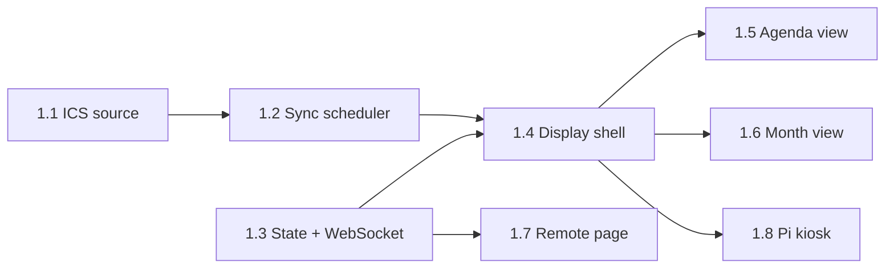

# Wall Calendar — Implementation Plan

This plan turns [architecture.md](architecture.md) into milestones and pull requests. Each PR should be small enough to review in one sitting and should leave `main` deployable.

**Decisions this plan is built on**

| Topic | Decision |
|---|---|
| App shape | One **Nuxt 4** project (`calendar-app/`). Vue 3 for `/display`, `/remote` and `/settings`, and Nitro for the API, WebSocket and background services. It runs as a single Node 24 LTS process in one container. |
| Rendering | Client-rendered (`ssr: false`). Nothing on the display benefits from SSR, and skipping it keeps the Pi path simple. |
| Pi agent | **Python** (`pi-agent/`): `gpiozero`, `pyserial`, `smbus2`, `paho-mqtt`. |
| Photos | **Photo frame is a separate mode** (the `photo` view). Calendar views always use a plain themed background. A photo behind the calendar is in the backlog, opt-in only. |
| State field | `background` is renamed to `photo_source` (`immich` \| `google` \| `local`), because it now only chooses what photo frame mode shows. |
| Storage | SQLite through `better-sqlite3` and Drizzle, with migrations run at boot. |
| Cross-language contract | `contracts/mqtt.json` defines topics and payloads. The Vitest and pytest suites both check against it. |

---

## Conventions (apply to every PR)

- **Tooling:** pnpm, TypeScript `strict`, `@nuxt/eslint`, Vitest. On the Python side: Ruff and pytest.
- **CI** (from PR 0.1): lint, typecheck, unit tests, and `nuxi build` on every PR. Python jobs are added in PR 3.1. Playwright display snapshots are added in PR 1.4.
- **Done means:** tests for new logic, `config.example.yaml` and docs updated when behaviour or config changes, and no secrets in logs or client bundles.
- **Fake data first:** a dev config (`config.dev.yaml`) points at fixture ICS files and a fake photo folder. With it, anyone can run `pnpm dev` and see a populated display without real accounts.
- **Server services** (scheduler, MQTT, photo cache) are Nitro plugins that start once and stop cleanly on Nitro's `close` hook, so dev hot-reload doesn't leak timers or MQTT connections.
- **Commands, not state:** every input goes through one `applyCommand(displayId, command)` function (PR 1.3). New inputs reuse it rather than writing state directly.

PR sizes: **S** is under a day, **M** is 1–3 days, **L** is 3–5 days.

---

## Milestone 0 — Foundations

**Goal:** an empty but deployable app. Nothing here needs the Pi or the screen. The hardware tests are in a separate track (see [Hardware track](#hardware-track--standalone-test-kit)).

| PR | Title | Size | Contents |
|---|---|---|---|
| 0.1 | Scaffold Nuxt app and CI | S | `calendar-app/` with Nuxt 4, TS strict, ESLint, Vitest, `@nuxt/test-utils`. `ssr: false`, with stub pages `/display`, `/remote` and `/settings`. `GET /api/health`. A GitHub Actions workflow for lint, typecheck, test and build. Root README with dev instructions. |
| 0.2 | Config loading | M | Load `/config/config.yaml` and `secrets.yaml`, with support for a custom YAML `!secret` tag and env var overrides (`WALLCAL_*`). A `zod` schema for displays, calendars, button mapping, policies and photos. A typed `useConfig()` server util, and clear errors at startup for bad config. `config.example.yaml` and `config.dev.yaml`. Tests for secret resolution and validation errors. |
| 0.3 | SQLite and migrations | S | `better-sqlite3` + Drizzle. Tables: `calendars`, `events`, `sync_status`, `display_state`, `photo_assets`. Migrations run in a boot plugin. The DB lives in `/data/wallcal.db`, using WAL mode. |
| 0.4 | Docker image and compose | S | Multi-stage `Dockerfile` (`node:24-bookworm-slim`, chosen because `sharp` and `better-sqlite3` need glibc), running as a non-root user, with a `HEALTHCHECK`. `docker-compose.yml` with `calendar-app` and an optional `mosquitto` service (compose profile). |

**Exit criteria:** `docker compose up` serves `/api/health` on the home server.

---

## Hardware track — standalone test kit

**Goal:** answer the hardware questions (architecture §11) with a small tool that doesn't depend on the calendar app, so app development never waits for parts to arrive. This track runs alongside Milestones 0–2 and starts when the Pi and the M80F are on hand.

`tools/hw-probe/` is a self-contained Python CLI plus a static HTML page. You copy it to a fresh Pi OS install and run it, and it needs no server, MQTT or config. Each probe prints a pass/fail summary and adds to a markdown report, which you commit as `docs/hardware-findings.md`.

| PR | Title | Size | Contents |
|---|---|---|---|
| H.1 | Screen probe | M | `hw-probe screen`: CEC standby and wake (`cec-client`), whether the monitor reports power state over CEC, HDMI output off and on (`wlr-randr` / `wlopm`) with a timed wake that asks "press Enter when the picture is back", and DDC/CI detect plus a brightness read/write (`ddcutil`). `hw-probe render`: a static 2560×1440 benchmark page (a dense month grid and a crossfading photo pair, with a `requestAnimationFrame` frame-time counter) opened in the same Chromium kiosk flags as PR 1.8. It records dropped frames and memory, so Pi 4 and Pi 5 can be compared. |
| H.2 | Sensor probes | S | `hw-probe button`: live single, double and long press detection on GPIO17, used to tune the timings. `hw-probe mmwave`: the LD2410 OUT pin state and, optionally, UART frames with gate energies, used to tune range and placement. `hw-probe light`: VEML7700/BH1750 lux readings over time, used to choose thresholds. The detection code is written so PRs 3.3–3.5 can lift it into `pi-agent`. |

**How it feeds the app:** none of the app PRs wait on these results. PR 3.2 builds all three screen back ends against fakes, and the findings only choose the default. The render numbers settle the Pi 4 vs Pi 5 choice and set the baseline that PR 4.2 is checked against.

---

## Milestone 1 — Calendar MVP

**Goal:** the family calendar on the wall, kept up to date, switchable from a phone.

| PR | Title | Size | Contents |
|---|---|---|---|
| 1.1 | ICS source | L | Fetch with `ETag` / `If-Modified-Since`. Parse with `ical.js`, register `VTIMEZONE`s, and expand recurrences over the rolling window (2 weeks back, 8 forward). Map to the normalised `Event`, then replace each calendar's window inside one transaction. **Fixture tests:** weekly and monthly `RRULE`, `EXDATE`, `RECURRENCE-ID` overrides, all-day and multi-day events, and events across the March and October `Europe/London` DST changes. Include a real Google export with secrets removed. |
| 1.2 | Sync scheduler | M | A poller for each source with its own interval (ICS default 120 s), start-up jitter, and exponential backoff on failure. On failure it keeps the last good data and records `sync_status` (last success, last error). Changes go to an internal event bus (`events.updated`). Includes `POST /api/refresh` (force all sources) and `GET /api/events?from&to`. |
| 1.3 | Display state, commands and WebSocket | M | `shared/` types for `DisplayState` and `Command` (`set_view`, `next_view`, `set_screen`, `set_brightness`, `set_photo_source`, `set_overlay`, `photo_next`, `refresh`), validated with zod. `applyCommand()` persists the state and broadcasts it. A Nitro WebSocket handler at `/_ws?display=<id>&role=display\|remote` sends the full state on connect and pushes `state.updated` / `events.updated`. Also `GET /api/displays/:id/state` and `POST /api/displays/:id/commands`. |
| 1.4 | Display shell | M | The `/display` page: a fixed 2560×1440 stage scaled to fit the viewport, and a `useDisplaySocket` composable that reconnects with backoff. The last-known state and events are cached in `localStorage`, and an "offline" badge shows when the socket is down. The server picks the view (a `<component :is>` switch with a fade). Theme tokens: a dark high-contrast default and a light theme. Clock widget and brightness dimming overlay. Playwright visual tests run at 2560×1440 with a frozen clock and fixture data. |
| 1.5 | Agenda view | M | Today and tomorrow in large type: all-day events first, then timed events, with calendar colour bars and a "now" marker. Long titles truncate cleanly, and an empty day shows a calm state. Snapshot tests for a busy day, an empty day and a long-title day. |
| 1.6 | Month view | L | A 6-week grid with the week starting Monday (configurable). Multi-day events draw as continuous bars across the week, cells that overflow show "+N more", and today is highlighted. A side panel shows the next few days. Snapshot tests, including a month that crosses a DST change. |
| 1.7 | Remote page | M | `/remote`, mobile-first: large view buttons, screen toggle, brightness slider and refresh. It is driven by the same WebSocket, so it stays live. A web app manifest and icons make "Add to Home Screen" work. An optional shared PIN from config is sent as a header and checked on command routes. |
| 1.8 | Pi kiosk setup | M | `kiosk/setup.sh` for Raspberry Pi OS Lite (Bookworm): auto-login, `labwc` (or `cage`), Chromium in `--kiosk` with flags tuned for the Pi (GPU raster, no first-run prompts, no translate prompt), screen blanking turned off, and auto-restart. The display URL is a parameter. Docs for reflashing. |

**Exit criteria:** on the real screen, the agenda and month views show the family calendars; an edit in Google Calendar appears within about 2 minutes; the phone remote switches views; and pulling the server's network cable shows the offline badge rather than an error page.

---

## Milestone 2 — Home Assistant integration

**Goal:** the calendar shows up in HA as a device you can control and automate, and HA-only calendars show on the display.

| PR | Title | Size | Contents |
|---|---|---|---|
| 2.1 | MQTT contract and client | M | `contracts/mqtt.json`: topics from architecture §6.3, with JSON Schema payloads. An MQTT.js client with an availability last-will, retained `…/state` topics, and command topics routed into `applyCommand()`. Reconnects with backoff. The app runs normally with no broker configured, or with the broker down. Contract tests check topics and payloads against the JSON file. |
| 2.2 | HA MQTT discovery | M | Discovery configs for the "Wall Calendar" device: view `select`, screen `switch`, photo source `select`, brightness `number`, auto presence and auto brightness `switch`es, message `text`, next photo and refresh `button`s, and last sync `sensor`. They are republished when HA restarts (on the `homeassistant/status` birth message). Snapshot tests of the discovery payloads. |
| 2.3 | HA calendar source | M | A `homeassistant` source type: `GET /api/calendars/<entity_id>?start&end` with a long-lived token (default poll 300 s). All-day events are mapped (`date` vs `dateTime`). Fits into the same scheduler and `sync_status`. |
| 2.4 | Overlay messages | S | The `set_overlay` command with text, icon and TTL, and server-side expiry. Shown as a banner component on every view, photo frame included. Set from the HA `text` entity, the remote page or the API. |
| 2.5 | Settings page v1 (status) | M | `/settings`, read-only: calendars with colour, source type, last sync and last error; MQTT and HA connection status; current state of each display; and buttons for "refresh now" and "republish discovery". Secrets are never sent to the browser. |
| 2.6 | HA docs and examples | S | `docs/home-assistant.md`: broker setup, the example automations from the architecture doc, and a dashboard card with the remote page as a Webpage card. |

**Exit criteria:** the device appears in HA with no YAML; changing the view from HA updates the wall and the remote within a second; the bin-collection calendar shows on the display; and the app keeps working with the broker stopped.

---

## Milestone 3 — Pi hardware (Python agent)

**Goal:** the button, presence and light sensors work, the screen turns off when nobody is around, and it still works when HA is down.

| PR | Title | Size | Contents |
|---|---|---|---|
| 3.1 | pi-agent skeleton | M | A `pi-agent/` Python package (`pyproject.toml`, Python 3.11) with a small config file (MQTT host and credentials, display ID, enabled sensors). `paho-mqtt` 2.x with a last-will. HA discovery for the "Wall Calendar Pi" device and diagnostic sensors (CPU temperature, uptime). A systemd unit with `Restart=always` and an install script. A hardware abstraction with fake implementations, so it can be tested off-Pi. CI: Ruff, pytest, and contract tests against `contracts/mqtt.json`. |
| 3.2 | Screen power | M | Back ends chosen in config (the default comes from the H.1 findings, but the work doesn't wait for them): `cec` (`cec-client`), `output` (`wlr-randr` / `wlopm`) and `black`. The agent subscribes to `pi/screen/set` and reports `pi/screen/state`. App side: a change to `screen` state publishes `pi/screen/set`, and when the back end is `black` the display page shows pure black. |
| 3.3 | Button | S | `gpiozero` on GPIO17 with debounce and single, double and long press detection (timings configurable). Publishes `pi/button`, plus an HA `event` entity. App side: a per-gesture mapping from config (`next_view`, `toggle_photo`, `ha`, …) handled through `applyCommand()`. |
| 3.4 | mmWave presence and auto-presence policy | M | LD2410 via the OUT pin as a plain GPIO input (the default), with UART frame parsing as an option. Publishes `pi/presence` (retained). App side: the **auto presence** policy turns the screen on when presence goes ON, turns it off after N minutes of OFF, respects quiet hours, and can be turned off from HA. |
| 3.5 | Light sensor and auto-brightness policy | M | VEML7700 (or BH1750) over I²C via `smbus2`. Publishes on a meaningful change or every 30 s. App side: the **auto brightness** policy maps lux to `brightness` with smoothing and hysteresis, and below a darkness threshold switches to `night` (or turns the screen off, per config). It can be turned off from HA. Unit tests for the curve and hysteresis. |
| 3.6 | Agent offline fallback | S | If the app's availability is `offline` (or MQTT is unreachable) for longer than a timeout, the agent applies a local rule: no presence for N minutes turns the screen off, and presence wakes it. Covers the "server down" row of architecture §9. |

**Exit criteria:** walking up to the wall wakes it; leaving the room turns it off after the timeout; button gestures behave as configured and fire HA events; brightness follows the room; and stopping HA doesn't break any of this.

---

## Milestone 4 — Photo frame mode

**Goal:** a separate, fullscreen photo frame mode, fed from local providers and kept independent of the calendar views.

| PR | Title | Size | Contents |
|---|---|---|---|
| 4.1 | Photo cache, playlist and local provider | L | A `PhotoProvider` interface (`list()` / `fetch()`). A `sharp` pipeline that resizes to 2560×1440 WebP, and for portrait or other non-16:9 images pre-renders the "centred over a blurred copy" composite on the server, so the Pi only decodes one image. A size-capped cache in `/data/photos` with LRU eviction. A shuffled playlist with no repeats until it is exhausted, stored in SQLite. Routes: `GET /api/photos/next?display=`, `GET /photos/:id.webp` (long cache headers). Starts with the **local folder** provider. |
| 4.2 | Photo frame view | M | The `photo` view: fullscreen crossfade between two layered ``s, with the next image decoded ahead (`img.decode()`). A small clock and "next event" chip sit on a translucent pill in a corner, and overlay banners still show. The rotation interval is set by the server, which sends `photo.next`, so the remote, HA and the button can all skip. Options: interval, landscape only. A performance check on the Pi against the H.1 render baseline. |
| 4.3 | Immich provider | M | API key in the `x-api-key` header. Modes: albums, random (`POST /api/search/random` with optional person or date filters), and memories (`GET /api/memories`). Downloads `thumbnail?size=preview`, never originals. Tests use recorded fixtures. If Immich is down, the cache keeps rotating. |
| 4.4 | Google Photos Picker | L | Standard web-server OAuth with the `photospicker.mediaitems.readonly` scope. It redirects to the app's existing local HTTPS hostname (Google accepts this if the hostname is under a public domain), and the refresh token is stored in `/data`. Then: start a picker session from `/settings` (with a QR code, so the pick can happen on a phone), poll the session, and download the selected items straight away (their URLs are short-lived) into a "Google batch" playlist. |
| 4.5 | Photo controls everywhere | S | `photo_source` select (HA, remote), next photo (HA button, remote, button gesture), a photo frame view button on the remote, and a `toggle_photo` button action that switches between photo frame and the last calendar view. |

**Exit criteria:** photo frame mode rotates Immich photos smoothly on the Pi; the calendar views are unchanged; and switching between photo frame and calendar from HA, the remote or the button works.

---

## Milestone 5 — Polish

| PR | Title | Size | Contents |
|---|---|---|---|
| 5.1 | Week view | L | 7 columns with timed blocks, all-day events in a strip at the top, side-by-side layout for overlapping events, and a "now" line. Hours outside a configurable range are collapsed. |
| 5.2 | Night view | S | A very dim clock on black, with optional next-alarm or first-event text. Chosen by the auto-brightness policy or set by hand. |
| 5.3 | Weather widget | M | Reads a configured HA `weather` entity: current conditions from its state, and the forecast via `POST /api/services/weather/get_forecasts?return_response` (HA no longer puts forecasts in entity attributes). Cached on the server. Shown in the month and agenda views and the photo frame pill. |
| 5.4 | Burn-in shifting | S | Every few minutes, shift the stage by a few pixels in a slow orbit, and move the photo frame pill between corners. Applies to every view. |
| 5.5 | Built-in schedules | M | Optional rules in the app, such as "agenda 06:30–09:00" or "photo frame 10:00–16:00 on weekdays", evaluated in `Europe/London`. A manual command overrides a rule until the next rule boundary. Each rule set can be turned off from HA. |
| 5.6 | Multiple displays | M | `displays:` in config, with separate state, WebSocket rooms, MQTT topics and HA devices for each display, and per-display defaults (view, theme, photo source, policies). Most of this is already keyed by display ID from PR 1.3, so this PR is mostly config, discovery and tests. |
| 5.7 | Settings page v2 | M | Edit non-secret display preferences in the browser (theme, default view, photo interval, policy thresholds), stored in SQLite as overrides on top of `config.yaml`. Sources and secrets stay in YAML. |

---

## Backlog (not scheduled)

- **Photo behind the calendar (opt-in).** Per-view setting, a heavily blurred and darkened layer, and an automatic contrast check that falls back to the plain background. See architecture §4.3.
- **Auto photo frame when idle.** Switch to photo frame when nothing is on for the next few hours, and switch back on presence.
- **Google Calendar API with `syncToken`.** Only worth it if ICS freshness turns out not to be good enough.
- **DDC/CI backlight.** If H.1 finds the M80F supports it, drive the real backlight from `brightness`.
- **ESP32 / ESPHome sensors.** The alternative to the Pi agent's sensors. The app already accepts presence and lux over MQTT, so this is mostly docs.
- **Event detail on the remote.** Tap an event on the phone to see its location and description.

---

## Risks and how the plan deals with them

| Risk | Mitigation |
|---|---|
| The M80F doesn't support CEC or DDC/CI | The H.1 probe tests this on the real hardware without the app. PR 3.2 has three back ends, and `black` always works. |
| Nitro WebSocket (`crossws`) quirks | All socket use goes through one hub module (PR 1.3). If it causes problems, it can be swapped for SSE plus POST without touching the views. |
| Background services misbehaving under Nuxt dev hot-reload | Plugins are idempotent and stop on the `close` hook (see Conventions). |
| Native modules (`sharp`, `better-sqlite3`) in Docker | A glibc base image with the build in the same image family. CI runs a Docker build so breakage shows up early. |
| ICS edge cases (recurrence overrides, DST) | Fixture-driven tests in PR 1.1, including a real Google export. |
| Pi 4 too slow at 1440p | Measured by the H.1 render probe and checked again in PR 4.2. The server pre-renders photo composites, so the Pi does less work. |
| Google OAuth on a LAN-only app | It uses the existing local HTTPS hostname as the redirect. Immich stays the recommended main photo source. |

---

## Suggested order and parallel work

Milestones 0 → 1 → 2 are sequential. The **hardware track** is independent and can start whenever the Pi and the screen arrive. Ideally it finishes before PR 3.2 merges, so the right default back end ships, but nothing is blocked if it doesn't. Once PR 2.1 (the MQTT contract) is merged, **Milestone 3 (Python) and Milestone 4 (photos) can go in parallel**, because they touch separate parts of the code. Milestone 5 PRs are independent of each other and can be picked in any order. PR 5.4 (burn-in) is worth doing soon after the display is on the wall.
