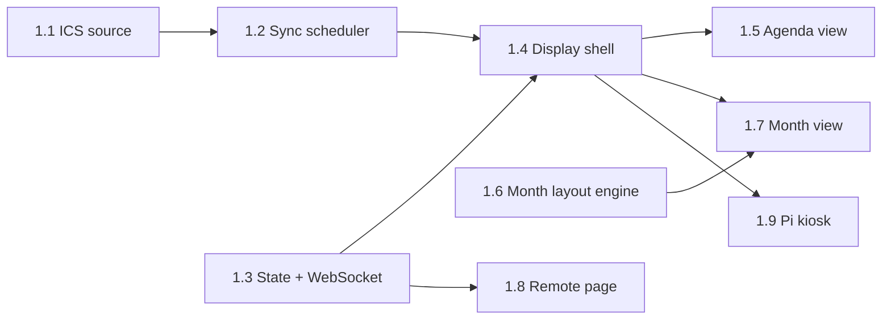

# Wall Calendar — Implementation Plan

This plan turns [architecture.md](architecture.md) into milestones and pull requests. Each PR should be small enough to review in one sitting and should leave `main` deployable.

**Decisions this plan is built on**

| Topic | Decision |
|---|---|
| App shape | One **Nuxt 4** project (`calendar-app/`). Vue 3 for `/display`, `/remote` and `/settings`, and Nitro for the API, WebSocket and background services. It runs as a single Node 24 LTS process in one container. |
| Rendering | Client-rendered (`ssr: false`). Nothing on the display benefits from SSR, and skipping it keeps the Pi path simple. |
| Pi agent | **Python** (`pi-agent/`): `gpiozero`, `pyserial`, `smbus2`, `paho-mqtt`. |
| Photos | **Photo frame is a separate mode** (the `photo` view). Calendar views always use a plain themed background (a special day's illustrated takeover art is the one exception). A photo behind the calendar is in the backlog, opt-in only. |
| State field | `background` is renamed to `photo_source` (`immich` \| `google` \| `local`), because it now only chooses what photo frame mode shows. |
| Storage | SQLite through `better-sqlite3` and Drizzle, with migrations run at boot. |
| Visual design | The **Organic** design system from the Claude Design project: its tokens in one CSS file, with Caprasimo and Figtree bundled (not loaded from Google Fonts) and Lucide icons at stroke width 2.75. There are `light` (default) and `dark` themes, set per display. |
| People | Events are shown by person (name, initial, colour). An event's people are worked out at sync time from its title **and description**, using the same rules for both. First come names or aliases at the start of the title or of a description line (`Theo: Swimming`, `[Isla & Theo] Dentist`, or a `Who: Theo` line in the description, which keeps titles clean in Google Calendar and other apps). Then keyword rules, then the calendar's default person. One shared family calendar works as well as one calendar per person. See architecture §3.3. |
| Month view | Always five week rows, with up to four lanes a day, then "+N more". The layout engine is a pure, unit-tested function in `shared/`. **Soft** is the first and default style. **Classic** comes later (PR 5.7) and reuses the engine. |
| Month browsing | A `month` field in the display state (`null` means the current month), set from the remote's month picker within 12 months either side. It goes back to the current month on its own. The sync window is widened to match. |
| Special days | Edited in `/settings`, stored in SQLite, with art in `/data/special-days/`. They are not in YAML. They are built in their own track (S.1–S.4) once the month view and the settings shell exist. |
| Weather | Moved from Polish into Milestone 2 (PR 2.7), because the month view's side panel is designed around it. Views leave it out when no weather entity is set up. |
| Cross-language contract | `contracts/mqtt.json` defines topics and payloads. The Vitest and pytest suites both check against it. |

---

## Conventions (apply to every PR)

- **Tooling:** pnpm, TypeScript `strict`, `@nuxt/eslint`, Vitest. On the Python side: Ruff and pytest.
- **CI** (from PR 0.1): lint, typecheck, unit tests, and `nuxi build` on every PR. Python jobs are added in PR 3.1. Playwright display snapshots are added in PR 1.4.
- **Done means:** tests for new logic, `config.example.yaml` and docs updated when behaviour or config changes, and no secrets in logs or client bundles.
- **Fake data first:** a dev config (`config.dev.yaml`) points at fixture ICS files and a fake photo folder. With it, anyone can run `pnpm dev` and see a populated display without real accounts. One fixture is a single shared family calendar, with people named in titles and in descriptions (including Google-style HTML descriptions), so person detection is exercised from the start. The fixtures copy the design mocks' family (Mum, Dad, Isla, Theo, Poppy, Household) and October 2026, with a frozen "today" of Wed 28 Oct, so Playwright snapshots can be checked side by side with the mocks.
- **Server services** (scheduler, MQTT, photo cache) are Nitro plugins that start once and stop cleanly on Nitro's `close` hook, so dev hot-reload doesn't leak timers or MQTT connections.
- **Commands, not state:** every input goes through one `applyCommand(displayId, command)` function (PR 1.3). New inputs reuse it rather than writing state directly.

PR sizes: **S** is under a day, **M** is 1–3 days, **L** is 3–5 days.

---

## Milestone 0 — Foundations

**Goal:** an empty but deployable app. Nothing here needs the Pi or the screen. The hardware tests are in a separate track (see [Hardware track](#hardware-track--standalone-test-kit)).

| PR | Title | Size | Contents |
|---|---|---|---|
| 0.1 | Scaffold Nuxt app and CI | S | `calendar-app/` with Nuxt 4, TS strict, ESLint, Vitest, `@nuxt/test-utils`. `ssr: false`, with stub pages `/display`, `/remote` and `/settings`. `GET /api/health`. A GitHub Actions workflow for lint, typecheck, test and build. Root README with dev instructions. |
| 0.2 | Config loading | M | Load `/config/config.yaml` and `secrets.yaml`, with support for a custom YAML `!secret` tag and env var overrides (`WALLCAL_*`). A `zod` schema for people (with `aliases`), calendars (a default `person`, `detect_people`, `detect_in`, `strip_names` and keyword `rules`, with each rule's regex checked at load), displays (name, `theme`, `month_style`, `month_return_minutes`, week start), button mapping, policies and photos. A typed `useConfig()` server util, and clear errors at startup for bad config. `config.example.yaml` and `config.dev.yaml`. Tests for secret resolution and validation errors. |
| 0.3 | SQLite and migrations | S | `better-sqlite3` + Drizzle. Tables: `calendars`, `events`, `sync_status`, `display_state`, `photo_assets`, `special_days`. Migrations run in a boot plugin. The DB lives in `/data/wallcal.db`, using WAL mode. |
| 0.4 | Docker image and compose | S | Multi-stage `Dockerfile` (`node:24-bookworm-slim`, chosen because `sharp` and `better-sqlite3` need glibc), running as a non-root user, with a `HEALTHCHECK`. `docker-compose.yml` with `calendar-app` and an optional `mosquitto` service (compose profile). |

**Exit criteria:** `docker compose up` serves `/api/health` on the home server.

---

## Hardware track — standalone test kit

**Goal:** answer the hardware questions (architecture §12) with a small tool that doesn't depend on the calendar app, so app development never waits for parts to arrive. This track runs alongside Milestones 0–2 and starts when the Pi and the M80F are on hand.

`tools/hw-probe/` is a self-contained Python CLI plus a static HTML page. You copy it to a fresh Pi OS install and run it, and it needs no server, MQTT or config. Each probe prints a pass/fail summary and adds to a markdown report, which you commit as `docs/hardware-findings.md`.

| PR | Title | Size | Contents |
|---|---|---|---|
| H.1 | Screen probe | M | `hw-probe screen`: CEC standby and wake (`cec-client`), whether the monitor reports power state over CEC, HDMI output off and on (`wlr-randr` / `wlopm`) with a timed wake that asks "press Enter when the picture is back", and DDC/CI detect plus a brightness read/write (`ddcutil`). `hw-probe render`: a static 2560×1440 benchmark page (a dense month grid and a crossfading photo pair, with a `requestAnimationFrame` frame-time counter) opened in the same Chromium kiosk flags as PR 1.9. It uses the real Organic fonts and OKLCH `color-mix()` colours, so it also confirms the Pi's Chromium renders them. It records dropped frames and memory, so Pi 4 and Pi 5 can be compared. |
| H.2 | Sensor probes | S | `hw-probe button`: live single, double and long press detection on GPIO17, used to tune the timings. `hw-probe mmwave`: the LD2410 OUT pin state and, optionally, UART frames with gate energies, used to tune range and placement. `hw-probe light`: VEML7700/BH1750 lux readings over time, used to choose thresholds. The detection code is written so PRs 3.3–3.5 can lift it into `pi-agent`. |

**How it feeds the app:** none of the app PRs wait on these results. PR 3.2 builds all three screen back ends against fakes, and the findings only choose the default. The render numbers settle the Pi 4 vs Pi 5 choice and set the baseline that PR 4.2 is checked against.

---

## Milestone 1 — Calendar MVP

**Goal:** the family calendar on the wall, kept up to date, switchable and browsable from a phone.

| PR | Title | Size | Contents |
|---|---|---|---|
| 1.1 | ICS source | L | Fetch with `ETag` / `If-Modified-Since`. Parse with `ical.js`, register `VTIMEZONE`s, and expand recurrences over the rolling window: whole months, from 12 months back to 12 months ahead (configurable), so the month picker always has data. Map to the normalised `Event`, then replace each calendar's window inside one transaction. **Fixture tests:** weekly and monthly `RRULE`, `EXDATE`, `RECURRENCE-ID` overrides, all-day and multi-day events, and events across the March and October `Europe/London` DST changes. Include a real Google export with secrets removed. A timing test shows a busy calendar over the 25-month window expands and stores in well under a second. |
| 1.2 | Sync scheduler and person detection | L | A poller for each source with its own interval (ICS default 120 s), start-up jitter, and exponential backoff on failure. On failure it keeps the last good data and records `sync_status` (last success, last error). Changes go to an internal event bus (`events.updated`). Includes `POST /api/refresh` (force all sources) and `GET /api/events?from&to`. **Person detection:** a pure `resolvePeople(event, calendar, people)` in `shared/` runs on every synced event, from any source. It checks the title and each line of the description, after turning HTML descriptions into plain text (tags removed, ` ` and `
` as line breaks, entities decoded). The steps are: whole-word names and aliases at the start of the title or of a description line (`Theo: …`, `Theo - …`, `[Theo] …`, `Isla & Theo: …`, `Isla, Theo: …`, a names-only line, or a `Who:` or `For:` line), or anywhere if configured, with title and description people merged; then keyword rules against both; then the calendar's default. It stores `person_ids` and, with `strip_names`, a `display_title` with the prefix removed. Stored events are re-resolved at boot when people or rules have changed. Unit tests cover each form in both title and description, people split across title and description, HTML and multi-line descriptions, a description sentence that mentions a name mid-line (no match by default), several people, aliases, case, names inside other words ("Theodore", "Mum's") not matching, names beating keyword rules, and the fallback. Events come back with their people (name, initial, colour) attached. |
| 1.3 | Display state, commands and WebSocket | M | `shared/` types for `DisplayState` and `Command` (`set_view`, `next_view`, `set_month`, `set_screen`, `set_brightness`, `set_photo_source`, `set_overlay`, `photo_next`, `refresh`), validated with zod. `set_month` takes `YYYY-MM`, `current`, `prev` or `next`. It is clamped to 12 months either side of today and stored as `null` for the current month. `month` goes back to `null` when the view leaves `month`, and after `month_return_minutes` with no month change. Unit tests cover the clamp, the reset rules and a year boundary. `applyCommand()` persists the state and broadcasts it. A Nitro WebSocket handler at `/_ws?display=<id>&role=display\|remote` sends the full state on connect and pushes `state.updated` / `events.updated`. Also `GET /api/displays/:id/state` and `POST /api/displays/:id/commands`. |
| 1.4 | Display shell and design tokens | M | The `/display` page: a fixed 2560×1440 stage scaled to fit the viewport, and a `useDisplaySocket` composable that reconnects with backoff. The last-known state and events are cached in `localStorage`, and an "offline" badge shows when the socket is down. The server picks the view (a `<component :is>` switch with a fade). **Design system:** the Organic tokens in `app/assets/tokens.css`, Caprasimo and Figtree bundled through `@fontsource`, and `lucide-vue-next` at stroke width 2.75. **Themes:** `light` (default) and `dark` as named token sets (`bg`, `surface`, `text`, `muted`, `line`, `accent`, `todayCell`, `panel`, `tile`, `veil`, …), set up so a special day palette can replace them later. A helper turns a person's colour into the bar fill (`color-mix` with the page background). Clock widget and brightness dimming overlay. Playwright visual tests run at 2560×1440 with a frozen clock and fixture data, in both themes. |
| 1.5 | Agenda view | M | Today and tomorrow in large type: all-day events first, then timed events, with person colour bars and initials and a "now" marker. Long titles truncate cleanly, and an empty day shows a calm state. There is no mock yet, so it follows the side panel's styling in mock 1c. Snapshot tests for a busy day, an empty day and a long-title day. |
| 1.6 | Month layout engine | M | A pure function in `shared/month-layout.ts` (the design project's `wall-data.js` is a working sketch of it). Given a month, today, the display's time zone, week start and events (each already carrying its people), it returns the weekday header and the five week rows. Each item carries all of its people: the first sets the bar colour, and up to three initials go in the badge. **Wrapping:** month days that need a sixth row go into the top row's empty leading cells. **Lanes:** a date row plus four lanes. All-day and multi-day bars are placed first (by start, longest first), then timed events in time order. When a day has more than four items, its fourth lane shows "+N more". **Bars:** split by week, with rounded or square ends depending on whether the event continues, and split around a hidden lane. **Veils:** one per run of past days. It also returns the side panel data: today plus the next three days, all-day items then timed. Unit tests: October 2026 (matches the mocks), March 2026 (needs wrapping, and has a DST change), February 2027, a five-day bar across a week boundary, a day with seven items, and a pinned month a year ahead. |
| 1.7 | Month view (Soft style) | L | The `month` view in the Soft style from mocks 1c and 1d. On the left are the month title and year above the sage today panel: large date, weekday, current weather, then Today, Tomorrow and the next two weekdays, each with its weather and events with initial badges. On the right are the weekday header and five rows of rounded tiles, bars and timed rows from PR 1.6, with today's tile and number highlighted and past days veiled. It shows `state.month` when it's set, otherwise the current month, and fetches that month's events when it changes. Weather slots stay hidden until PR 2.7. Leaves a slot in each tile's top-right corner and a greeting and art slot in the panel for special days (S.3). Playwright snapshots in light and dark, matched against the mocks, plus a pinned month. |
| 1.8 | Remote page | M | `/remote`, mobile-first, from mocks 1e, 1f and 3b. It has the display name and a connection pill (Connected, Reconnecting, Offline), a screen card with a toggle (the rest fades to half opacity when the screen is off), view tiles (Agenda, Month, Week, Night, and a full-width Photo frame), and the **month picker**, shown only while Month is active. The picker has back and forward arrows, a dropdown covering 12 months either side, and a "Back to this month" link when another month is shown. A plain "More" section at the bottom has brightness and refresh, which aren't designed yet. The Photo frame tile and the "Photos from" section stay hidden until PR 4.5. It follows the phone's light or dark setting. It is driven by the same WebSocket, so it stays live. A web app manifest and icons make "Add to Home Screen" work. An optional shared PIN from config is sent as a header and checked on command routes. |
| 1.9 | Pi kiosk setup | M | `kiosk/setup.sh` for Raspberry Pi OS Lite (Bookworm): auto-login, `labwc` (or `cage`), Chromium in `--kiosk` with flags tuned for the Pi (GPU raster, no first-run prompts, no translate prompt), screen blanking turned off, and auto-restart. The display URL is a parameter. Docs for reflashing. |

**Exit criteria:** on the real screen, the agenda and month views show the family calendars and look like the mocks; an edit in Google Calendar appears within about 2 minutes; the phone remote switches views and moves the month view forward and back, and the wall goes back to the current month by itself; and pulling the server's network cable shows the offline badge rather than an error page.

---

## Milestone 2 — Home Assistant integration

**Goal:** the calendar shows up in HA as a device you can control and automate, HA-only calendars and the weather show on the display, and the settings area exists.

| PR | Title | Size | Contents |
|---|---|---|---|
| 2.1 | MQTT contract and client | M | `contracts/mqtt.json`: topics from architecture §7.3 (including `month/set`, `month/state` and `special_day/state`), with JSON Schema payloads. An MQTT.js client with an availability last-will, retained `…/state` topics, and command topics routed into `applyCommand()`. Reconnects with backoff. The app runs normally with no broker configured, or with the broker down. Contract tests check topics and payloads against the JSON file. |
| 2.2 | HA MQTT discovery | M | Discovery configs for the "Wall Calendar" device: view `select`, month shown `sensor`, previous, next and this month `button`s, screen `switch`, photo source `select`, brightness `number`, auto presence and auto brightness `switch`es, message `text`, next photo and refresh `button`s, and last sync `sensor`. They are republished when HA restarts (on the `homeassistant/status` birth message). Snapshot tests of the discovery payloads. |
| 2.3 | HA calendar source | M | A `homeassistant` source type: `GET /api/calendars/<entity_id>?start&end` over the same 25-month window, with a long-lived token (default poll 300 s). All-day events are mapped (`date` vs `dateTime`). Fits into the same scheduler and `sync_status`. |
| 2.4 | Overlay messages | S | The `set_overlay` command with text, icon and TTL, and server-side expiry. Shown as a banner component on every view, photo frame included. Set from the HA `text` entity, the remote page or the API. |
| 2.5 | Settings shell and status | M | `/settings` in the Organic style, with the tab bar from mock 3a: Calendars, Photos, Special days and Displays. This PR fills in the read-only parts. **Calendars:** each calendar with its default person, whether detection is on, source type, last sync and last error, and "Refresh now". It also lists recent events that fell back to the default person, so missing rules or aliases are easy to spot. **Displays:** each display's live state and connection, and "Republish discovery". **Photos:** a placeholder until Milestone 4. **Special days:** a placeholder until S.4. MQTT and HA connection status. The remote's PIN now guards every write route under `/api`, not just commands. Secrets are never sent to the browser. |
| 2.6 | HA docs and examples | S | `docs/home-assistant.md`: broker setup, the example automations from the architecture doc, and a dashboard card with the remote page as a Webpage card. |
| 2.7 | Weather | M | Reads a configured HA `weather` entity: current conditions from its state, and the daily forecast via `POST /api/services/weather/get_forecasts?return_response` (HA no longer puts forecasts in entity attributes). Cached on the server and pushed as `weather.updated`. HA conditions map to Lucide icons (rain, sun, cloud-sun, cloud, snow, moon at night). Fills the month view's slots: current temperature and condition under today's date, and the icon and high/low for each of the four side panel days. Also shown in the agenda view, and later in the photo frame pill (PR 4.2). |

**Exit criteria:** the device appears in HA with no YAML; changing the view or month from HA updates the wall and the remote within a second; the bin-collection calendar shows on the display as Household events; the month view shows the weather; and the app keeps working with the broker stopped.

---

## Special days track

**Goal:** birthdays and holidays get their own art on the calendar, and on the day itself the wall takes on that day's look. This is all set up from the browser.

The track needs the month view (PR 1.7) and the settings shell (PR 2.5). It touches its own server module, one settings tab and the display's theme layer, so it can run alongside Milestones 3 and 4. See architecture §6 for the full behaviour.

| PR | Title | Size | Contents |
|---|---|---|---|
| S.1 | Special days model and resolution | M | The `special_days` table and zod schema (name, date, `repeat`, `lead`, `lead_days`, `takeover`, `greeting`, `palette`, art file names). CRUD routes under `/api/special-days`, behind the PIN. A pure `resolveSpecialDays(from, to)` in `shared/` works out the tile decorations for a range and today's takeover. It handles yearly and one-off dates, lead windows (`day`, `week`, `month`, or a custom number of days), precedence (`once` over `yearly`, then most recently edited), and 29 February in non-leap years. A midnight timer, correct on DST change days, re-resolves and broadcasts `special_days.updated`. Publishes `special_day/state` and adds the HA "Special day" `sensor` when MQTT is on. Unit tests for every date rule, with a frozen clock. |
| S.2 | Art uploads and storage | M | `POST /api/special-days/:id/art/tile` and `…/art/full` (multipart, behind the PIN). **Tile art:** PNG, WebP or SVG up to 2 MB. Raster images are resized to fit 512×512. SVG is sanitised with DOMPurify and rejected if anything is stripped that matters (scripts, event handlers, external references). **Full art:** any image `sharp` reads, up to 20 MB, cropped to fill 2560×1440 WebP. Files are stored in `/data/special-days/` under a content hash and served with immutable cache headers. SVGs are also served with `Content-Security-Policy: default-src 'none'; style-src 'unsafe-inline'` and `nosniff`. Unused files are cleaned up when art is replaced or a day is deleted. Tests include a hostile SVG fixture. |
| S.3 | Special days on the display | L | **Tile art:** within the lead window, the day's tile is tinted with the palette accent at about 26%, and the art is drawn about 60 px tall in its top-right corner, in both month styles. **Takeover:** the palettes `night`, `frost` and `sage` are token sets with the same names as the base themes (`warm` keeps the display's theme). On the day they replace the theme on every calendar view. The greeting goes at the top of the today panel and above the agenda list, and the full art is a layer behind the view with tiles and panels kept solid. Photo frame and night views don't change, and overlays stay on top. **Preview:** a `preview_special_day { id, seconds = 60 }` command sets `state.preview`, and the display renders that day with a "Preview" badge and then goes back. Art for tomorrow is preloaded in the evening (`img.decode()`). A contrast check in CI runs every palette's text and surface pairs. Playwright snapshots match mocks 2a (Halloween takeover) and 2b (tile art before the day), and test a midnight rollover with a frozen clock. |
| S.4 | Special days admin page | M | The Special days tab, from mock 3a. On the left is the list (date chip, name, summary such as "Every year · tile art · full screen") with **Add**. On the right is the editor: name, date and **Repeats** (Every year, Once); **Day tile art** drop zone and **Show on the calendar from** (On the day, A week before, All month, or a number of days before); a **Full-screen takeover** toggle that enables the 16:9 art drop zone, the **Greeting** field and the **Palette** swatches (Warm, Night, Frost, Sage). Then **Delete**, **Preview on wall** and **Save**. Drag-and-drop or file picker uploads, with progress and clear errors for the wrong type or size. Unsaved changes are flagged, and Delete asks to confirm. Component tests for the form and its validation. |

**Exit criteria:** adding Christmas with tile art and "All month" shows the art on 25 December's tile all through December; with the takeover on, the wall switches to the Frost palette, greeting and art at midnight on the 25th and back at midnight on the 26th, with no reload; "Preview on wall" shows the takeover for a minute from the admin page; and HA's "Special day" sensor reads "Christmas Day" that day.

---

## Milestone 3 — Pi hardware (Python agent)

**Goal:** the button, presence and light sensors work, the screen turns off when nobody is around, and it still works when HA is down.

| PR | Title | Size | Contents |
|---|---|---|---|
| 3.1 | pi-agent skeleton | M | A `pi-agent/` Python package (`pyproject.toml`, Python 3.11) with a small config file (MQTT host and credentials, display ID, enabled sensors). `paho-mqtt` 2.x with a last-will. HA discovery for the "Wall Calendar Pi" device and diagnostic sensors (CPU temperature, uptime). A systemd unit with `Restart=always` and an install script. A hardware abstraction with fake implementations, so it can be tested off-Pi. CI: Ruff, pytest, and contract tests against `contracts/mqtt.json`. |
| 3.2 | Screen power | M | Back ends chosen in config (the default comes from the H.1 findings, but the work doesn't wait for them): `cec` (`cec-client`), `output` (`wlr-randr` / `wlopm`) and `black`. The agent subscribes to `pi/screen/set` and reports `pi/screen/state`. App side: a change to `screen` state publishes `pi/screen/set`, and when the back end is `black` the display page shows pure black. |
| 3.3 | Button | S | `gpiozero` on GPIO17 with debounce and single, double and long press detection (timings configurable). Publishes `pi/button`, plus an HA `event` entity. App side: a per-gesture mapping from config (`next_view`, `toggle_photo`, `ha`, …) handled through `applyCommand()`. |
| 3.4 | mmWave presence and auto-presence policy | M | LD2410 via the OUT pin as a plain GPIO input (the default), with UART frame parsing as an option. Publishes `pi/presence` (retained). App side: the **auto presence** policy turns the screen on when presence goes ON, turns it off after N minutes of OFF, respects quiet hours, and can be turned off from HA. |
| 3.5 | Light sensor and auto-brightness policy | M | VEML7700 (or BH1750) over I²C via `smbus2`. Publishes on a meaningful change or every 30 s. App side: the **auto brightness** policy maps lux to `brightness` with smoothing and hysteresis, and below a darkness threshold switches to `night` (or turns the screen off, per config). It can be turned off from HA. Unit tests for the curve and hysteresis. |
| 3.6 | Agent offline fallback | S | If the app's availability is `offline` (or MQTT is unreachable) for longer than a timeout, the agent applies a local rule: no presence for N minutes turns the screen off, and presence wakes it. Covers the "server down" row of architecture §10. |

**Exit criteria:** walking up to the wall wakes it; leaving the room turns it off after the timeout; button gestures behave as configured and fire HA events; brightness follows the room; and stopping HA doesn't break any of this.

---

## Milestone 4 — Photo frame mode

**Goal:** a separate, fullscreen photo frame mode, fed from local providers and kept independent of the calendar views.

| PR | Title | Size | Contents |
|---|---|---|---|
| 4.1 | Photo cache, playlist and local provider | L | A `PhotoProvider` interface (`list()` / `fetch()`). A `sharp` pipeline that resizes to 2560×1440 WebP, and for portrait or other non-16:9 images pre-renders the "centred over a blurred copy" composite on the server, so the Pi only decodes one image. A size-capped cache in `/data/photos` with LRU eviction. A shuffled playlist with no repeats until it is exhausted, stored in SQLite. Routes: `GET /api/photos/next?display=`, `GET /photos/:id.webp` (long cache headers). Starts with the **local folder** provider. |
| 4.2 | Photo frame view | M | The `photo` view: fullscreen crossfade between two layered ``s, with the next image decoded ahead (`img.decode()`). A small clock, the weather (from PR 2.7) and a "next event" chip sit on a translucent pill in a corner, and overlay banners still show. The rotation interval is set by the server, which sends `photo.next`, so the remote, HA and the button can all skip. Options: interval, landscape only. A performance check on the Pi against the H.1 render baseline. |
| 4.3 | Immich provider | M | API key in the `x-api-key` header. Modes: albums, random (`POST /api/search/random` with optional person or date filters), and memories (`GET /api/memories`). Downloads `thumbnail?size=preview`, never originals. Tests use recorded fixtures. If Immich is down, the cache keeps rotating. |
| 4.4 | Google Photos Picker | L | Standard web-server OAuth with the `photospicker.mediaitems.readonly` scope. It redirects to the app's existing local HTTPS hostname (Google accepts this if the hostname is under a public domain), and the refresh token is stored in `/data`. Then: start a picker session from the Photos tab in `/settings` (with a QR code, so the pick can happen on a phone), poll the session, and download the selected items straight away (their URLs are short-lived) into a "Google batch" playlist. |
| 4.5 | Photo controls everywhere | S | Turns on the remote's Photo frame tile and its "Photos from" section: an Immich, Google, Folder segmented control for `photo_source`, and "Next photo", which reads "Skipped" for a moment to confirm. Also the `photo_source` select and next photo button in HA, next photo as a button gesture, provider status and cache size on the settings Photos tab, and a `toggle_photo` button action that switches between photo frame and the last calendar view. |

**Exit criteria:** photo frame mode rotates Immich photos smoothly on the Pi; the calendar views are unchanged; and switching between photo frame and calendar from HA, the remote or the button works.

---

## Milestone 5 — Polish

| PR | Title | Size | Contents |
|---|---|---|---|
| 5.1 | Week view | L | 7 columns with timed blocks, all-day events in a strip at the top, side-by-side layout for overlapping events, and a "now" line. Hours outside a configurable range are collapsed. Uses the Organic tokens and person markers, and shows special day tints and takeovers like the month view. No mock yet. |
| 5.2 | Night view | S | A very dim clock on black, with optional next-alarm or first-event text. Chosen by the auto-brightness policy or set by hand. |
| 5.3 | Burn-in shifting | S | Every few minutes, shift the stage by a few pixels in a slow orbit, and move the photo frame pill between corners. Applies to every view. |
| 5.4 | Built-in schedules | M | Optional rules in the app, such as "agenda 06:30–09:00" or "photo frame 10:00–16:00 on weekdays", evaluated in `Europe/London`. A manual command overrides a rule until the next rule boundary. Each rule set can be turned off from HA. |
| 5.5 | Multiple displays | M | `displays:` in config, with separate state, WebSocket rooms, MQTT topics and HA devices for each display, and per-display defaults (view, theme, month style, photo source, policies). The remote's header display name becomes a display switcher. Special days are shared by every display. Most of this is already keyed by display ID from PR 1.3, so this PR is mostly config, discovery and tests. |
| 5.6 | Settings page v2 | M | The Displays tab becomes editable: theme, month style, default view, week start, month return timeout, photo interval and policy thresholds. These are stored in SQLite as overrides on top of `config.yaml`. Sources and secrets stay in YAML. |
| 5.7 | Month view, Classic style | M | `month_style: classic`, from mocks 1a and 1b: ruled week rows with colour dots instead of tiles and initials, the today highlight as a rounded cell, and on the right the month title, a weather card (current conditions and a three-day forecast) and the next four days' events. It reuses the PR 1.6 layout engine unchanged, and shows special day tile art and takeovers like Soft. Playwright snapshots in light and dark. Drop this PR if Classic isn't wanted (architecture §12). |

---

## Backlog (not scheduled)

- **Photo behind the calendar (opt-in).** Per-view setting, a heavily blurred and darkened layer, and an automatic contrast check that falls back to the plain background. See architecture §4.5.
- **Auto photo frame when idle.** Switch to photo frame when nothing is on for the next few hours, and switch back on presence.
- **Google Calendar API with `syncToken`.** Only worth it if ICS freshness turns out not to be good enough.
- **DDC/CI backlight.** If H.1 finds the M80F supports it, drive the real backlight from `brightness`.
- **ESP32 / ESPHome sensors.** The alternative to the Pi agent's sensors. The app already accepts presence and lux over MQTT, so this is mostly docs.
- **Event detail on the remote.** Tap an event on the phone to see its location and description.
- **Special days linked to a person.** A birthday picks up that child's colour for its tint (as in mock 2b) and could show their initial in the greeting.
- **Special days from a calendar.** Create special days from a birthdays calendar or an HA holidays integration, so they don't have to be entered by hand.
- **Starter art pack.** A few ready-made tile drawings and takeover scenes (Halloween, Bonfire Night, Christmas, birthday) to pick from in the admin page.
- **More palettes.** For example Easter or spring. Each one needs a contrast check.

---

## Risks and how the plan deals with them

| Risk | Mitigation |
|---|---|
| The M80F doesn't support CEC or DDC/CI | The H.1 probe tests this on the real hardware without the app. PR 3.2 has three back ends, and `black` always works. |
| Nitro WebSocket (`crossws`) quirks | All socket use goes through one hub module (PR 1.3). If it causes problems, it can be swapped for SSE plus POST without touching the views. |
| Background services misbehaving under Nuxt dev hot-reload | Plugins are idempotent and stop on the `close` hook (see Conventions). |
| Native modules (`sharp`, `better-sqlite3`) in Docker | A glibc base image with the build in the same image family. CI runs a Docker build so breakage shows up early. |
| Person detection guesses wrong (a name used in another sense, or a typo) | Detection matches only at the start of the title or of a description line by default, and only whole words, so a name in the middle of a description sentence is ignored. Keyword rules handle regular activities. The settings page lists events that fell back to the default person. Any calendar can turn detection off. |
| ICS edge cases (recurrence overrides, DST) | Fixture-driven tests in PR 1.1, including a real Google export. |
| A 25-month sync window costs too much | Expansion and storage are timed in PR 1.1. The window is configurable, and the picker's range can shrink to match. |
| Pi 4 too slow at 1440p | Measured by the H.1 render probe and checked again in PR 4.2. The server pre-renders photo composites, so the Pi does less work. |
| OKLCH, `color-mix()` or the bundled fonts render wrongly on the Pi's Chromium | The H.1 render page uses them, so any problem shows up before the views are built. Tokens could be flattened to hex at build time if needed. |
| Uploaded SVG art carries a script | Sanitised on upload and served with a locked-down CSP and `nosniff` (PR S.2), with a hostile SVG fixture in the tests. |
| A takeover palette or art makes the calendar hard to read | Palettes are fixed in code and contrast-checked in CI (PR S.3). Tiles and panels stay solid over the art. "Preview on wall" lets you check before the day. |
| Special days are lost with the container | They live in `/data`, and the deployment docs say to back it up along with `/config`. |
| Google OAuth on a LAN-only app | It uses the existing local HTTPS hostname as the redirect. Immich stays the recommended main photo source. |

---

## Suggested order and parallel work

Milestones 0 → 1 → 2 are sequential. The **hardware track** is independent and can start whenever the Pi and the screen arrive. Ideally it finishes before PR 3.2 merges, so the right default back end ships, but nothing is blocked if it doesn't. Once PR 2.1 (the MQTT contract) is merged, **Milestone 3 (Python) and Milestone 4 (photos) can go in parallel**, because they touch separate parts of the code. The **special days track** can start once PRs 1.7 and 2.5 are in, and runs alongside both. If you want it ready for a particular date, such as Christmas, start it early. Milestone 5 PRs are independent of each other and can be picked in any order. PR 5.3 (burn-in) is worth doing soon after the display is on the wall.
