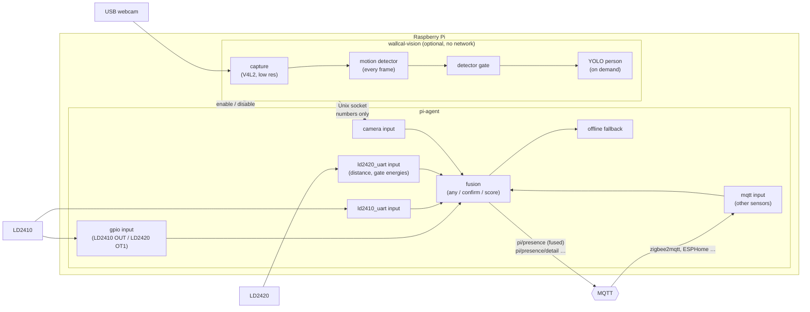

# Presence sensing — LD2420 radar, webcam, and combined sensors

This plan adds two new ways for the wall to tell whether someone is there, and a way to combine several sensors into one answer. It sits alongside the presence work already in [implementation-plan.md](implementation-plan.md) (PR 3.4, the LD2410 on its OUT pin or its UART) and [architecture.md](architecture.md) (§7.2, §7.7, §8.1, §8.2, §10). **Nothing here replaces the LD2410 paths.** A Pi with one LD2410 and today's config behaves exactly as it does now.

The two new paths:

- **A. LD2420 over UART.** A 24 GHz radar read over its serial port, for the distance of whoever it sees and the energy at each distance gate, not only a yes or no. This is the sensor most likely to go on the wall.
- **B. A USB webcam.** Very cheap OpenCV motion detection on every frame, and YOLO person detection run only when the motion detector, or the need to confirm someone is still there, asks for it.

And the part that ties them together:

- **C. Sensor fusion.** Any mix of the LD2410 (pin or UART), the LD2420, the webcam and sensors elsewhere in the house (over MQTT) feeds one fusion step in the agent, which publishes the same `pi/presence` the app already reads.

---

**Decisions this plan is built on**

| Topic | Decision |
|---|---|
| Where fusion runs | In **`pi-agent`**, not the app. The agent already owns `pi/presence`, and the offline fallback (architecture §10) needs the fused answer when the server is down. The app's auto presence policy (§7.7) doesn't change: it still reads one `ON`/`OFF`. |
| Old config | The existing `presence:` block (`source: gpio \| uart`, `pin`, `uart`) still works unchanged and means "one LD2410". The new multi-input form is a list under `presence.inputs`. The agent accepts one form or the other, not both. |
| One sensor | With a single input, fusion is a pass-through, so today's behaviour and tests hold exactly. |
| LD2420 interface | **UART only** for this path, because the point is the data. Its OT1 pin can still be read as a plain GPIO input through the existing `gpio` input if someone wants that. |
| LD2420 settings | Thresholds and distance zones are applied **in the agent, in software**, from the energy-mode frames, so a sensor can be swapped without reflashing its settings. The agent sends the sensor the few commands it needs to switch to energy mode (the LD2410 path still sends none). |
| Webcam process | A **separate service**, `wallcal-vision`, in the same Python package as an optional extra (`pip install '.[vision]'`). It talks to the agent over a local Unix socket. The agent keeps the only MQTT connection, the last will and the HA discovery. |
| Webcam privacy | Frames never leave the vision process: nothing is written to disk, published, sent over the network or logged. The service runs with no network (`PrivateNetwork=yes`). An HA switch turns the camera off and closes the device, and the choice survives restarts. |
| Person detector | A YOLO-family nano model in **ONNX** format, run with `onnxruntime` on the CPU, person class only, at 320×320. The model file is not in the repo: the user downloads or exports one (see [Models and licences](#models-and-licences)). |
| New MQTT topics | `pi/presence` keeps its meaning (now the fused answer). New topics carry the detail: distance, people count, per-input state and a camera switch. All are added to `contracts/mqtt.json` first, as with every topic. |
| Tuning | Every input and the fused result can be **recorded** to a file and **replayed** through a different fusion config off the Pi, so settings are chosen from real evidence. This works because the filters are pure and are told the time, like `presence.py` today. |

---

## 1. How it fits



Each input turns its sensor's readings into **evidence**: whether it thinks someone is there (or doesn't know), how sure it is, whether it is working, and anything extra it knows (a distance, a people count). Each input debounces itself with the existing `PresenceFilter`. Fusion combines the evidence into one confirmed state and a short reason, and the agent publishes it the way it publishes presence today.

---

## 2. Groundwork: presence inputs and multi-input config

Today `agent.py` owns one presence reader (`GpioPresence` or `Ld2410Uart`) and one `PresenceFilter`. This step turns that into a list of inputs with a common interface, without changing what a single LD2410 does.

```python
@dataclass(frozen=True)
class Evidence:
    present: bool | None      # None: this input doesn't know (no reading yet, blind, warming up)
    confidence: float         # 0 to 1; 1 for a plain pin
    healthy: bool             # False: port lost, no frames, camera unplugged or switched off
    distance_m: float | None = None
    people: int | None = None
    motion: float | None = None   # share of the watched area that moved, 0 to 1
    at: float = 0.0           # monotonic seconds
```

- An input is a small class with `start()`, `stop()` and a callback that hands the agent `Evidence`. The existing GPIO pin and LD2410 UART readers become the `gpio` and `ld2410_uart` inputs, with their parsers and threads unchanged.
- Each input gets its own `PresenceFilter`, with its own `hold_ms` (defaulting to the top-level `presence.hold_ms`), because a camera, a radar and a pin flicker in different ways.
- A broken input is **unhealthy**, not **absent**. Fusion leaves it out rather than counting it as "nobody", so an unplugged camera never turns the screen off.

New config form (the old one still works and is read as a single `gpio` or `ld2410_uart` input):

```yaml
sensors:
  presence: true

presence:
  hold_ms: 500                 # the default for each input below
  inputs:
    - id: radar                # 1-32 letters, digits, - and _; used in logs, topics and HA entity names
      type: ld2420_uart        # gpio | ld2410_uart | ld2420_uart | camera | mqtt
      device: /dev/serial0
    - id: camera
      type: camera
  fusion:
    mode: confirm              # any (the default with more than one input) | confirm | score
```

Config checks follow the agent's existing style: unknown keys are errors, every setting is checked even while its sensor is off, ids are unique, two inputs can't share a GPIO pin or a serial device, and a GPIO input can't use the button's pin.

---

## 3. Path A: LD2420 over UART

### 3.1 Why UART, and what it adds

The LD2420's OT1 pin is a yes or no from the sensor's own thresholds, which are set with the maker's app and which the Pi can't see. Over UART in **energy mode**, the sensor streams, several times a second, whether it sees someone, the distance to them and the energy in each of its 16 distance gates. With that the agent can:

1. **Draw its own zones.** Only count someone between `min_m` and `max_m` (for example 0.3 m to 3.5 m), so the far end of the hall or the room behind a stud wall doesn't wake the screen. No reflashing needed, and it can be changed in YAML.
2. **Use its own per-gate thresholds**, from an empty-room calibration (§3.4), with separate "arrive" and "stay" levels so someone sitting still isn't lost.
3. **Publish the distance** to HA (`sensor.wall_calendar_pi_presence_distance`), for dashboards and automations ("someone at the wall" versus "someone in the room").
4. **Trust a very close reading on its own.** With a camera in the mix, a target nearer than `trust_within_m` doesn't need the camera to confirm it (§5.3).
5. **Tell a dead sensor from an empty room.** Frames arriving means the sensor is alive. A pin that stays low can't say which.

The LD2420 can't tell moving from still targets the way the LD2410 does, and reports one target. That is fine for a wall: the question is "anyone near", not "who".

### 3.2 Hardware

| LD2420 | Pi | Notes |
|---|---|---|
| 3V3 | 3.3 V (pin 1 or 17) | **3.3 V, not 5 V**, unlike the LD2410. Check the module's datasheet before powering it; the H.3 probe asks you to confirm the wiring first. |
| GND | GND | |
| OT2 (UART TX) | GPIO15 / RXD (pin 10) | On the LD2420, OT2 doubles as the serial TX pin. |
| RX | GPIO14 / TXD (pin 8) | Needed, because the agent sends the energy-mode commands. |
| OT1 | (unused, or a GPIO) | Optional: wire it to a spare GPIO and add a `gpio` input too, to compare the two in a recording. |

- The serial port is set up as for the LD2410 UART today: `raspi-config`, Interface Options, Serial Port: no login shell, hardware on. The service user is already in `dialout`.
- **Only one sensor can use `/dev/serial0`.** To run an LD2410 on UART and an LD2420 together, put the second on another UART (on a Pi 4 or 5, `dtoverlay=uart2` and friends free more ports on other GPIOs) or a USB serial adapter (`/dev/ttyUSB0`). The config check refuses two inputs on one device.
- The default speed is **115200** baud on current firmware. Older firmware differs, so `baud: auto` (the default) tries the likely rates until the sensor answers a "read version" command, and logs the firmware version it finds.
- Placement is the same advice as for the LD2410 (architecture §12): facing into the room, at chest height or on the wall above the screen, angled away from doors that swing and fans that turn.

### 3.3 Protocol and reader

`hardware/ld2420.py`, built like `hardware/ld2410.py`: a pure parser (bytes in, reports out) and a reader thread that owns the port.

- **Command frames** use the same framing as the LD2410 (`FD FC FB FA` … `04 03 02 01`). On open, the agent sends: enable configuration, read firmware version, set the system mode to **energy mode**, end configuration. Each step waits for its acknowledgement with a timeout, and a failure is one warning and a retry later, not a crash. The sensor's own gate thresholds are never written.
- **Energy-mode frames** (`F4 F3 F2 F1` … `F8 F7 F6 F5`) carry the presence flag, the distance and 16 gate energies. The exact byte layout is checked against the datasheet and the real sensor in H.3 and recorded in `docs/hardware-findings.md` before the parser is finished.
- **Text-mode lines** (`ON`, `OFF`, `Range 123`), which some firmware sends in normal mode, are parsed too, so a sensor that refuses to switch mode still gives presence and distance, with a warning that gate energies aren't available.
- Health: no frames for 10 s is one warning and the input goes unhealthy; frames returning is logged and it goes healthy again. A port that fails is closed and reopened every few seconds, as for the LD2410.

### 3.4 Zones, thresholds and calibration

From each energy frame the input works out its own "someone is there":

- Only gates whose distance range overlaps `[min_m, max_m]` count.
- Someone **arrives** when any counted gate's energy is above its `arrive` threshold. They **stay** while any counted gate is above its (lower) `stay` threshold. The gap is the hysteresis that keeps a still person from flickering out.
- The distance published is the sensor's own reported distance when it is inside the zone, otherwise none.
- `confidence` rises with how far above its threshold the strongest gate is, capped at 1, so the `score` fusion mode (§5.2) can weigh a strong reading above a marginal one.

**Calibration** (`wallcal-agent calibrate ld2420 --input radar --seconds 60`, with the room empty) records the peak and spread of each gate's energy and prints a `thresholds:` block to paste into the config: `stay` at the empty-room peak plus a margin, `arrive` above that. Without calibration, the defaults are the maker's factory thresholds, so it works out of the box.

```yaml
    - id: radar
      type: ld2420_uart
      device: /dev/serial0
      baud: auto               # or 115200, 256000 …
      hold_ms: 500
      min_m: 0.3
      max_m: 3.5
      trust_within_m: 1.2      # with fusion mode confirm: this close needs no confirmation
      distance_report_m: 0.1   # publish the distance when it moves by this much (and at most once a second)
      thresholds:              # optional; from `wallcal-agent calibrate ld2420`. Index = gate.
        arrive: [60, 55, 50, 45, 40, 40, 35, 35, 30, 30, 30, 30, 30, 30, 30, 30]
        stay:   [40, 35, 30, 28, 25, 25, 22, 22, 20, 20, 20, 20, 20, 20, 20, 20]
```

The same zone and threshold logic can later be put behind the LD2410 UART input too, since its engineering frames carry gate energies. That is in the backlog, not in this plan.

---

## 4. Path B: USB webcam with OpenCV motion and YOLO person detection

### 4.1 Hardware

- Any **UVC** USB webcam (no driver needed on Pi OS). A wide field of view (75° or more) covers the area in front of the wall from one spot. 720p is plenty; the pipeline reads it at a small resolution.
- Mount it on or just above the screen's top edge, looking into the room. Keep windows and the screen's own reflection out of view where possible; a mask (§4.3) hides what can't be avoided.
- A camera only sees what is lit. For a dark room, the radar is the answer, and fusion treats a dark camera as **blind**, not as "nobody" (§5.4). An IR-capable camera with an IR illuminator is an option for people who want it, and needs no code change.
- The M80F comes with its own clip-on camera. Whether the Pi can use it is an open question (§10); the plan assumes a separate UVC camera on the Pi's USB.
- A **Pi 5** is recommended if person detection is wanted, because Chromium is already drawing 1440p on the same chip. A Pi 4 can run motion-only, or YOLO at a lower duty cycle. H.4 measures both.

### 4.2 Process model

`wallcal-vision` is its own systemd service, in the `pi-agent` package under `wallcal_agent/vision/`, installed only with `install.sh --vision` (which adds the `[vision]` extra: `opencv-python-headless`, `numpy`, `onnxruntime`).

Why a separate process:

- **CPU isolation.** The unit runs with `Nice=10`, `CPUQuota=` (default 60 %, meaning just over half of one core) and `MemoryMax=`, so the kiosk and the button never wait for a frame.
- **Crash isolation.** A fault in native OpenCV or ONNX code restarts the vision service, not the agent's button and screen control.
- **Privacy by construction.** `PrivateNetwork=yes`, `IPAddressDeny=any`, a read-only file system apart from its socket, and access to `/dev/video*` only. It can't send a frame anywhere even by mistake.
- **Optional dependencies.** The agent itself stays importable and testable without OpenCV, as `tests/test_hardware_imports.py` already requires for other hardware libraries.

The agent listens on `/run/wallcal-agent/vision.sock`. The vision service connects and sends one JSON line per change or per second at most, such as `{"healthy": true, "blind": false, "motion": 0.08, "people": 1, "person_conf": 0.81, "largest_box": 0.34, "at": 1234.5}`. The agent sends back `{"enabled": false}` when the camera switch is turned off, and the service then **closes the device** (so a webcam with an activity light shows it is off) until it is told `{"enabled": true}`. The agent tells it the fused presence too, which the detector gate uses (§4.4). If the socket goes quiet for 10 s the `camera` input goes unhealthy.

### 4.3 Motion detection (every frame, as cheap as possible)

The goal is a few milliseconds per frame on one core, so it can run all the time.

1. **Capture small.** Open the camera with V4L2 at its smallest mode at or above 320×240, preferring raw YUYV (no JPEG to decode) and falling back to MJPEG. `CAP_PROP_BUFFERSIZE=1` so a frame is never stale. Read only the **luma** (grey) plane.
2. **Process at a low rate.** `motion.fps` (default 5). Frames in between are `grab()`bed and thrown away without decoding. When nobody is there and nothing has moved for a while the rate drops to `motion.idle_fps` (2), and it goes back up as soon as something moves.
3. **Shrink and smooth.** Resize to 160×120 with `INTER_AREA` (which also averages out sensor noise), then a light box blur. `cv2.setNumThreads(1)`.
4. **Running background.** `cv2.accumulateWeighted` into a float background with a slow rate (`motion.learn_rate`, 0.05), so the scene adapts to furniture and sunlight but not to a person walking through.
5. **Difference and threshold.** `absdiff` against the background, then a threshold set from the frame's own noise (a multiple of the median difference, with a floor), so it works by day and in a dim evening. One dilation to join a person's pieces.
6. **Mask.** A polygon mask (`motion.mask`, in fractions of the frame so it survives a resolution change) blanks out windows, the TV, a fish tank. The share of unmasked pixels that changed is the **motion** value, 0 to 1. Motion counts once it is above `motion.min_area` (default 0.5 % of the area) for `motion.min_frames` (2) frames in a row.
7. **Lighting guard.** If the mean brightness jumps by more than `motion.light_jump` (20 %) between processed frames, or more than half the frame changes at once, that is a light switched on, a cloud or the camera's auto exposure, not a person. The background is re-seeded from the new frame and no motion is reported for one second.
8. **Blindness.** The mean luma over a few seconds below `camera.dark_luma` means the camera can't see. It reports `blind: true` (and, if the light sensor is on, the agent also treats lux below `camera.dark_lux` as blind).

Expected cost, to be confirmed by H.4: well under 5 % of one Pi 4 core at 5 fps.

### 4.4 YOLO person detection (only when asked)

Running a detector on every frame would cost a whole core or more. Instead a small **gate** decides when to run it:

| Situation | When the detector runs |
|---|---|
| Motion starts | At once, on the next full-resolution frame. |
| Motion continues | Every `person.active_interval_s` (2 s), until it has seen a person or motion stops. |
| Presence is ON and nothing moves | Every `person.still_interval_s` (15 s), to check someone is still sitting there. This is what lets the camera keep presence for someone who is reading, without the radar. |
| Presence is OFF and nothing moves | Never. An empty, still room costs nothing beyond motion detection. |
| The camera is blind or switched off | Never. |
| Always | At most `person.max_per_minute` (30) runs, whatever else asks. |

When it runs:

- It takes the latest frame at the capture size (for example 640×480), crops to the mask's bounding box, letterboxes to the model size (320×320 by default, 256 to make it faster) and runs the model.
- Only the **person** class is kept, above `person.min_confidence` (0.45), after non-maximum suppression. It reports the number of people, the best confidence and the height of the largest box as a share of the frame (a rough "how close").
- Pets and moving curtains don't count as a person, which is one of the main reasons to pair a camera with a radar (§5).

**Runtime back ends** (`person.runtime`): `onnxruntime` (the default, CPU, 2 threads), `opencv` (OpenCV's own DNN module, no extra package, slower) and, later, `ncnn` (usually the fastest on ARM) or an accelerator such as the Raspberry Pi AI Kit (Hailo) on a Pi 5. Each sits behind one `Detector` interface that takes a frame and returns boxes, so a back end can be added without touching the gate.

Expected latency per run at 320×320, to be measured by H.4: roughly 50–150 ms on a Pi 5 and 200–500 ms on a Pi 4. With the gate, the average load in a lived-in room is a few runs a minute.

### 4.5 Models and licences

The repo doesn't ship a model. The docs list tested options and how to get each as an ONNX file with a person class, exported at 320×320:

- **YOLOv8n / YOLO11n** (Ultralytics). The best accuracy for the size, but the code and weights are **AGPL-3.0** (or a commercial licence). The agent never imports `ultralytics`: the model is exported once, on any machine, and the agent only reads the ONNX file with `onnxruntime`. Whether that use suits them is the user's call, and the docs say so plainly.
- **YOLOX-Nano** (Apache-2.0), a permissively licensed alternative with a slightly different output layout.

The post-processing is written for the YOLOv8-style output first (`[1, 4 + classes, N]`), with YOLOX's layout as a second decoder chosen by `person.model_format`. The model's path, its format and its input size are in the config, and the service checks the model's input and output shapes at start, with a clear error if they don't match.

### 4.6 Camera config

```yaml
    - id: camera
      type: camera
      hold_ms: 1500            # a camera's yes needs a little longer to settle than a radar's
      # Everything below is read by the wallcal-vision service; the agent checks it and passes it on.
      device: /dev/video0      # or a stable /dev/v4l/by-id/... path
      dark_luma: 25            # 0-255; below this the camera is blind
      dark_lux: 3              # with sensors.light on: below this the camera is blind too
      motion:
        fps: 5
        idle_fps: 2
        learn_rate: 0.05
        min_area: 0.005
        min_frames: 2
        light_jump: 0.2
        mask:                  # optional polygons to ignore, in fractions of the frame (0,0 top left)
          - [[0.70, 0.00], [1.00, 0.00], [1.00, 0.45], [0.70, 0.45]]   # the window
      person:
        enabled: true          # false: motion only
        model: /var/lib/wallcal-agent/models/person.onnx
        model_format: yolov8   # or yolox
        size: 320
        runtime: onnxruntime   # or opencv
        min_confidence: 0.45
        active_interval_s: 2
        still_interval_s: 15
        max_per_minute: 30
      off_hours:               # optional: the camera is closed in this window, like quiet hours
        from: "23:00"
        to: "06:30"
```

What the camera input turns into evidence:

- A person seen: `present: true`, confidence from the detector.
- Motion with no person seen yet: `present: true` with low confidence (0.4), and marked as motion, so `confirm` mode (§5.2) can treat motion as a trigger but not as a confirmation.
- No person and no motion for `person.still_interval_s` × 2 while lit: `present: false`.
- Blind, switched off, in `off_hours`, or the service gone: `present: None` and, for the last, unhealthy. **None of these ever count as nobody.**

---

## 5. Path C: combining sensors

### 5.1 What each sensor is good and bad at

| Sensor | Good at | Bad at |
|---|---|---|
| LD2410 / LD2420 radar | Still people, the dark, fast response, no privacy worry | Ghosts: fans, curtains, pets, people through a thin wall |
| Camera motion | Very fast, cheap, a clear "something moved in view" | Lighting changes, pets, and it misses anyone who keeps still |
| Camera person (YOLO) | Few false alarms: a person is a person | Slow, needs light, misses anyone out of view, costs CPU |
| GPIO pin (either radar) | Simple, no setup | Can't tell a dead sensor from an empty room |
| Another sensor over MQTT | Adds coverage elsewhere (a Zigbee PIR by the door, an ESPHome radar on the sofa) | Depends on the broker; latency |

The strengths and weaknesses mostly don't overlap. A radar confirmed by a camera rejects most ghosts, and a radar holds a still reader the camera would lose. That is the case fusion is built for.

### 5.2 Fusion modes

`presence.fusion.mode` picks one. All are pure functions of the inputs' latest evidence and the time, in `wallcal_agent/fusion.py`, and their output goes through one more `PresenceFilter` (`fusion.hold_ms`, default 0) before it is published.

**`any`** (the default with more than one input): someone is there if any healthy input says so; nobody once every healthy input that knows says nobody. The most sensitive, and the easiest to predict. Good for two radars, or a radar plus a door PIR.

**`confirm`**: arriving needs agreement; staying needs only one. Each input has **roles**, with defaults from its type that can be changed per input (`roles: [trigger, confirm, hold]`):

| Type | Default roles |
|---|---|
| `gpio`, `ld2410_uart`, `ld2420_uart` | trigger, hold |
| `camera` (motion) | trigger |
| `camera` (person) | confirm, hold |
| `mqtt` | trigger, hold |

The rules:

1. **Arriving.** Presence goes ON when a *trigger* input says someone is there **and** a *confirm* input agrees within `fusion.confirm_window_s` (5 s) either side. A trigger that nobody confirms is logged at debug level and counted as a "possible ghost" (§5.5).
2. **Trusted alone.** A radar trigger closer than its `trust_within_m` doesn't need confirming. Someone standing at the wall is real.
3. **Nothing can confirm.** If every *confirm* input is unhealthy, switched off or blind, `fusion.unconfirmable` decides: `trust_trigger` (the default: fall back to `any`, so a dark room still wakes the screen) or `wait` (stay OFF until a confirmer can see).
4. **Staying.** While ON, presence stays ON while any healthy *hold* input says someone is there.
5. **Leaving.** Presence goes OFF once every healthy *hold* input has said nobody for its own `hold_ms`. The app's `off_after_minutes` then applies as it does today.
6. **Veto (opt-in).** An input with the `veto` role (normally the camera's person detector) can end presence early: when it is healthy, not blind, and has seen no person and no motion for `fusion.veto_after_s` (default off), presence goes OFF even though the radar still sees something. This is for a radar that picks up the next room. It is off by default because someone just out of the camera's view would be turned off.

**`score`**: each healthy input adds `weight × confidence` while it says someone is there. A positive fades out over its `decay_s` after the input last said so, rather than stopping at once. Presence goes ON when the total reaches `fusion.on_score` and OFF when it falls below `fusion.off_score`, which is lower (hysteresis). For people who want to weigh, say, three sensors of different quality. Default weights: radar 1.0, camera person 1.0, camera motion 0.5, gpio 0.8, mqtt 0.6; `on_score` 1.0, `off_score` 0.4.

### 5.3 Presets

The docs give a ready block for each common set-up:

| Set-up | Mode | Behaviour |
|---|---|---|
| LD2410 alone (today) | (pass-through) | Unchanged. |
| LD2420 alone | (pass-through) | Zones and calibrated thresholds from §3.4. |
| **LD2420 + webcam** (recommended) | `confirm` | The radar wakes the screen, the camera's person check confirms it within a second or so, a reader sitting still is held by the radar, a fan or the cat on its own doesn't wake anything, and someone right at the wall (`trust_within_m`) wakes it at once. In the dark, the radar alone decides. |
| Webcam alone | (pass-through) | Motion wakes, a person seen holds, a person check every 15 s keeps someone still, and blind means "unknown", which leaves the screen as it is. |
| LD2410 pin + LD2420 UART | `any` | Two radars covering different areas, or the same area during a trial to compare them. |
| Radar + a Zigbee PIR by the door (via `mqtt`) | `any` | Wake as someone comes through the door, before the radar sees them. |

```yaml
presence:
  inputs:
    - { id: radar, type: ld2420_uart, device: /dev/serial0, min_m: 0.3, max_m: 3.5, trust_within_m: 1.2 }
    - { id: camera, type: camera, device: /dev/video0 }
    - id: hall_pir
      type: mqtt
      topic: zigbee2mqtt/hall_motion
      json_path: occupancy     # optional: read one field of a JSON payload
      on: [true, "ON"]         # payload values that mean someone is there
      off: [false, "OFF"]
      stale_after_s: 600       # no message for this long: unhealthy
  fusion:
    mode: confirm
    confirm_window_s: 5
    unconfirmable: trust_trigger
```

An `mqtt` input only reads topics on the agent's own broker connection, and never one of the agent's own topics.

### 5.4 Health and degradation

| What happens | What fusion does |
|---|---|
| An input fails (port gone, no frames, camera unplugged, vision service stopped, an `mqtt` input gone stale) | It is left out, and the rest decide. A warning is logged once, and its HA entity goes unavailable. |
| The camera is blind (dark) or switched off | Its evidence is "unknown". In `confirm` mode, `unconfirmable` applies. |
| Every input has failed | The last confirmed state stands (as today when the LD2410's port fails), a warning is logged, and `pi/presence/detail` says so. Nothing turns the screen off because sensors broke. |
| The broker goes away | Local inputs carry on, and the fused state is published on reconnect, as `pi/presence` is today. `mqtt` inputs go stale after `stale_after_s`. |
| The server goes away | The offline fallback (architecture §10) runs on the fused state, so a camera-plus-radar wall keeps its robustness while the app is down. |

### 5.5 Explaining and tuning

- **Reasons.** Each change of the fused state is logged at `info` with why, such as `Presence: someone is there (radar at 2.1 m, confirmed by camera: 1 person)` or `Presence: nobody (radar and camera both clear for 30 s)`. The same reason goes into `pi/presence/detail`.
- **Ghost counter.** Triggers that nothing confirmed, and vetoes, are counted per input and published in the detail, so "the radar fires 40 times a night with nobody there" shows up in HA and points at a fan or a wall.
- **Record.** `wallcal-agent --record-presence FILE.jsonl` (and `hw-probe presence --record`) writes every input's evidence and the fused result, with times, as JSON lines. No images.
- **Replay.** `wallcal-agent replay FILE.jsonl --config other.yaml` runs a recording through another config's filters and fusion, off the Pi, and prints when the fused state would have changed and how that differs from what happened. Settings are chosen from real evenings, not guesses.

---

## 6. MQTT and Home Assistant

`pi/presence` stays as it is, retained, `ON`/`OFF`: now the fused answer. New entries in `contracts/mqtt.json`, all from the Pi unless stated:

| Topic | Retained | Payload |
|---|---|---|
| `…/pi/presence/detail` | no | JSON: `{ "state": "ON", "mode": "confirm", "reason": "…", "inputs": { "radar": { "present": true, "healthy": true, "distance_m": 2.1, "ghosts": 0 }, "camera": { "present": true, "healthy": true, "blind": false, "motion": 0.02, "people": 1 } } }`. On every change of an input's state or health, and at least every 30 s, at most once a second. Not retained, because it is diagnostics. |
| `…/pi/presence/distance` | no | metres to the nearest target in a zone, two decimals, such as `2.10`, or empty when nobody is in the zone. Only with an LD2420 input. At most once a second, when it moves by `distance_report_m`. |
| `…/pi/presence/people` | no | the number of people the camera last saw, a whole number. Only with a camera input. On change. |
| `…/pi/presence/<input id>` | yes | `ON` \| `OFF` \| empty (unknown): one input's own confirmed state, so HA can see each sensor on its own. Only when there is more than one input. |
| `…/pi/camera/set` | → pi | `ON` \| `OFF` from HA: turn the camera on or off. A retained `set` is ignored, as for every `…/set`. The agent saves the choice in `/var/lib/wallcal-agent/state.json`, so a camera switched off stays off after a reboot. |
| `…/pi/camera/state` | yes | `ON` \| `OFF`: whether the camera is allowed to run (published on every change and connect). |

New HA discovery entities on the "Wall Calendar Pi" device, each removed with an empty retained config when its input isn't configured:

| Entity | Kind | When |
|---|---|---|
| Presence distance | `sensor`, device class `distance`, `m` | an LD2420 input |
| People in view | `sensor`, a count | a camera input with person detection |
| Camera motion | `binary_sensor`, `motion` | a camera input |
| Presence (one per input) | `binary_sensor`, `occupancy`, diagnostic | more than one input |
| Camera | `switch`, with a `mdi:cctv` icon | a camera input |
| Presence detail | `sensor` with the reason as its state and the detail JSON as attributes, diagnostic | always, with presence on |

The existing "Presence" binary sensor keeps its entity id and now shows the fused answer.

---

## 7. App changes

The auto presence policy (§7.7) needs **no change**: it still reads one `ON`/`OFF`. The app's contract tests pick up the new topics. Two small, optional additions:

- **Presence card on the settings page** (Displays tab): the fused state, its reason, each input's state, health and extra numbers (distance, people, motion), and the ghost counts, live from `pi/presence/detail`. It is read-only; the agent's YAML stays the place where sensors are set up, as architecture §8.1 says. This changes a settings page, so the visual baselines need updating as AGENTS.md describes.
- **The camera switch on the remote**, next to Auto presence, for anyone who wants it off without opening HA. Routed as a command to the app, which publishes `pi/camera/set`.

Later, distance could drive things on the wall (for example, show the agenda when someone stands within a metre for a few seconds). That is in the backlog, not in this plan.

---

## 8. Pull requests

A **Presence track** (P), alongside Milestone 3 and the hardware track. Sizes as in the main plan: **S** under a day, **M** 1–3 days, **L** 3–5 days.

| PR | Title | Size | Contents |
|---|---|---|---|
| H.3 | LD2420 probe | S | `hw-probe ld2420`: asks you to confirm 3.3 V wiring, finds the baud rate, reads the firmware version, switches to energy mode, shows live distance and a bar per gate as you walk about, and records an empty-room baseline. Adds the frame layouts it saw and the firmware version to `docs/hardware-findings.md`. The parser is written so P.2 lifts it into `pi-agent`. |
| H.4 | Camera probe | M | `hw-probe camera`: lists UVC devices and their modes, measures capture fps and CPU per mode, runs the motion detector live (motion value, the lighting guard firing, blindness), times the person detector on each runtime at 256 and 320, and repeats the timings with `hw-probe render` running, so Pi 4 and Pi 5 can be compared under the real load. `--snapshot FILE` saves one local frame with the mask drawn on it, for setting the mask; it is the only place a frame is ever written, and only when asked. |
| P.1 | Presence inputs and multi-input config | M | The `Evidence` type and input interface; `gpio` and `ld2410_uart` become inputs with their own filter; `presence.inputs` with ids and per-input `hold_ms`; the old config form read as one input; a pass-through for one input and `any` for several. All existing presence and fallback tests pass unchanged. |
| P.2 | LD2420 UART input | M | `hardware/ld2420.py`: pure parser for command acks, energy frames and text lines, tested with byte strings like `test_ld2410.py`; reader thread with the start-up command sequence, baud auto-detect, health, reopen. Zones, arrive/stay thresholds and confidence. Distance in the evidence. Config and README. |
| P.3 | LD2420 calibration | S | `wallcal-agent calibrate ld2420`: an empty-room run that prints a `thresholds:` block. Shares its code with H.3. |
| P.4 | Fusion | M | `fusion.py`: `any`, `confirm` and `score`, roles, `trust_within_m`, `unconfirmable`, opt-in veto, health and blindness, reasons, ghost counts. Pure and tested with timed scenario tables (a fan, a cat, a still reader, a dark room, a camera unplugged mid-evening, every input failing). The offline fallback reads the fused state. |
| P.5 | Presence detail over MQTT and HA | M | The new topics in `contracts/mqtt.json` (with examples and invalid examples), published by the agent; the new discovery entities; `docs/home-assistant.md` and architecture §7.3 updated. |
| P.6 | `mqtt` presence input | S | Reads another sensor's topic (plain or one JSON field), with `on`/`off` values and `stale_after_s`. Refuses the agent's own topics. |
| P.7 | Vision service: capture and motion | L | `wallcal_agent/vision/` and the `[vision]` extra; the `wallcal-vision` systemd unit with its sandbox (`PrivateNetwork`, `CPUQuota`, `Nice`, `MemoryMax`, device access only); `install.sh --vision`; the Unix socket protocol and the agent's `camera` input; capture, motion detection, mask, lighting guard, adaptive rate and blindness. Motion is tested with synthetic numpy frames (a moving block, sensor noise, a light switched on, a dark frame). CI installs `opencv-python-headless` and `numpy` for these tests. |
| P.8 | Camera switch and privacy | S | `pi/camera/set` and `state`, the HA switch, the saved choice, `off_hours`, closing the device when off. README section on what the camera does and doesn't do with frames. Comes before P.9, so person detection never ships without the switch. |
| P.9 | Person detection | L | The detector gate; the `Detector` interface with `onnxruntime` and `opencv` back ends; letterboxing, YOLOv8-style and YOLOX decoders and NMS, tested with fixed tensors; model shape checks at start; people count and confidence in the evidence. Docs on getting a model, with the licence notes in §4.5. The model is never downloaded by CI; a test that runs a real model is skipped unless one is present. |
| P.10 | Record and replay | M | `--record-presence` and `wallcal-agent replay`, plus `hw-probe presence --record` for a Pi without the agent set up. |
| P.11 | Presence card and camera switch in the app | M | Optional. The settings card and the remote's camera switch from §7, with component tests, the settings e2e secrets check extended to any new route, and the visual baselines updated for the changed pages only. |

**Order.** H.3 and H.4 can start as soon as the parts arrive, like H.1 and H.2, and nothing waits on them except the defaults they choose. P.1 comes first in the agent. After it, the radar line (P.2 → P.3) and the camera line (P.7 → P.8 → P.9) are independent and can go in parallel. P.4 needs P.1 only, but is best tested with P.2 or P.7 in place to record real evenings. P.5 follows P.4. P.6, P.10 and P.11 can go in any time after P.4 (P.11 after P.5).

**Exit criteria.** With an LD2420 and a webcam in `confirm` mode: walking up to the wall wakes it within about a second; a fan, a pet or the next room doesn't; someone reading still on the sofa keeps it on; a dark room still works; switching the camera off in HA turns its light off and leaves the radar in charge; unplugging the camera or the radar mid-evening degrades to the other with one warning; and a Pi with only an LD2410 and the old config behaves exactly as before.

---

## 9. Risks and how the plan deals with them

| Risk | Mitigation |
|---|---|
| YOLO and Chromium fighting over a Pi 4's CPU | A separate, niced, CPU-capped service; the detector gate (nothing runs in an empty, still room); 256×256 as a lighter size; motion-only as a fallback (`person.enabled: false`); H.4 measures it under the real render load before P.9 sets defaults. A Pi 5 is recommended for person detection. |
| LD2420 firmware versions differ in speed and output | Baud auto-detect, version logged, text-mode fallback, and H.3 records what the real sensor sends before the parser is final. |
| Powering the LD2420 from 5 V | The docs, the config comments and the H.3 probe all say 3.3 V first. |
| One hardware UART | The config refuses two inputs on one port; the docs show the extra-UART overlays and USB adapters. |
| A camera in the family's living space | Frames stay in memory in a process with no network, nothing is stored or published, the HA switch closes the device and survives reboots, `off_hours`, and the README says plainly what is and isn't done. The camera path is entirely optional. |
| Model licence (Ultralytics AGPL) | No model in the repo and no `ultralytics` dependency; the user chooses a model; a permissively licensed option (YOLOX-Nano) is supported. |
| False motion from lighting and auto exposure | The lighting guard, the noise-based threshold, the mask, and motion being only a trigger (never a confirmation) in `confirm` mode. |
| A broken sensor turning the screen off | Unhealthy and blind inputs are left out, never counted as nobody; with every input failed, the last state stands. |
| Fusion being hard to set up and reason about | One input behaves exactly as today; presets for the common set-ups; reasons in the log and in HA; ghost counts; record and replay to tune from real data. |

---

## 10. Open questions

- Can the Pi use the M80F's own clip-on camera, or is it only reachable from the monitor's own system? The plan assumes a separate UVC webcam.
- Does person detection push the choice to a Pi 5? H.4 answers this with numbers.
- Which person model to recommend by default, given the licence trade-off in §4.5?
- Should the LD2420's zones and thresholds also go behind the LD2410's UART input (backlog), so both radars work the same way?
- With several displays, each with its own Pi, should a sensor near one wall be able to feed another wall's fusion (through `mqtt` inputs), or should cross-room logic stay in HA?
- Is `confirm` the right default when a camera is added to a radar, or should the docs start people on `any` and suggest `confirm` once they have a recording?

---

## 11. Docs to update as the PRs land

- [architecture.md](architecture.md): §2 (the vision service and the new inputs in the diagram), §7.2 and §7.3 (inputs and topics), §8.1 and §8.2 (the LD2420 and the webcam in the software list and the hardware table), §10 (degradation of fused presence), §12 (the open questions above).
- [implementation-plan.md](implementation-plan.md): the hardware track's H.3 and H.4.
- [pi-agent/README.md](../pi-agent/README.md): Presence (inputs, fusion, presets), the LD2420, the camera and its privacy, calibration, record and replay, and the new topics and entities.
- [tools/hw-probe/README.md](../tools/hw-probe/README.md): the `ld2420`, `camera` and `presence` probes.
- [home-assistant.md](home-assistant.md): the new entities and an example automation using the distance.
- `pi-agent/config.example.yaml`: the inputs and fusion blocks, commented, with the old form still shown as the simplest one.
